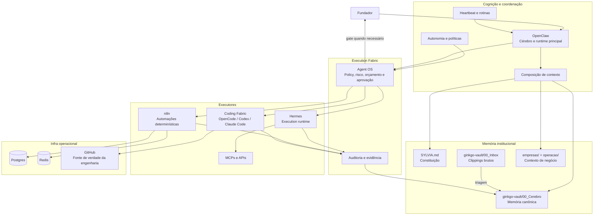
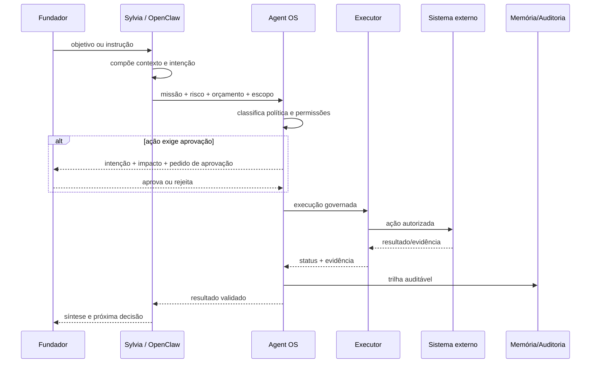
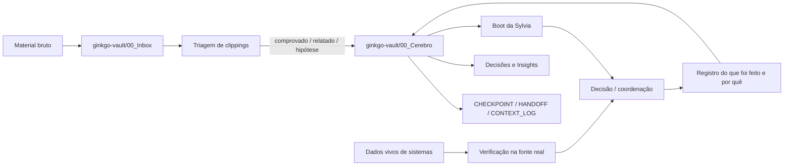
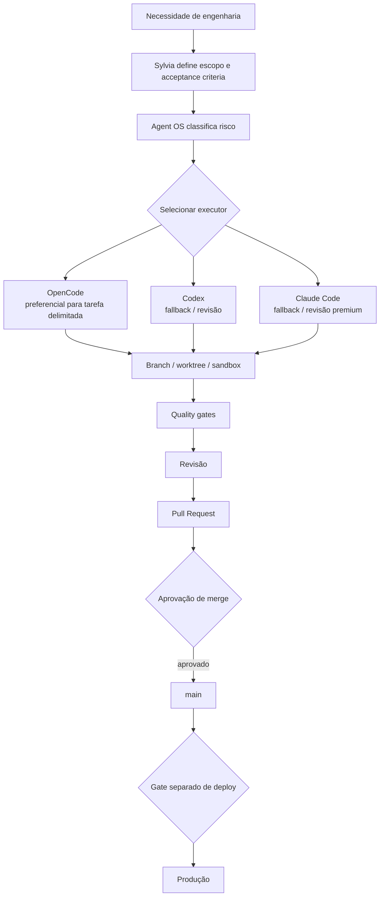
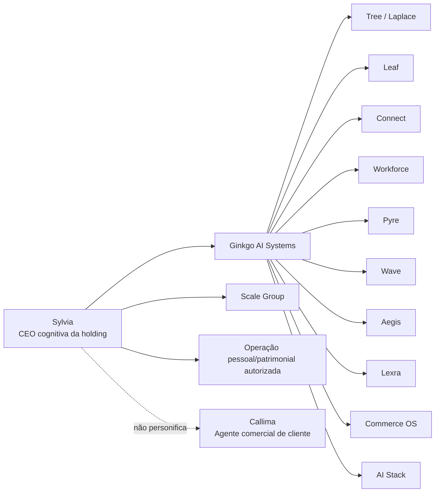

# Sylvia — Arquitetura Visual

> Arquitetura atual da Sylvia v2.1. Fonte normativa: `SYLVIA.md`. Este documento substitui o diagrama histórico da antiga Sexta-feira como mapa operacional principal.

## 1. Mapa do sistema

## 2. Fluxo de uma ação com efeito colateral

## 3. Memória e verdade

Regra: conversa não registrada não é memória institucional; estado de sistema vivo não deve ser inferido da memória.

## 4. Coding Fabric

Invariantes: nenhum coding worker recebe segredos; `main` não é alvo direto por padrão; merge e deploy são decisões separadas; `SUCCESS` exige quality gates aplicáveis.

## 5. Fronteiras do ecossistema

Sylvia governa a holding e prepara execução; não é um produto, não atende clientes e não compartilha identidade com Callima.

## 6. Responsabilidades por camada

| Camada | Responsabilidade |
|---|---|
| OpenClaw | intenção, contexto, heartbeat, coordenação e comunicação |
| Agent OS | política, risco, orçamento, permissões, aprovação e auditoria |
| Hermes | terminal, browser, skills, jobs, MCPs/APIs e delegação executiva |
| n8n | processos repetíveis, integrações estáveis, retries e workflows aprovados |
| Coding Fabric | implementação/revisão de engenharia com workers substituíveis |
| GitHub | fonte de verdade técnica e fluxo branch/PR |
| ginkgo-vault | memória institucional e biblioteca documental, sem segredos/PII |

## 7. Histórico

A arquitetura v1 da antiga **Sexta-feira** usava Hermes como núcleo. Ela foi sucedida pela Sylvia v2.x: OpenClaw tornou-se cérebro/runtime principal e Hermes passou a executor governado. Para decisões atuais, prevalecem `SYLVIA.md`, `cognicao/AUTONOMIA.md` e `docs/feature_sylvia_execution_fabric.md`.
