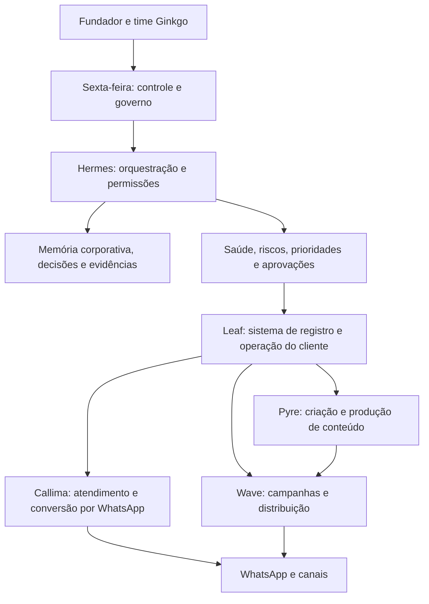

# Auditoria de Sistema Ginkgo

**Data:** 2026-07-15  
**Escopo:** Sexta-feira, Hermes, Callima, ai-stack, Ginkgo Tree/Leaf, Ginkgo Sale, vault de marca e documentação local.

## Veredito

A visão de produto faz sentido e é mais ambiciosa do que um SaaS isolado: a Ginkgo pode operar como uma agência de IA composta por produtos e agentes especializados. Hoje, porém, os melhores componentes estão em planos diferentes.

- A **Callima** tem execução conversacional real e é a melhor referência de experiência final para o cliente.
- O **Leaf** tem uma base de SaaS e governança de ações mais segura, mas não está em execução local, ainda não entrega o CRM operacional completo proposto e não recebe os eventos da Callima.
- A **Sexta-feira** tem um núcleo de orquestração instalado e pontes de leitura funcionais, mas ainda não tem memória corporativa alimentada, telemetria de saúde ou uma camada de decisão operacional funcionando de ponta a ponta.
- **Wave** e **Pyre** existem como arquitetura e superfícies iniciais, não como produtos entregáveis.

O ponto decisivo não é criar mais agentes agora. É definir uma única arquitetura operacional, uma única fonte de verdade e uma hierarquia clara entre inteligência de governo, produto cliente e execução automatizada.

## Modelo Alvo Compreendido

### Papéis que não podem se misturar

| Camada | Responsabilidade | Não deve fazer |
|---|---|---|
| Sexta-feira | Governo da empresa: observar, explicar, priorizar, propor e pedir aprovação | Atender clientes finais como se fosse Callima ou executar ações irreversíveis sem trilha e aprovação |
| Hermes | Orquestrar ferramentas, identidades, permissões, memória e evidência | Virar outra base de dados comercial ou esconder ações diretas em prompts |
| Leaf | Produto SaaS e sistema de registro por organização: clientes, CRM, atividades, campanhas, agenda, faturamento e auditoria | Possuir uma segunda IA conversacional desconectada do runtime que atende o usuário |
| Callima | Experiência conversacional do cliente, qualificação, atendimento, handoff, agendamento e ações autorizadas | Ser a fonte paralela de leads, agenda e histórico fora do Leaf |
| Wave e Pyre | Módulos de campanha, mídia, criação, publicação e análise | Serem vendidos como produto pronto antes de terem dados, permissões e evidência de entrega |

O princípio é simples: **Sexta-feira governa, Leaf registra e habilita, Callima atende, Wave distribui e Pyre cria**.

## Método e Limites da Auditoria

Foram revisados código, configurações, documentação, históricos, exportações de fluxos e estados de execução locais. O acervo incluiu 49 PDFs, 12 documentos Word, centenas de arquivos de texto e código, e o catálogo de mídia local. Foram extraídos e classificados os textos dos documentos; as imagens e vídeos foram catalogados por metadados, com inspeção visual de amostras relevantes de marca e produto. Os vídeos não foram assistidos integralmente quadro a quadro.

Não houve alteração de produção, disparo de mensagens, acesso a contas externas ou exposição de credenciais nesta auditoria.

### Rastreabilidade técnica

- Controle de assinatura ainda pendente: `C:\dev\ginkgo-tree\packages\db\src\store.ts:478-479`.
- Validação de link de cobrança limitada a HTTPS: `C:\dev\ginkgo-tree\apps\api\src\routes\offers.ts:15-22`.
- Imagens sem versão fixa e modos de execução divergentes no n8n: `C:\dev\ai-stack\docker-compose.yml:58-70`, `109-119`, `196`, `231-244`.
- Relatório de lead e agendamento da Callima apontando para o host: `C:\sexta-feira\callima\leaf_dump\Callima.json`.
- Leitor de status com senha dependente de arquivo local: `C:\sexta-feira\bridges\db\status_reader.py:8-16`.

## Estado Real Encontrado

### Sexta-feira e Hermes

- O gateway Hermes registra estado `running`, com Telegram configurado e um agente ativo no momento da checagem.
- As três pontes existem e foram validadas em modo somente leitura:
  - a ponte n8n conseguiu listar workflows;
  - a ponte AnythingLLM respondeu, mas a consulta sobre a própria Sexta-feira retornou que não havia informação relevante no workspace;
  - a ponte de status retornou uma janela sem eventos.
- Portanto, a Sexta-feira possui conectividade, mas ainda não possui **memória corporativa útil** nem **sinais operacionais contínuos**.
- O `dashboard-orb` não tem uma implementação funcional identificável. A memória operacional em `memory/` está defasada em relação ao estado atual e o sistema de memória canônico descrito nos documentos continua marcado como futuro.
- O leitor de status usa uma senha guardada em arquivo na raiz local e a repassa a um comando de banco. Isto é inadequado como base para um plano de controle corporativo.

### ai-stack e Callima

- O `ai-stack` tem serviços em execução local: n8n, worker n8n, Evolution, AnythingLLM, PostgreSQL, Redis, Temporal e Postiz.
- n8n e AnythingLLM responderam a verificações de saúde. A API do n8n está acessível pela ponte da Sexta-feira.
- A exportação da Callima contém um workflow ativo com 58 nós, incluindo entrada Evolution, buffer Redis, agente, memória de chat, RAG, CRM/lead, agenda, mídia e relatórios.
- Alguns componentes que os documentos descrevem como experiência humana, como digitação e áudio, aparecem desativados na exportação. Isso exige teste de ponta a ponta antes de ser tratado como capacidade ativa.
- O nó chamado `Gemini Brain` está configurado como integração OpenRouter. O nome e a configuração não contam a mesma história e devem ser normalizados.
- A Callima tenta reportar lead e agendamento para `host.docker.internal/ingest/...`. Na checagem, não havia serviço Leaf escutando no host. Na prática, esses eventos não chegam ao Leaf.
- A Callima mantém dados e memória no seu runtime atual; o Leaf possui um modelo próprio de inbox/CRM/worker. Isso é uma duplicação de produto e dados, não uma integração.
- Postiz está ligado localmente, mas a porta principal não respondeu na checagem e o container já consome uma parcela relevante da memória disponível. Há risco de confiabilidade e capacidade antes de usá-lo para publicação comercial.
- O compose usa imagens `latest` para componentes importantes e não define saúde para o n8n. A documentação descreve um modo de fila diferente do modo efetivamente usado. Há deriva entre documento e operação.

### Leaf e Ginkgo Tree

- O repositório possui uma base séria: autenticação, organizações, memberships, inbox, CRM, pipeline, agenda, ofertas, billing, tarefas, permissões, worker de ações e testes.
- A validação anterior encontrou 381 testes passando, typecheck e build passando. O lint ainda falha por configuração e problemas de código.
- Nenhum serviço do compose do Ginkgo Tree estava em execução local na checagem. O compose de produção não renderiza sem variáveis obrigatórias. Isto não prova que não existam usuários em ambiente externo, mas impede afirmar que a máquina local esteja pronta para recebê-los.
- Apesar de variáveis Supabase existirem no ambiente, o produto atual não usa Supabase como camada de autenticação, API ou RLS. A implementação real é Prisma/PostgreSQL com JWT e escopo de organização no Fastify.
- O isolamento por organização é bem tratado no caminho normal da API, mas é controle de aplicação, não RLS de banco. Workers, scripts e acessos diretos ao banco precisam de uma política de privilégio explícita.
- O CRM atual entrega contatos, pipeline, notas, inbox, agenda e tarefas de governança. Ainda não há modelo de **atividade comercial** de primeira classe com próximos passos, ligações, follow-ups, SLA, timeline, cadência e responsabilidade.
- Não há entidades e operação completas para campanha, calendário promocional, biblioteca de mídia, aprovação, broadcast ou gestão de grupos de WhatsApp. Este é o centro do MVP pedido, portanto Leaf ainda é um núcleo de CRM e não o CRM completo proposto.
- A camada de billing possui boa base de webhook/idempotência, mas a própria base de dados declara que suspensão/cancelamento ainda não bloqueia acesso em middleware. Uma cobrança falha pode não retirar acesso ao workspace.
- Links de pagamento externos são validados como HTTPS, mas não como links Stripe efetivos.
- Wave e Pyre aparecem como telas de "Em breve". Eles não devem entrar em proposta comercial como funcionalidades entregues.

### Marca, conteúdo e acervo

- O acervo visual é rico e os quatro agentes inspecionados têm qualidade e personalidade. Callima, Brann, Nyra e Alfred formam um bom ponto de partida de universo de marca.
- Não existe ainda uma identidade canônica. A Callima aparece como entidade azul em imagens e como personagem humana em vídeo. Há materiais antigos com outro nome de agente e promessas diferentes.
- Vídeos de referência, demos de terceiros e materiais de clientes estão misturados com mídia própria. Isso cria risco de direito de uso, privacidade e contaminação do RAG.
- As apresentações e documentos comerciais têm preços, promessas, prazos, termos de cancelamento e capacidades contraditórias. Afirmações sobre automação de anúncios, produto pronto, APIs proprietárias ou atendimento em prazos definidos precisam ser reconciliadas com a capacidade que existe hoje.
- Contratos e documentos jurídicos revisados são rascunhos ou modelos com lacunas. Não devem ser tratados como instrumentos prontos para contratação sem revisão profissional.

## Achados Prioritários

### P0: conter antes de ampliar

1. **Segredos expostos em exportações, checkpoints, tokens locais e arquivo de senha.**  
   Há credenciais de integrações em arquivos exportados e históricos. Rotacionar as chaves não basta se os artefatos continuam acessíveis. É necessário revogar/rotacionar, retirar de exportações e backups, mover para um gerenciador de segredos, restringir permissões e instalar varredura de segredo no Git e no diretório de trabalho.

2. **Duas fontes de verdade para Callima/Leaf.**  
   A Callima ativa não consegue entregar lead/agendamento ao Leaf local, enquanto ambos mantêm modelos próprios. A empresa não pode operar assim com clientes: conversas, consentimento, agenda, atribuição e resultado vão divergir.

3. **Não existe ainda um plano de controle corporativo com dados.**  
   Hermes está vivo, mas o RAG corporativo vazio e a tabela de status sem eventos significam que a Sexta-feira não sabe o que está acontecendo. Sem ingestão, qualidade de fontes e trilha de decisão, ela será apenas uma interface de chat.

### P1: fechar para receber usuários com segurança

1. Publicar e verificar o Ginkgo Tree como a superfície operacional real: domínio, TLS, variáveis, migrations, jobs, observabilidade, backup/restore e alertas.
2. Transformar o Leaf em fonte de verdade e integrar Callima por uma API interna autenticada, idempotente e observável. Conversa, contato, lead, atividade, consentimento e agendamento precisam do mesmo identificador de organização.
3. Implementar bloqueio efetivo de acesso para assinatura suspensa/cancelada e validação estrita dos links de cobrança.
4. Definir o modelo de isolamento de dados. Ou o produto assume PostgreSQL próprio com roles, políticas e workers limitados, ou migra os limites relevantes para RLS. Manter variáveis Supabase sem usar Supabase só aumenta ambiguidade.
5. Criar atividades comerciais de primeira classe: tipo, dono, prazo, resultado, próxima ação, origem, SLA e timeline unificada por contato/empresa/oportunidade.
6. Criar o mínimo de campanhas de WhatsApp: segmento consentido, calendário, rascunho de mídia, aprovação humana, envio controlado, status, opt-out e resultado. Promoção em grupo deve ser tratada como operação com consentimento e política de canal, não como disparo irrestrito.
7. Fixar versões de imagens, adicionar healthchecks, reconciliar documentação do ai-stack e resolver a saúde/capacidade do Postiz antes de publicar por ele.

### P2: consolidar qualidade e capacidade de escala

1. Corrigir lint e tornar build, typecheck, testes, secret scan e análise de dependências obrigatórios no CI.
2. Definir branch de integração e publicar a branch atual do Ginkgo Tree; hoje o código mais avançado não tem upstream configurado.
3. Separar o vault em: canônico atual, rascunho, histórico, referência externa, ativo de cliente e material sensível. Somente conteúdo canônico, licenciado e classificado pode entrar em RAG de agente.
4. Unificar marca, oferta, preço, nomes de agentes e alegações comerciais em uma fonte editorial com proprietário e data de validade.

## MVP Recomendado do Leaf

O Leaf não precisa tentar ser toda a agência de IA no primeiro lançamento. Ele precisa tornar uma pequena operação comercial inegavelmente melhor para quem usa WhatsApp.

1. Organização, usuários e canal próprio conectados com segurança.
2. Inbox único com Callima e handoff humano, mantendo consentimento e histórico no Leaf.
3. CRM com contatos, empresas, oportunidade, pipeline, atividades, responsável, próxima ação e timeline.
4. Agenda com proposta, confirmação, lembrete e resultado ligado ao contato e à oportunidade.
5. Campanha promocional simples: público elegível, calendário, imagem/vídeo aprovado, mensagem, envio, resultado e opt-out.
6. Painel de operação: novos leads, tempo até primeira resposta, próximas atividades, agendamentos, conversão e pendências humanas.

Isso já atende a visão da Callima como experiência ideal sem fingir que Wave, Pyre, anúncios e uma suíte financeira/jurídica já são produtos prontos.

## Sexta-feira V1: Governo de Verdade

O primeiro produto da Sexta-feira não deve ser uma assistente que "faz tudo". Deve ser um gabinete operacional confiável.

### Memória em camadas

| Camada | Conteúdo | Acesso |
|---|---|---|
| Corporativa | estratégia, decisões, saúde dos produtos, finanças agregadas, riscos, backlog e evidências | Sexta-feira e agentes internos autorizados |
| Produto | eventos técnicos, deploys, incidentes, métricas e contratos de integração | Hermes e agentes de engenharia/operação |
| Cliente/tenant | conversas, CRM, mídia, campanhas e conhecimento de cada organização | Somente Leaf/Callima no escopo daquele tenant |
| Referência | pesquisas, clippings e inspirações com origem/licença | Consulta controlada, nunca verdade automática |
| Arquivo | histórico, versões antigas e material obsoleto | Não indexar como instrução operacional |

### Permissões

- **Ler:** métricas, eventos, documentos classificados e saúde de integrações.
- **Propor:** plano, campanha, conteúdo, ajuste de pipeline, correção técnica e prioridade.
- **Preparar:** rascunhos, tarefas, payloads, simulações e prévias.
- **Executar com aprovação:** disparo, publicação, alteração financeira, mudança de produção, exclusão e ação sobre cliente.
- **Executar automaticamente:** apenas ações reversíveis, de baixo risco e previamente aprovadas por política, sempre com log de evidência.

### Ciclo operacional

1. Coletores enviam eventos normalizados para uma trilha append-only.
2. Hermes correlaciona serviço, produto, organização e impacto.
3. Sexta-feira gera diagnóstico com fontes e nível de confiança.
4. O responsável aprova ou rejeita uma ação proposta.
5. O executor realiza a ação, registra resultado e atualiza a memória de decisão.

O resumo diário da Sexta-feira deve responder: o que mudou, o que está quebrado, quais clientes/campanhas exigem atenção, qual é o próximo gargalo comercial e quais decisões precisam do fundador. Isso é governo; não um painel decorativo.

## Sequência Recomendada

### Fase 0: 48 horas

1. Revogar e rotacionar os segredos presentes em arquivos e históricos; bloquear novos commits de segredos.
2. Classificar e isolar vault, exportações, clientes e referências externas.
3. Escolher por escrito a fonte de verdade: Leaf será o registro comercial; Callima será runtime de atendimento integrado por contrato de eventos.

### Fase 1: duas semanas

1. Subir o Leaf em ambiente verificável e reparar a conexão Callima -> API Leaf.
2. Criar um contrato de evento versionado para conversa, lead, atividade, agendamento, consentimento, envio e handoff.
3. Implementar outbox, idempotência, retries, dead-letter e painel de falhas para essas integrações.
4. Fechar a lacuna de billing e estabelecer observabilidade, backup e restauração.

### Fase 2: três a cinco semanas

1. Entregar CRM com atividades e timeline.
2. Entregar Callima por organização, incluindo conexão de canal, onboarding e handoff humano.
3. Entregar campanha promocional de WhatsApp com aprovação, consentimento, calendário e resultado.
4. Rodar um piloto real com poucos usuários e medir conversão, qualidade de resposta, falhas e opt-out.

### Fase 3: duas semanas

1. Alimentar a memória corporativa da Sexta-feira apenas com fontes classificadas.
2. Publicar eventos de saúde de Leaf, ai-stack, integrações, deploys e campanhas.
3. Lançar briefing diário e fila de decisões, inicialmente em modo leitura/proposta.

### Fase 4: depois da prova de Leaf

1. Ativar Pyre como produção de ativos conectada ao calendário e às aprovações.
2. Ativar Wave como distribuição e análise conectada aos resultados reais.
3. Expandir agentes de finanças, jurídico, vendas e anúncios por domínios, contratos de dados e permissões próprias. Nenhum deles deve ganhar acesso total só por fazer parte da "agência IA".

## Informações Externas Necessárias Para Fechar a Auditoria

Para cruzar o estado local com a realidade de produção, ainda são necessários acessos ou evidências dos ambientes externos: organização GitHub e CI, hospedagem/domínios, banco e backups, Stripe, provedor de WhatsApp/Meta, e-mail, calendário, contas de mídia/publicação e o ambiente que hoje atende usuários reais. A auditoria deve ser feita por permissões de leitura e sem compartilhar segredos no chat.

## Conclusão

A Ginkgo já tem matéria-prima para uma agência de IA diferenciada. A força não está em prometer que cada agente faz tudo; está em construir um sistema em que cada agente possui contexto certo, escopo limitado, evidência e uma ação útil no momento certo.

A prioridade é fazer a Callima e o Leaf serem a mesma operação comercial vista de duas faces, enquanto a Sexta-feira passa a observar e governar essa operação com fatos. Quando esse circuito estiver fechado, Wave e Pyre deixam de ser promessa e passam a ser extensões naturais do mesmo sistema.
