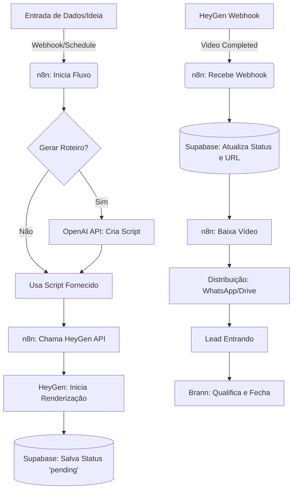

# Arquitetura de Automação de Vídeos com HeyGen e Ecossistema Ginkgo

## 1. Visão Geral da Solução

A solução proposta visa automatizar a criação de vídeos de "prova social distribuída" (formato "Nyra na Rua") utilizando a API do HeyGen, orquestrada pelo n8n e integrada ao ecossistema Ginkgo (Supabase, WhatsApp, Brann, Alfred).

O objetivo é criar uma **máquina de aquisição real** que transforma percepção em autoridade, gerando vídeos curtos (Reels/TikTok) de forma escalável, barata e rápida.

## 2. Arquitetura do Sistema

A arquitetura é baseada em um fluxo assíncrono, dado que a geração de vídeos por IA não é instantânea.

### Componentes Principais:
1. **Gatilho/Entrada**: Planilha, formulário ou mensagem no WhatsApp (via Evolution API).
2. **Orquestrador**: n8n (gerencia o fluxo, chamadas de API e webhooks).
3. **Gerador de Roteiro**: OpenAI API (GPT-4o) para criar variações do script baseadas no template "Nyra na Rua".
4. **Gerador de Vídeo**: HeyGen API (Studio Video API).
5. **Banco de Dados**: Supabase (armazena metadados, status e URLs dos vídeos).
6. **Distribuição**: WhatsApp (Evolution API), Google Drive ou postagem direta.

### Diagrama de Fluxo (Pipeline de Produção)



## 3. Integração com HeyGen API

Para este caso de uso, utilizaremos a **Generate Studio Video API** (`POST /v2/video/generate`), que permite controle total sobre o avatar, voz e script.

### 3.1. Preparação (Setup Único)
Antes de rodar a automação, é necessário:
1. Criar o **Photo Avatar** da Nyra no painel do HeyGen.
2. Obter o `avatar_id` da Nyra.
3. Escolher uma voz adequada e obter o `voice_id`.
4. Obter a `API Key` no painel do HeyGen.

### 3.2. Chamada de Criação de Vídeo (n8n HTTP Request)

**Endpoint**: `POST https://api.heygen.com/v2/video/generate`
**Headers**:
- `X-API-KEY`: `{{ $credentials.heygen_api_key }}`
- `Content-Type`: `application/json`

**Payload Exemplo**:
```json
{
  "title": "Nyra na Rua - Cliente 01",
  "caption": true,
  "dimension": {
    "width": 1080,
    "height": 1920
  },
  "callback_id": "req_12345",
  "video_inputs": [
    {
      "character": {
        "type": "avatar",
        "avatar_id": "ID_DO_AVATAR_NYRA",
        "avatar_style": "normal"
      },
      "voice": {
        "type": "text",
        "input_text": "Tu responde cliente em quanto tempo? Ah, depende? Então já perdeu. A Ginkgo não depende.",
        "voice_id": "ID_DA_VOZ_ESCOLHIDA",
        "speed": 1.1
      },
      "background": {
        "type": "color",
        "value": "#000000"
      }
    }
  ]
}
```

## 4. Fluxo n8n Detalhado

O processo no n8n deve ser dividido em dois fluxos (workflows) para lidar com a natureza assíncrona da geração de vídeos.

### Workflow 1: Solicitação de Vídeo
1. **Trigger**: Recebe os dados (ex: nome do cliente, dor principal).
2. **OpenAI Node**: Gera o script adaptado usando o prompt da Nyra.
3. **HTTP Request Node**: Chama a API do HeyGen (`/v2/video/generate`).
4. **Supabase Node**: Insere um registro na tabela `videos_gerados` com o `video_id` retornado pelo HeyGen, status `pending` e dados do cliente.

### Workflow 2: Webhook de Conclusão (Callback)
*Nota: O HeyGen permite configurar webhooks globais no painel ou passar um `callback_url` na requisição.*

1. **Webhook Node**: Recebe o POST do HeyGen quando o vídeo está pronto.
2. **Supabase Node**: Atualiza o registro correspondente ao `video_id` com a URL de download e status `completed`.
3. **HTTP Request Node**: Faz o download do arquivo MP4 da URL fornecida.
4. **Evolution API Node**: Envia o vídeo via WhatsApp para aprovação ou posta diretamente.

## 5. Estrutura de Dados (Supabase)

Tabela sugerida: `heygen_videos`

| Coluna | Tipo | Descrição |
| :--- | :--- | :--- |
| `id` | uuid | PK |
| `created_at` | timestamp | Data de criação |
| `video_id` | text | ID retornado pelo HeyGen |
| `status` | text | pending, processing, completed, failed |
| `script` | text | O texto falado no vídeo |
| `video_url` | text | URL de download (preenchido no webhook) |
| `lead_id` | uuid | FK para a tabela de leads (opcional) |

## 6. O "Upgrade Estratégico" - Pipeline Completo Ginkgo

Para implementar a visão de "máquina de aquisição real":

1. **Atração (Nyra)**: Os vídeos gerados por esta automação são postados no Reels/TikTok.
2. **Educação (Conteúdo)**: O vídeo demonstra a dor ("demora no atendimento") e a solução ("Ginkgo responde na hora").
3. **Fechamento (Brann)**: O CTA do vídeo direciona para o WhatsApp. O agente Brann (via n8n + Evolution API) atende o lead, qualifica e agenda a reunião.
4. **Operação (Alfred)**: Após o fechamento, o Alfred assume a gestão operacional.

## 7. Custos e Limites Estimados

- **HeyGen API**: O plano Pay-As-You-Go começa em $5. O custo por vídeo varia conforme a duração, mas vídeos curtos (Reels de 15-30s) consomem frações de crédito.
- **Resolução**: A API gratuita limita a 720p. Para 1080p (ideal para Reels), é necessário um plano pago.
- **Limites de Texto**: Máximo de 5000 caracteres por cena (mais que suficiente para vídeos curtos).

## 8. Próximos Passos para Implementação

1. **Setup HeyGen**: Criar conta, gerar API Key e configurar o Avatar da Nyra.
2. **Setup Supabase**: Criar a tabela `heygen_videos`.
3. **Desenvolvimento n8n**: Importar/criar os dois workflows descritos acima.
4. **Testes**: Rodar um teste com script fixo para validar o webhook e o download do vídeo.
5. **Escala**: Conectar o gerador de scripts (OpenAI) e plugar a saída no fluxo do Brann.
