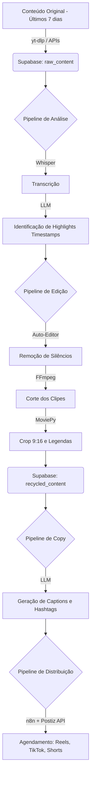

# Arquitetura: Skill de Reciclagem de Conteúdo (Content Recycler)

## Visão Geral

A skill **Content Recycler** é projetada para automatizar o processo de transformação de conteúdos longos (vídeos de YouTube, lives, podcasts) e posts de redes sociais em múltiplos formatos curtos (Reels, Stories, TikToks, Shorts, Carrosséis). O sistema opera em um ciclo contínuo de análise, extração, edição e distribuição, ideal para criadores de conteúdo e agências.

## Componentes Principais

A arquitetura é dividida em 5 pipelines principais, orquestrados via n8n e integrados com Supabase para persistência de dados.

### 1. Pipeline de Inventário (Inventory Pipeline)
Responsável por mapear o conteúdo criado nos últimos 7 dias.

*   **Fontes de Dados**: APIs do YouTube, Instagram, TikTok (via Manus Data API).
*   **Processo**:
    1.  Busca vídeos e posts publicados nos últimos 7 dias.
    2.  Extrai metadados (título, descrição, views, engajamento).
    3.  Baixa os arquivos de mídia originais (usando `yt-dlp` para vídeos).
*   **Armazenamento**: Registra os metadados e URLs de mídia no **Supabase** (tabela `raw_content`).

### 2. Pipeline de Análise (Analysis Pipeline)
Responsável por identificar os melhores momentos (highlights) do conteúdo longo.

*   **Processamento de Áudio**: Transcrição do áudio usando Whisper (via API da OpenAI ou local).
*   **Análise de Texto (LLM)**: Uso de LLMs (ex: GPT-4o ou Claude) para analisar a transcrição e identificar blocos de 15 a 60 segundos com alto potencial de engajamento (ganchos fortes, valor entregue, call to action).
*   **Análise de Vídeo**: Detecção de silêncios e mudanças de cena.
*   **Saída**: Uma lista de *timestamps* (início e fim) para cada highlight identificado.

### 3. Pipeline de Edição (Processing Pipeline)
O núcleo da transformação de mídia, utilizando ferramentas open source robustas.

*   **Auto-Editor**: Utilizado para remover automaticamente silêncios ("dead space") dos vídeos originais, tornando o conteúdo mais dinâmico.
*   **FFmpeg**: Utilizado para cortes precisos baseados nos *timestamps* gerados no Pipeline de Análise.
*   **MoviePy (Python)**: Utilizado para:
    *   Redimensionamento (Crop) inteligente para formatos verticais (9:16) ou quadrados (1:1).
    *   Adição de legendas dinâmicas (geradas a partir da transcrição).
    *   Composição de elementos visuais (ex: adicionar um título fixo no topo, barra de progresso).
*   **Armazenamento**: Salva os clipes gerados e registra no **Supabase** (tabela `recycled_content`).

### 4. Pipeline de Geração de Copy (Generation Pipeline)
Criação do material de apoio para cada novo clipe.

*   **LLM Integration**: Para cada clipe gerado, um LLM cria:
    *   Legendas (captions) otimizadas para a plataforma destino (Instagram, TikTok, LinkedIn).
    *   Hashtags relevantes.
    *   Sugestões de títulos para os vídeos.
*   **Variações**: Cria múltiplas variações de copy para o mesmo clipe, permitindo testes A/B.

### 5. Pipeline de Distribuição (Distribution Pipeline)
Agendamento e publicação do conteúdo reciclado.

*   **Integração Postiz**: Utiliza a API do [Postiz](https://github.com/gitroomhq/postiz-app) (ferramenta open source de agendamento) para programar a publicação dos Reels, Stories e Posts.
*   **Orquestração n8n**: O n8n gerencia o fluxo de envio dos arquivos de mídia e metadados para o Postiz.

## Fluxo de Dados (Data Flow)



## Tecnologias Recomendadas

| Componente | Tecnologia | Justificativa |
| :--- | :--- | :--- |
| **Orquestração** | n8n | Fluxos visuais, fácil integração com APIs e webhooks. |
| **Banco de Dados** | Supabase | PostgreSQL escalável, ideal para gerenciar o inventário de conteúdo. |
| **Download de Mídia** | yt-dlp | Padrão ouro open source para download de vídeos de diversas plataformas. |
| **Edição Automática** | Auto-Editor | Excelente para remover silêncios de forma rápida via CLI. |
| **Processamento de Vídeo** | MoviePy / FFmpeg | Flexibilidade máxima para cortes, redimensionamento e composição via Python. |
| **Agendamento** | Postiz | Solução open source robusta para agendamento em múltiplas redes sociais. |
| **IA / LLM** | OpenAI API / Grok | Transcrição (Whisper) e análise semântica para cortes e copy. |

## Exemplo de Implementação (Pseudocódigo Python para Edição)

```python
from moviepy.editor import VideoFileClip, TextClip, CompositeVideoClip
import subprocess

def process_highlight(video_path, start_time, end_time, output_path):
    # 1. Corte inicial com FFmpeg (mais rápido)
    temp_cut = "temp_cut.mp4"
    subprocess.run(["ffmpeg", "-i", video_path, "-ss", str(start_time), "-to", str(end_time), "-c", "copy", temp_cut])
    
    # 2. Remoção de silêncios com Auto-Editor
    temp_edited = "temp_edited.mp4"
    subprocess.run(["auto-editor", temp_cut, "--margin", "0.2sec", "-o", temp_edited])
    
    # 3. Crop para 9:16 e composição com MoviePy
    clip = VideoFileClip(temp_edited)
    
    # Lógica simplificada de crop centralizado
    w, h = clip.size
    target_w = int(h * 9/16)
    x_center = w / 2
    clip_cropped = clip.crop(x1=x_center - target_w/2, y1=0, x2=x_center + target_w/2, y2=h)
    
    # Adicionar título (exemplo)
    txt_clip = TextClip("Highlight!", fontsize=70, color='white').set_position(('center', 50)).set_duration(clip_cropped.duration)
    
    final_video = CompositeVideoClip([clip_cropped, txt_clip])
    final_video.write_videofile(output_path, codec="libx264", audio_codec="aac")

# Exemplo de uso
# process_highlight("podcast_completo.mp4", 120, 180, "reel_01.mp4")
```
