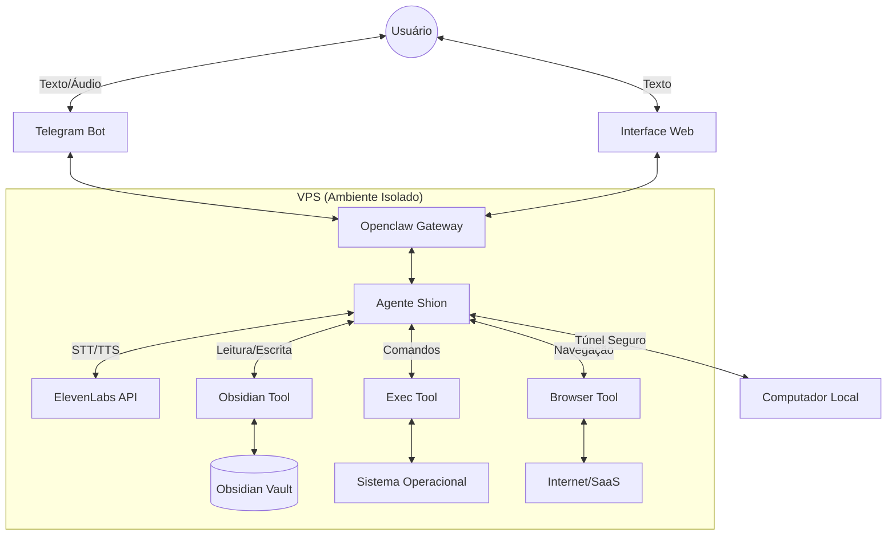

# Arquitetura do Sistema S+ (Shion)

## Visão Geral

O projeto **S+ (Shion)** é um ecossistema de agente autônomo baseado no framework Openclaw, projetado para atuar como um "copiloto operador" com acesso profundo ao sistema operacional, comunicação por voz natural (ElevenLabs) e memória estruturada (Obsidian).

A arquitetura foi desenhada para ser escalável, modular e orientada a execução prática, alinhada com os princípios da Ginkgo AI Systems.

## Componentes Principais

### 1. Core (Openclaw Gateway)
O coração do sistema é o Openclaw Gateway, rodando como um daemon na VPS. Ele orquestra a comunicação entre os canais de entrada, o agente cognitivo e as ferramentas de execução.

- **Agente Cognitivo (Shion)**: Processa intenções, consulta a memória e decide ações.
- **Roteamento**: Gerencia sessões isoladas por usuário/grupo.
- **Segurança**: Aplica políticas de allowlist para garantir que apenas usuários autorizados (Gabriel) tenham acesso.

### 2. Canais de Comunicação (Interfaces)
O sistema suporta múltiplas interfaces de entrada/saída, priorizando a comunicação fluida e humanizada.

- **Telegram (Principal)**: Interface primária para comandos rápidos, áudios e notificações. Utiliza a integração nativa do Openclaw via grammY com suporte a long polling.
- **WebChat**: Interface secundária para interações mais complexas ou visualização de dados estruturados.

### 3. Integração de Voz (ElevenLabs)
A comunicação por linguagem natural é bidirecional, permitindo interações por voz de alta qualidade.

- **Speech-to-Text (STT)**: Converte áudios recebidos no Telegram para texto antes do processamento pelo agente.
- **Text-to-Speech (TTS)**: Utiliza a API da ElevenLabs para gerar respostas em áudio humanizado quando apropriado, enviando o arquivo de voz de volta pelo canal.

### 4. Memória Operacional (Obsidian)
O Obsidian atua como o "sistema de pensamento externo" do agente, seguindo regras estritas de leitura e escrita.

- **Leitura (Contexto)**: O agente consulta o cofre (vault) antes de agir, navegando via wikilinks (index -> mocs -> methods -> claims).
- **Escrita (Aprendizado)**: O agente registra claims, methods, logs e insights, mantendo o grafo de conhecimento atualizado e comprimindo informações redundantes.
- **Sincronização**: Um plugin/tool específico gerencia a leitura e escrita nos arquivos Markdown locais do Obsidian.

### 5. Acesso Total ao Sistema (Ferramentas)
O agente possui ferramentas (tools) que concedem acesso profundo ao ambiente computacional.

- **Exec Tool**: Permite a execução de comandos shell na VPS para automação de infraestrutura, deploy de containers (Docker) e gerenciamento de serviços.
- **Browser Tool**: Automação web isolada para interagir com painéis, raspar dados ou executar ações em sistemas sem API.
- **Acesso Local (Computador Pessoal)**: Conexão segura (ex: via túnel SSH reverso ou agente local secundário) para executar tarefas diretamente na máquina do usuário.

## Fluxo de Execução (Loop do Agente)

1. **Entrada**: Recebe comando (texto ou áudio via Telegram).
2. **Transcrição**: Se áudio, converte para texto.
3. **Consulta**: Busca contexto no Obsidian (memória).
4. **Decisão**: Analisa o pedido e decide a melhor ação.
5. **Execução**: Utiliza ferramentas (Exec, Browser, APIs) para realizar a tarefa.
6. **Aprendizado**: Registra logs, métodos ou insights no Obsidian.
7. **Resposta**: Gera resposta (texto ou áudio via ElevenLabs) e envia ao usuário.

## Diagrama de Arquitetura

## Considerações de Segurança

- **Isolamento**: O Browser Tool deve rodar em um ambiente isolado (container) para evitar contaminação.
- **Autenticação**: O acesso via Telegram é restrito por `allowlist` contendo apenas o ID numérico do usuário autorizado.
- **Auditoria**: Todas as ações críticas executadas via Exec Tool devem ser registradas como `log` no Obsidian.
