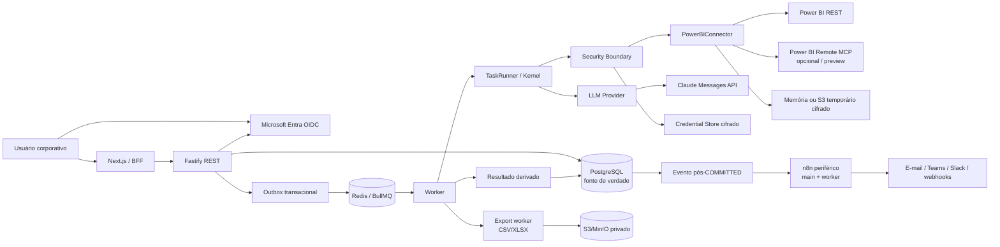

# Plano de extração e fundação do `ginkgo-connect`

## Resumo

Construir um monorepo novo, sem importar histórico, migrations ou domínios dos doadores. A extração será fixada nestas revisões:

- `ginkgo-tree@194061c600b5f5779008bbc644c2193475ee8164`
- `ginkgo-platform@9b5db872e9d4583018dea74671f6f3304cfccfa2`
- `ai-stack@f4540ca91c72e86606867cb88faf776e565bd141`

O Kernel, Boundary, ledger e testes do `ginkgo-tree` serão adaptados, não copiados literalmente. A nova implementação corrigirá:

- decisão congelada hoje re-resolvida no `resume`;
- transições, eventos e créditos não atômicos;
- reserva sem identidade própria por Task;
- Evidence “append-only” não garantida pelo banco;
- allowlist de egress apenas registrada, não aplicada;
- acoplamento direto entre Boundary e Prisma;
- worker misturado a domínios Leaf/WhatsApp.

Baseline novo: Node 24, pnpm 11, TypeScript 7, Turborepo 2, ESM, Next.js 16/React 19, Fastify 5/Zod 4 e Prisma 7. Nenhum lockfile dos doadores será reutilizado.

## Arquitetura resultante

O n8n fica fora do caminho crítico de Power BI. Não recebe tokens Microsoft, DAX, dados brutos, prompts, Evidence completa ou autoridade para alterar Task e créditos.

Há duas separações de transporte:

- Plataforma: REST externo e MCP interno chamam o mesmo `ConnectorOperationRegistry`.
- Power BI: REST é obrigatório; o Power BI Remote MCP é um provider opcional para schema completo e metadata de relatório.

O Power BI Remote MCP está em preview e requer habilitação no tenant; seus formatos podem mudar. O adapter será isolado, validado e desligável por feature flag. [Microsoft: Power BI Remote MCP](https://learn.microsoft.com/en-us/power-bi/developer/mcp/remote-mcp-server-tools)

## Mapa de extração dos doadores

| Fonte | Arquivos | Tratamento |
|---|---|---|
| `ginkgo-tree` | `packages/core/src/{states,contracts,kernel,ports,runner}.ts` | Adaptar estados, resolução determinística, portas e fluxo. Persistir `FrozenDecision`, aplicar CAS/versão e tornar cada transição atômica com seu evento. |
| `ginkgo-tree` | `packages/core/src/queue.ts` | Extrair somente contrato de Task/BullMQ; remover BRANN e qualquer fila de domínio. |
| `ginkgo-tree` | `test/kernel-flow.test.ts` | Portar cenários de resolução, budget, HITL e idempotência; corrigir os testes para garantir que `resume` leia a decisão persistida. |
| `ginkgo-tree` | `packages/boundary/src/{boundary-executor,confirmer,redactor,secret-resolver,validator}.ts` | Adaptar para portas desacopladas do Prisma, leases de credencial, redaction profunda, egress efetivo e Power BI direto. HMAC de `executorRef` vira hash de manifesto/versionamento do tool. |
| `ginkgo-tree` | `test/boundary.test.ts`, `test/evidence-binding.test.ts`, `test/crypto.test.ts` | Portar e ampliar com tokens Microsoft, tenant isolation, egress, payloads MCP e ausência de segredos em logs/artefatos. |
| `ginkgo-tree` | `packages/db/prisma/schema.prisma` | Extrair apenas conceitos de Tenant, Task, Event, Evidence, Wallet, Ledger, Policy, Skill/Tool, Secret e VaultAccess. O schema final será refeito para Prisma 7. |
| `ginkgo-tree` | `packages/db/src/store.ts` | Reaproveitar a intenção de reserva/liquidação/liberação e evidence binding; reescrever com transações, reservas idempotentes e repositórios menores. |
| `ginkgo-tree` | `packages/db/src/{crypto,evidence-binding}.ts` | Adaptar o matcher; transformar AES-GCM em adapter local de uma abstração de envelope encryption. |
| `ginkgo-tree` | `apps/worker/src/processor.ts` | Copiar-adaptar o wrapper BullMQ→TaskRunner. |
| `ginkgo-tree` | `apps/worker/src/index.ts` | Usar apenas como referência de composition root, shutdown e listeners. Recriar sem Leaf, WhatsApp, Brann, RAG ou AnythingLLM. |
| `ginkgo-tree` | `docker-compose.prod.yml`, `docker-compose.yml` | Extrair healthchecks, redes privadas, imagens pinadas e segregação de env. Não copiar o compose inteiro. |
| `ginkgo-tree` | `whatsapp-delegate.ts`, workflows e `n8n-provision.sh` | Apenas referência para executor cego, autenticação de webhook e provisionamento versionado. Nenhum código de WhatsApp será levado. |
| `ginkgo-platform` | `package.json`, `pnpm-workspace.yaml`, `turbo.json`, `packages/config/*` | Adaptar para o baseline uniforme ESM/Node 24/TS 7. |
| `ginkgo-platform` | `packages/ui/src/**`, exceto artefatos gerados | Copiar-adaptar primitives Radix/shadcn e utilitário `cn`; remover `tsconfig.tsbuildinfo`. |
| `ginkgo-platform` | `PageShell`, `GlassCard`, `KpiCard`, `StatusBadge`, `EmptyState`, layouts | Adaptar para Tasks, conexões, aprovações, créditos, Evidence e exports. Remover mocks e semântica CRM. |
| `ginkgo-platform` | `apps/api/src/server.ts` | Usar somente o padrão modular Fastify. Recriar sem CORS `*`, segredo JWT default ou `dotenv` no runtime. |
| `ginkgo-platform` | `apps/api/src/services/aiGateway.ts` | Reaproveitar apenas a interface conceitual request/response/usage/latency. Substituir providers por `LlmProvider` + Claude. |
| `ai-stack` | `docker-compose.yml` | Extrair n8n queue mode, separação main/worker, PostgreSQL, Redis e healthchecks. Reescrever removendo Evolution, Postiz, Temporal, Discord e AnythingLLM. |

Não copiar:

- migrations dos doadores;
- `packages/agents`, Souls, Leaf, Pyre, Wave, CRM, leads, personas ou WhatsApp;
- `packages/agents/src/tools/n8nExecutor.ts`;
- `apps/api/src/services/tokenRouter.ts`;
- `AnythingLLM`, pgvector e RAG no runtime padrão;
- `build.log`, `tsconfig.tsbuildinfo`, mocks, volumes de dados e arquivos `.env`;
- workflows públicos ou catálogo genérico de MCPs.

## Arquivos e módulos criados do zero

### Fundação e documentação

- configuração raiz do workspace, lint, CI, `.env.example` e Dockerfiles;
- `docs/extraction-manifest.md` com SHAs, origem e transformação de cada arquivo;
- `docs/adr/0001` a `0014`;
- um único baseline Prisma e uma única migration inicial;
- scripts explícitos de migration, seed de Tool Registry e verificação de readiness.

### `packages/shared`

- schemas Zod de Task, eventos, Evidence, conexão, aprovação, resultado, exportação e erros;
- contratos `SemanticModelSchema`, `ApprovalEnvelope`, `FrozenDecision` e eventos de outbox;
- serialização de `bigint` monetário/créditos como string nas interfaces externas.

### `packages/core`

- máquina de estados e `TaskRunner`;
- `risk/data-sensitivity.ts`;
- `risk/powerbi-risk-classifier.ts`;
- `policies/read-approval-policy.ts`;
- orçamento, rate card, reserva e settlement de Connect Credits;
- resolução determinística de tools;
- `FrozenDecision` persistida e imutável;
- aprovação/mandato recorrente por envelope congelado.

Política de risco:

- R0: healthcheck e metadata técnica;
- R1: agregados de baixa cardinalidade sem campos sensíveis;
- R2: detalhe por linha, dados sensíveis, DAX livre classificável, alta cardinalidade e exports;
- R3: escrita, administração, bypass de RLS, ferramenta desconhecida ou tentativa de evasão.

Claude pode elevar ou sugerir risco, mas nunca reduzi-lo.

### `packages/db`

Modelos principais:

- `Organization`, `User`, `Membership`, `UserSession`;
- `Connection`, `ConnectionCredential`, `VaultAccessEvent`;
- `Task`, `TaskDecision`, `TaskAttempt`, `TaskEvent`, `OutboxEvent`;
- `Evidence`, `DerivedResult`;
- `ApprovalRequest`, `ApprovalDecision`, `ApprovalMandate`;
- `CreditAccount`, `CreditReservation`, `CreditLedgerEntry`, `CreditRateCard`;
- `ConnectorDefinition`, `ToolDefinition`, `SchemaSnapshot`;
- `ExportArtifact`, `ExportAuditEvent`;
- `PlanPolicy`.

Garantias:

- status + evento gravados na mesma transação;
- `version` otimista/CAS para transições concorrentes;
- `TaskDecision` escrita uma única vez;
- Evidence, ledger, decisões e eventos protegidos contra `UPDATE`/`DELETE` por migration SQL;
- reserva única por Task e settlement/release idempotentes;
- outbox transacional elimina o dual-write PostgreSQL/BullMQ;
- todo repositório recebe `organizationId` do `AuthContext`, nunca do body.

Créditos serão inteiros (`bigint`), sem ponto flutuante. Custos reais internos usarão micros + moeda. A produção exigirá um `CreditRateCard` ativo; valores comerciais não ficarão hardcoded no Kernel.

Tasks aguardando aprovação não mantêm créditos presos indefinidamente: a decisão e estimativa são congeladas, mas a reserva ocorre atomicamente na aprovação. Se rate card, envelope ou limite tiver expirado, a Task volta para nova decisão.

### `packages/boundary`

- `SecretStore` e `SecretResolver` sem dependência de Prisma;
- lease por conexão, Task e tool, com expiração e revogação;
- refresh atômico de token Microsoft;
- trilha append-only de resolução, refresh, uso e revogação;
- redaction recursiva de logs, erros, eventos, headers e Evidence;
- HTTP clients com hosts fixos para Microsoft, Anthropic e storage;
- bloqueio de URL arbitrária, redirects fora da allowlist e endpoints MCP fornecidos pelo usuário;
- adapter local AES-256-GCM para desenvolvimento e interface de KMS/envelope encryption para produção.

### `packages/connectors`

- registry fechado de conectores e tools versionadas;
- `PowerBIConnector`;
- adapters Power BI REST e Remote MCP;
- schemas locais para as três tools MCP permitidas:
  - `get_semantic_model_schema`;
  - `get_report_metadata`;
  - `execute_query`;
- capability negotiation e estados `FULL_SCHEMA_MCP`, `LIMITED_REST`, `FULL_SCHEMA_XMLA`, `DEGRADED`, `DISCONNECTED`;
- normalização para `SemanticModelSchema`;
- `LimitedRestSchemaProvider`;
- interface, sem implementação, para `XmlaReadOnlySchemaProvider`.

REST permanece funcional para workspaces, relatórios, semantic models, health e `executeQueries`. O endpoint oficial limita cada chamada a uma query/uma tabela e impõe limites de linhas, valores e 15 MB; os limites internos serão menores. [Microsoft: Execute Queries](https://learn.microsoft.com/en-us/rest/api/power-bi/datasets/execute-queries)

O `Get Definition` do Fabric não será usado porque exige permissões de escrita. XMLA não entra no primeiro release porque depende de Premium/PPU ou capacity compatível. [Microsoft: XMLA read-only](https://learn.microsoft.com/en-us/fabric/enterprise/powerbi/service-premium-connect-tools)

### `packages/llm`

- `LlmProvider`, `LlmUsage`, `ToolProposal` e erros neutros;
- `ClaudeProvider` via `@anthropic-ai/sdk`;
- tool use estrito com schemas locais;
- geração de DAX somente quando houver schema completo;
- redução/seleção de contexto antes do modelo;
- nenhum acesso direto do modelo ao connector, n8n, credenciais ou ledger.

O worker interpreta a proposta, valida argumentos, classifica risco e somente então executa. O tool use estrito do SDK garante formato, mas não substitui autorização ou política. [Anthropic: tool use](https://platform.claude.com/docs/claude/docs/tool-use)

### `packages/exports`

- exporters CSV e XLSX;
- CSV UTF-8 BOM, escape correto e neutralização de formula injection;
- XLSX sem macros, fórmulas ou vínculos externos, com abas `Dados` e `Contexto`;
- storage S3-compatible cifrado e URLs assinadas;
- interfaces futuras `ReportRenderer` e `PresentationRenderer`, sem implementação ou UI falsa.

Cada export cria uma Task filha `export.generate`, vinculada à Task analítica COMMITTED.

### Apps e infraestrutura

- API Fastify modular com auth, tenant context, CSRF, rate limit, readiness e transportes REST/MCP;
- web Next.js com conexão Power BI, Tasks, resultados, Evidence resumida, aprovações, créditos e exports;
- worker com jobs de Task, export, outbox, limpeza de temporários e entrega pós-COMMITTED;
- `infra/docker` com PostgreSQL, Redis, MinIO, API, web, worker e n8n main/worker;
- bancos PostgreSQL separados para aplicação e n8n;
- Redis separado por DB/prefixo para BullMQ, cache/locks e fila n8n;
- n8n com workflows estáticos provisionados por ops, UI administrativa não exposta publicamente.

## APIs e transportes

Rotas mínimas:

- `POST /v1/tasks`
- `GET /v1/tasks/:taskId`
- `POST /v1/tasks/:taskId/approve`
- `POST /v1/tasks/:taskId/reject`
- `GET /v1/credits`
- `GET /v1/credits/ledger`
- `POST /v1/connections/powerbi/authorize`
- `GET /v1/connections/powerbi/callback`
- `GET /v1/connections`
- `POST /v1/connections/:id/refresh-capabilities`
- `DELETE /v1/connections/:id`
- `POST /v1/tasks/:taskId/exports`
- `GET /v1/exports/:exportId`
- `POST /v1/exports/:exportId/approve`
- `POST /v1/exports/:exportId/reject`
- `POST /v1/exports/:exportId/download-url`
- `DELETE /v1/exports/:exportId`
- `GET /health/live`
- `GET /health/ready`

MCP interno:

- endpoint Streamable HTTP stateless em `/internal/mcp`;
- bearer token de workload com audience e scopes próprios;
- Origin validado quando presente;
- tools fixas e versionadas;
- sem descoberta dinâmica de endpoints ou marketplace;
- testes de conformidade garantindo que REST e MCP produzam o mesmo comando interno.

Streamable HTTP é o transporte remoto padrão atual do MCP e exige autenticação e validação de Origin. [MCP transport specification](https://modelcontextprotocol.io/specification/2025-11-25/basic/transports)

## Identidade e OAuth

Três planos independentes:

1. Identity Plane: Microsoft Entra OIDC multitenant, Authorization Code + PKCE.
2. Application Authorization Plane: Membership, Role e scopes internos.
3. Connection Authorization Plane: OAuth delegado do Power BI.

Scopes de aplicação:

- `connect.read`
- `connect.execute`
- `connect.connections.manage`
- `connect.billing.manage`
- `connect.admin`

Regras:

- sessão backend com cookie Secure, HttpOnly e SameSite;
- nenhuma credencial em `localStorage`;
- `organizationId` derivado da Membership persistida;
- assinatura, issuer, audience, tenant, expiração e scopes sempre validados;
- fake auth somente em testes e bloqueado em produção;
- Power BI limitado a scopes `*.Read.All` necessários;
- refresh/access tokens Power BI cifrados na Boundary;
- desconexão apaga/invalida material local; revogação remota que exigiria escopos administrativos não será simulada como concluída.

## Dados, retenção e limites

Política canônica:

- raw data is transient;
- derived output is retained;
- Evidence is durable;
- secrets are never execution artifacts.

Defaults iniciais, carregados de `PlanPolicy`:

- R1 automático: até 1.000 linhas, 30 colunas, 2 MB e 30 segundos;
- R2 aprovado: até 50.000 linhas, 50 colunas, 15 MB e 60 segundos;
- contexto Claude: no máximo 200 linhas e 100 KB após agregação/seleção;
- memória: até 4 MB; acima disso, spill cifrado para S3/MinIO;
- objeto bruto temporário: TTL padrão de 30 minutos, máximo de 60;
- schema snapshot: 24 horas;
- resultado derivado: 30 dias Starter e 90 dias nos planos superiores;
- export: TTL de 24 horas;
- CSV: 50.000 linhas, 50 colunas, 25 MB;
- XLSX: 20.000 linhas, 50 colunas, 20 MB.

PostgreSQL retém resposta final, resumo, agregados, charts derivados, parâmetros sanitizados, período, custos, créditos e timestamps. Não retém as linhas completas automaticamente.

Evidence persistente contém hashes canônicos, contagens, schema hash, tool/version, conexão, workspace, semantic model, identidade técnica, request ID, duração, pricing version, custo e créditos. DAX sensível é redigido e guardado apenas em forma sanitizada + hash.

## Dependências

Manter ou atualizar:

- pnpm, Turborepo, TypeScript e `tsx`;
- Next.js, React, Tailwind, Radix, CVA, `clsx`, `tailwind-merge`, Lucide;
- Recharts e Framer Motion apenas onde houver visualização ou interação real;
- Fastify, Zod e plugins oficiais de cookie, CORS restrito, helmet, CSRF e rate limit;
- Prisma/PostgreSQL;
- BullMQ/ioredis;
- Node `crypto` e `fetch`.

Adicionar:

- `@azure/msal-node` e `jose`;
- `@anthropic-ai/sdk`;
- pacotes oficiais MCP v2 de server, client e Node transport;
- AWS SDK S3 e presigner;
- `exceljs`, `csv-stringify` e parser JSON streaming;
- canonicalização JSON para hashes estáveis;
- Testcontainers para integração.

Descartar:

- OpenRouter, Gemini/OpenAI adapters e `tokenRouter`;
- Supabase, bcrypt e JWT HMAC de usuário;
- Stripe, billing webhook e custos BRL dos doadores;
- `@ginkgo/leaf`, `@ginkgo/agents` e delegates de domínio;
- Evolution API, Postiz, Temporal, Cloudflare-specific deployment e pgvector;
- AnythingLLM e RAG no runtime;
- imagens Docker com tag `latest`;
- qualquer migration SQL dos doadores.

## Sequência de implementação

1. Criar o repositório e registrar o manifesto de proveniência com os três SHAs.
2. Montar workspace, baseline ESM, lint, CI, Dockerfiles e dependency constraints.
3. Criar `shared`, schemas públicos, eventos e regras de importação entre pacotes.
4. Modelar Prisma do zero, gerar migration baseline e implementar outbox/repositórios.
5. Adaptar Kernel, FrozenDecision, lifecycle, Evidence binding, créditos e testes doadores.
6. Implementar Boundary, credential leases, encryption, redaction e egress real.
7. Implementar Entra OIDC, sessões, Membership/RBAC e separação dos três planos de token.
8. Implementar OAuth Power BI, REST control plane e capability negotiation.
9. Implementar Remote MCP adapter feature-flagged, schema normalizer e degradação honesta.
10. Implementar BullMQ worker, Power BI execution, processamento transitório e Claude.
11. Expor REST e MCP interno sobre o mesmo command bus.
12. Construir dashboard com dados reais, sem mocks nem botões de capacidades ausentes.
13. Implementar exports CSV/XLSX, MinIO/S3, limpeza e auditoria.
14. Subir n8n queue mode apenas para triggers e entregas pós-COMMITTED.
15. Executar suíte de segurança, concorrência, RLS, recuperação e smoke de infraestrutura.

## Testes e critérios de aceitação

- Kernel: transições, capability gap, FrozenDecision imutável, approval/reject, failure e redelivery.
- Créditos: concorrência sem overspend; reserve/settle/release exatamente uma vez; nenhum débito duplicado.
- Banco: migration em banco vazio; triggers append-only; outbox sem perda; tenant isolation.
- Boundary: nenhum token em logs, eventos, n8n, Claude, Redis ou exports; redirects e hosts não allowlisted bloqueados.
- Auth: issuer/audience/scope/tenant inválidos; CSRF/state/PKCE; fake auth impossível em produção.
- Power BI: fixtures REST/MCP, RLS com usuários distintos, Build Permission ausente e refresh token rotacionado.
- Schema: MCP desligado resulta em `LIMITED_REST`; payload incompatível degrada capacidade sem derrubar conexão.
- Risk: tabela R0–R3, campos sensíveis, alta cardinalidade e DAX ambíguo; política nunca reduz risco.
- Raw data: spill acima de 4 MB, TTL, exclusão e ausência de linhas completas no PostgreSQL.
- Claude: recebe apenas contexto permitido; tool inválida, paralela ou não registrada é recusada.
- Exports: CSV injection, sheet/path sanitization, limites, MIME, hash, idempotência, URL expirada e cross-tenant.
- REST/MCP: testes de contrato executam o mesmo comando e comparam resultado normalizado.
- n8n: indisponibilidade não repete consulta nem settlement; falha de entrega vira tentativa separada.
- Infra: todos os serviços essenciais healthy, n8n main/worker separados e nenhuma porta administrativa pública.

Aceitação final: uma organização externa autentica via Entra, conecta Power BI por OAuth delegado, negocia capabilities, cria uma Task, passa por risco/créditos/HITL, executa preservando RLS, recebe resultado derivado reabrível e pode gerar CSV/XLSX governado sem que tokens ou dados brutos sejam persistidos indevidamente.

## ADRs iniciais

1. `0001-monorepo-boundaries-and-runtime-baseline.md`
2. `0002-task-lifecycle-frozen-decision-and-append-only-truth.md`
3. `0003-postgresql-source-of-truth-outbox-and-redis-ephemerality.md`
4. `0004-connect-credits-ledger-reservation-and-settlement.md`
5. `0005-powerbi-multitenant-delegated-oauth.md`
6. `0006-human-authentication-and-token-separation.md`
7. `0007-powerbi-data-retention-and-evidence.md`
8. `0008-powerbi-critical-path-without-n8n.md`
9. `0009-sensitivity-based-read-approval.md`
10. `0010-governed-derived-exports.md`
11. `0011-powerbi-schema-provider-strategy.md`
12. `0012-rest-and-internal-mcp-transport-equivalence.md`
13. `0013-security-boundary-secrets-egress-and-redaction.md`
14. `0014-claude-provider-and-governed-tool-proposals.md`

## Riscos técnicos

- Remote MCP é preview: isolar adapter, fixtures versionadas, métricas e kill switch.
- Tenants podem não habilitar MCP ou Build Permission: mostrar `LIMITED_REST` e bloquear análises sem schema.
- OAuth multitenant pode exigir admin consent: onboarding deve detectar e explicar sem marcar conexão ativa.
- Refresh tokens podem ser revogados externamente: falhar como `REAUTH_REQUIRED`, nunca em loop.
- Classificação de sensibilidade pode ter falso negativo: regras determinísticas, schema metadata e fail-up para R2/R3.
- DAX é read-only no endpoint, mas pode expor grande volume: budgets, cardinalidade, allowlists e HITL continuam obrigatórios.
- Exactly-once não existe entre banco e provedores: outbox, idempotency keys, attempts e settlement único.
- Resultado bruto pode vazar por observabilidade: logger estruturado com campos permitidos, nunca bodies genéricos.
- Storage temporário pode acumular órfãos: TTL do bucket mais sweeper reconciliador.
- UI e pacote `ui` do platform têm mocks e domínio legado: reaproveitar somente primitives/layout.
- Upgrades de runtime podem exigir ajustes nos trechos doadores: nenhuma dependência é promovida sem typecheck e testes.

## Checklist de migração sem dívida técnica

- [ ] Fixar SHAs e documentar proveniência antes da primeira cópia.
- [ ] Não copiar `.git`, locks, migrations, volumes, build outputs ou secrets.
- [ ] Não importar diretórios inteiros; cada arquivo deve constar no manifesto.
- [ ] Usar ESM, um `tsconfig` base e uma única versão de cada dependência.
- [ ] Proibir imports reversos: `core` não conhece Prisma, Fastify, BullMQ, Claude ou Power BI.
- [ ] Boundary depende de portas; apps fazem o wiring com DB e providers.
- [ ] Criar uma única migration baseline validada em PostgreSQL vazio.
- [ ] Aplicar tenant scope e índices compostos em toda entidade empresarial.
- [ ] Enforçar append-only no banco, não por boolean ou convenção.
- [ ] Persistir decisão/policy/tool/pricing versions usadas por cada Task.
- [ ] Implementar outbox antes de publicar o primeiro job BullMQ.
- [ ] Não manter crédito reservado durante espera humana ilimitada.
- [ ] Não aceitar URLs, tools, tenant IDs ou organization IDs fornecidos como autoridade pelo cliente/LLM.
- [ ] Não copiar CORS aberto, JWT default, `dotenv` permissivo ou tags Docker `latest`.
- [ ] Não disponibilizar Power BI write scopes, admin APIs ou service principal no MVP.
- [ ] Não fazer fallback silencioso de MCP para schema inventado.
- [ ] Não enviar raw result automaticamente ao Claude.
- [ ] Não armazenar export em PostgreSQL/Redis nem gerar arquivo no n8n.
- [ ] Não criar marketplace, editor de workflow ou descoberta livre de MCP.
- [ ] Manter AnythingLLM/RAG ausente do compose padrão e desativado.
- [ ] Bloquear deploy de produção sem rate card, KMS/encryption, Entra config, storage privado e políticas de retenção.
- [ ] Exigir testes unitários, integração, segurança, concorrência e compose smoke antes do primeiro release.

## Premissas e limites

- `ginkgoai/ginkgo-connect` ainda não existe ou não está acessível; sua criação ocorrerá somente na etapa de implementação.
- Não haverá Stripe ou checkout no Bloco 1; créditos entram por grants/ajustes administrativos auditados.
- Service principal, profiles, XMLA, PDF e PPTX ficam como extensões futuras.
- n8n é periférico e substituível.
- RAG permanece opcional e sem implementação crítica.
- Nenhuma operação Power BI de escrita, administração, refresh, publicação ou alteração de permissão entra no MVP.
