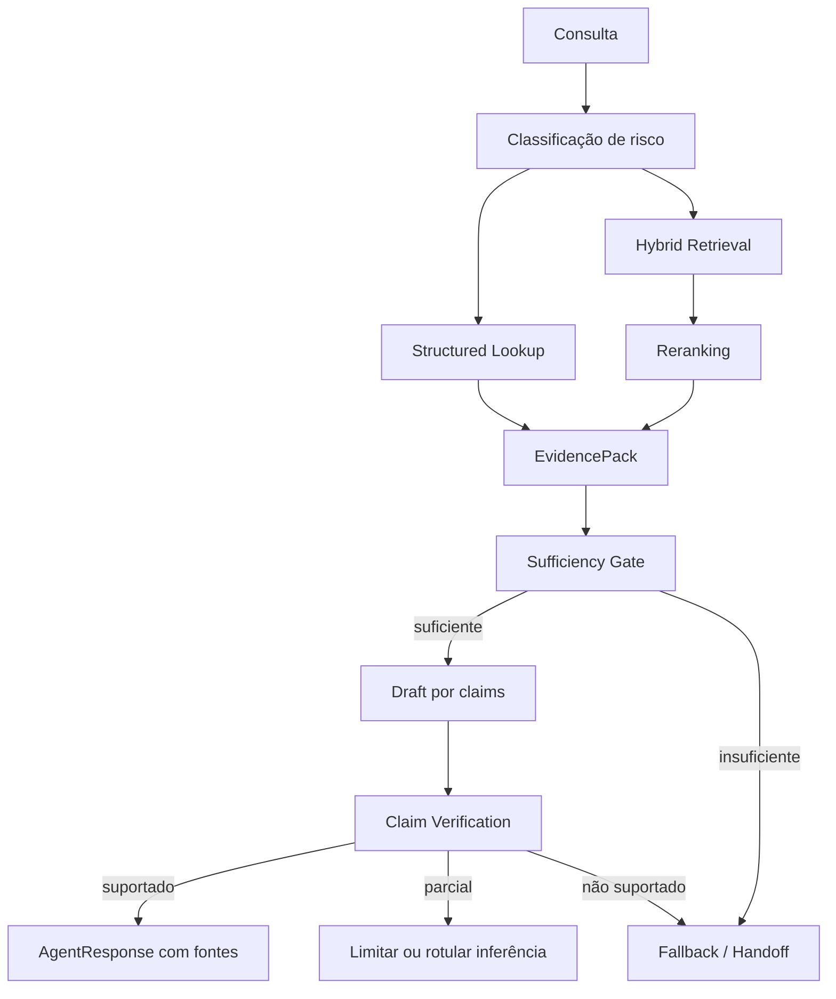

# PRD Técnico do Ginkgo Workforce para Cinquenta Usuários Funcionais

## Resumo executivo

O PRD técnico foi produzido em português, pronto para ser adicionado como:

```text
docs/PRD-TECHNICAL-MVP-50.md
```

O documento possui aproximadamente **1.880 linhas e 9.000 palavras**, incluindo arquitetura, decisão sobre Qdrant, kernel Laplace, anti-alucinação, `soul.md`, prompts semânticos, personas, guardrails, contratos, épicos, estimativas, testes, observabilidade, rollout, custos, riscos, Mermaid diagrams e instruções de commit e PR.

O planejamento resultante estima **392 dias/homem**, com uma faixa prudente de **330 a 460 dias/homem**. Com uma equipe de cinco pessoas — liderança/backend, backend/IA, full-stack, DevOps/SRE e QA/product engineering — o caminho crítico estimado é de **16 a 22 semanas**. Esse prazo não inclui esperas externas imprevisíveis, especialmente Meta App Review, Business Verification e negociações de licenciamento.

A arquitetura existente no branch `agent/refine-workforce-architecture` já estabelece corretamente a separação entre Eliza, Hermes, LangGraph, Skill Engine, n8n, ChatbotX, LiteLLM, PostgreSQL, Redis e armazenamento de objetos. Também define tenant obrigatório, Hermes isolado, ledger de créditos, memória com procedência e observabilidade por execução. O novo PRD transforma esses princípios em uma sequência implementável. fileciteturn4file0L11-L22 fileciteturn4file0L60-L84 fileciteturn4file0L113-L154

O pacote completo está disponível nos seguintes artefatos:

- [Baixar o PRD técnico em Markdown](sandbox:/mnt/data/ginkgo-prd-mvp-50/docs/PRD-TECHNICAL-MVP-50.md)
- [Baixar o pacote completo para o repositório](sandbox:/mnt/data/ginkgo-prd-mvp-50.zip)
- [Baixar o patch Git](sandbox:/mnt/data/ginkgo-prd-mvp-50/prd-mvp-50.patch)
- [Baixar a descrição do draft PR](sandbox:/mnt/data/ginkgo-prd-mvp-50/PR-DESCRIPTION.md)
- [Baixar o script de branch, commit, push e abertura do PR](sandbox:/mnt/data/ginkgo-prd-mvp-50/scripts/open-pr-prd-mvp-50.sh)

O conector GitHub disponível nesta sessão expõe leitura de repositórios, branches, commits e pull requests, mas não expõe operações de escrita para criar branch, commit ou PR. Por isso, não declarei um PR inexistente. O bundle contém um script que executa essas operações com `git` e `gh`, validando antes se está sendo executado no repositório correto.

## Decisões técnicas centrais

### Qdrant não é necessário para o primeiro marco

A recomendação do PRD é:

```text
MVP até 50 usuários:
PostgreSQL + pgvector + PostgreSQL Full-Text Search + HNSW + reranker

Evolução:
Qdrant atrás de VectorStorePort, ativado por benchmark
```

O pgvector oferece busca vetorial exata e aproximada, índices HNSW e IVFFlat, vetores densos, esparsos e binários, diferentes métricas de distância, composição com full-text search e reranking. Ele também preserva as propriedades do PostgreSQL, como transações, joins, point-in-time recovery e integração direta com metadados de procedência. citeturn12search2turn12search3

Para o MVP, isso facilita manter no mesmo domínio transacional:

```text
documento
→ versão
→ chunk
→ embedding
→ autoridade
→ validade
→ tenant
→ ACL
→ claim
→ source reference
```

A decisão não significa executar tudo no mesmo pool ou no mesmo banco lógico. O PRD recomenda separar:

```text
Postgres Control
├── tenants
├── agentes
├── credits
├── approvals
└── audit

Postgres Knowledge
├── documents
├── versions
├── chunks
├── embeddings
├── claims
└── retrieval analytics
```

Os dois podem começar no mesmo servidor, mas devem possuir databases, usuários, connection pools, migrations, métricas e políticas de backup separados.

O Qdrant é tecnicamente superior quando o problema exige dense+sparse fusion nativa, consultas multiestágio, custom scoring, agrupamento e sharding distribuído por tenant. Também permite escalar a busca sem compartilhar recursos com o OLTP. Porém, adicioná-lo agora criaria outro serviço stateful, outro backup, outro restore, outra política de autorização e outra superfície de observabilidade. citeturn1search1turn1search3turn12search0

O PRD define gatilhos objetivos para introduzi-lo:

| Gatilho | Threshold inicial |
|---|---:|
| Chunks ativos | acima de cinco milhões |
| Retrieval `p95` após tuning | acima de 300 ms |
| Contenção no Postgres | comprovada por métricas |
| HNSW afetando OLTP | comprovado |
| Necessidade de custom sharding | presente |
| Dense+sparse multistage | requisito frequente |
| Escala independente do knowledge plane | necessária |
| HA do retrieval independente do Postgres | necessária |

A interface `VectorStorePort` impede que essa decisão fique embutida no Laplace:

```python
class VectorStorePort(Protocol):
    async def upsert(
        self,
        chunks: list["IndexedChunk"],
    ) -> None: ...

    async def search(
        self,
        query: "RetrievalQuery",
    ) -> list["RetrievedChunk"]: ...

    async def delete_namespace(
        self,
        namespace: str,
    ) -> None: ...

    async def health(
        self,
    ) -> "VectorStoreHealth": ...
```

### OpenMeter e OpenFGA permanecem evoluções planejadas

O ledger próprio em PostgreSQL continua sendo a escolha correta para cinquenta usuários. O OpenMeter utiliza Kafka para ingestão e desacoplamento, ClickHouse para agregação e PostgreSQL para estado transacional de billing, catálogo, subscriptions e entitlements. É uma arquitetura adequada para alto volume, mas adiciona infraestrutura desnecessária antes de o modelo de Ginkgo Credits estar validado comercialmente. citeturn14search5turn16search1

O MVP deve publicar eventos compatíveis com CloudEvents e manter contratos que possam alimentar OpenMeter posteriormente:

```json
{
  "specversion": "1.0",
  "id": "evt_01J...",
  "type": "ginkgo.media.video.generated",
  "source": "ginkgo-workforce",
  "subject": "tenant_123",
  "data": {
    "agent_id": "nyra_01",
    "run_id": "run_456",
    "provider_cost": 0.82,
    "credits_settled": 1180
  }
}
```

O OpenFGA também permanece opcional no início. O RBAC local será suficiente para `owner`, `admin`, `operator` e `viewer`, desde que tools, resources e approvals sejam autorizados fora do modelo. A migração para OpenFGA deve ocorrer quando houver compartilhamento fino de recursos, parceiros, grants temporários ou explosão de papéis. A documentação atual do OpenFGA já modela agentes como principals, delegação explícita, autorização por tarefa e autorização de tools MCP, o que combina diretamente com a evolução do Skill Engine. citeturn15search6turn15search9turn15search10turn15search16

## Laplace e o principal guardrail anti-alucinação

### Anti-alucinação como arquitetura, não como frase no prompt

A Constituição existente já define corretamente que fatos relevantes devem carregar procedência, com estados como `verified`, `user_reported`, `estimated` e `missing`; também determina que ausência de informação não pode virar zero ou certeza e que valores críticos devem ser calculados por código determinístico. fileciteturn5file0L18-L76

O PRD aprofunda isso em um pipeline obrigatório:



RAG fornece memória externa e permite associar respostas a evidências, mas não garante sozinho que a recuperação esteja correta ou que o modelo permaneça fiel ao contexto. Self-RAG e Corrective RAG avançam justamente ao introduzir decisões sobre quando recuperar, avaliar a qualidade da evidência e aplicar correções quando o contexto recuperado é inadequado. citeturn9academia38turn8academia2turn9academia39

A OWASP também alerta que RAG e fine-tuning não eliminam prompt injection. Conteúdo externo pode carregar instruções maliciosas, inclusive em arquivos, páginas, mensagens e modalidades não textuais. As mitigações recomendadas incluem segregação do conteúdo externo, least privilege, validação de formato, autorização fora do modelo, human-in-the-loop e testes adversariais. citeturn13search0

### Structured-first para fatos operacionais

As seguintes informações nunca devem depender apenas de busca vetorial:

```text
preço
saldo
estoque
pagamento
status de pedido
agenda
disponibilidade
crédito
orçamento
permissão
estado de campanha
resultado de publicação
```

O Laplace primeiro consulta a fonte de verdade estruturada. RAG documental entra para explicações, políticas, contexto e procedimentos.

Exemplo:

```text
Pergunta:
“Meu pagamento foi aprovado?”

Incorreto:
buscar conversas parecidas ou um documento sobre pagamentos

Correto:
consultar payment provider / ledger
→ validar tenant e payment_id
→ obter status atual
→ gerar claim com source_ref
→ responder
```

Se a fonte não responder:

```json
{
  "status": "unknown",
  "message": "Ainda não recebi confirmação do provedor.",
  "missing_evidence": [
    "payment-provider-confirmation"
  ],
  "next_action": "retry_or_handoff"
}
```

### EvidencePack e claim ledger

Cada resposta factual passa por um `EvidencePack` com:

- fonte e versão;
- autoridade;
- data de recuperação;
- validade;
- hash;
- sensitivity;
- ACL;
- trecho e localização;
- scores de busca/reranking;
- cobertura;
- contradições.

Depois, a resposta é decomposta em claims:

```json
{
  "claim_id": "clm_01J...",
  "text": "O atendimento termina às 18h.",
  "type": "operational_fact",
  "status": "supported",
  "support": [
    {
      "source_ref": "business-hours:v4",
      "locator": "weekday.close_time"
    }
  ]
}
```

Estados permitidos:

```text
supported
partially_supported
inference
contradicted
unsupported
not_verifiable
```

Claims `unsupported` ou `contradicted` não chegam ao usuário como fatos. Claims `inference` precisam ser linguisticamente identificadas. Para fatos operacionais de alto risco, `partially_supported` também bloqueia a resposta.

### Confiança multidimensional

O PRD evita um único número arbitrário fornecido pelo modelo:

```yaml
confidence:
  source_authority: 0.0..1.0
  evidence_freshness: 0.0..1.0
  retrieval_coverage: 0.0..1.0
  entailment: 0.0..1.0
  tool_confirmation: boolean
  contradiction_count: integer
```

A política inicial determina:

| Classe | Regra |
|---|---|
| Preço, estoque, pagamento, saldo e agenda | fonte estruturada obrigatória |
| Jurídico, saúde, fiscal e sensível | fonte autorizada e possível revisão humana |
| Política comercial | versão vigente obrigatória |
| Fato geral do tenant | autoridade, cobertura e entailment acima dos thresholds |
| Recomendação | premissas e fatos separados |
| Criativo | liberdade criativa, mas claims factuais continuam verificáveis |

### Memory promotion

A arquitetura de memória existente já diferencia scopes de organização, tenant, workspace, agente, usuário, contato e sessão, além de separar operational memory, documentos, methods, claims, insights e logs. Também determina que o filesystem do Hermes não é fonte oficial. fileciteturn6file0L19-L60 fileciteturn6file0L98-L129 fileciteturn6file0L191-L217

O PRD mantém o fluxo:

```text
evento/conversa/upload
→ memory_candidate
→ authority e sensitivity checks
→ revisão determinística ou humana
→ promoção
→ claim/method versionado
→ indexação
→ uso
→ feedback, expiração ou superseded
```

A aprovação de uma boa resposta nunca aumenta autonomia automaticamente. A correção de um usuário nunca reescreve silenciosamente a persona. Ela cria um candidate e, quando aplicável, uma nova versão testada.

### `soul.md` governado

O `soul.md` torna cada agente legível e coerente como um funcionário digital:

```markdown
# Soul: Callima

## Missão
Ajudar clientes a obter respostas e concluir próximos passos
autorizados com clareza e continuidade.

## Princípios
- Clareza acima de charme.
- Uma pergunta por vez.
- Confirmar dados críticos.
- Nunca transformar ausência de dado em certeza.
- Entregar o controle ao humano quando o risco exigir.

## Voz
Calma, cordial, objetiva e adaptável à marca.

## Escalonamento
Escalar quando há fonte ausente, conflito, assunto sensível,
baixa confiança ou falha repetida.
```

Ele não pode conter:

```text
segredos
URLs administrativas
IDs de workflow
SQL
permissões
tool grants
limites financeiros
instruções para ignorar políticas
```

Essa separação preserva o princípio já adotado no repositório: persona é experiência, não permissão. O agente implantado resulta da composição entre lineage, blueprint, configuração do tenant, persona, policy profile, grants, knowledge namespace e runtime. fileciteturn7file0L5-L23

## Plano de construção e rollout

### Épicos consolidados

| Épico | Esforço esperado | Resultado |
|---|---:|---|
| Fundação e contratos | 10 d/h | ADRs, schemas, CI e packages |
| Infraestrutura base | 24 d/h | ambientes reproduzíveis e restore |
| Tenancy, identidade e secrets | 30 d/h | isolamento comprovado |
| Credits e entitlements | 24 d/h | economia controlada |
| Laplace, ingestão e RAG | 42 d/h | knowledge kernel funcional |
| Anti-alucinação e Prompt Compiler | 36 d/h | respostas evidence-first |
| LangGraph e personas | 38 d/h | workforce governada |
| Hermes single-tenant | 26 d/h | missões autônomas contidas |
| Engagement e connectors | 34 d/h | Callima, ChatbotX e n8n |
| Mídia, social e Meta | 40 d/h | conteúdo até conversão |
| Onboarding automático | 28 d/h | ativação self-service |
| Qualidade e observabilidade | 36 d/h | SLO, evals e DR |
| Piloto e rollout | 24 d/h | 5 → 15 → 30 → 50 |
| **Total** | **392 d/h** | |

O PRD contém, para cada épico:

```text
milestone
→ tarefas
→ dias/homem
→ dependências
→ critério de aceite
→ arquivos envolvidos
```

### Definição operacional dos cinquenta usuários

O marco não considera contas cadastradas. Um usuário funcional precisa:

```yaml
authenticated: true
workspace_active: true
onboarding_completed: true
deployed_agent_count_min: 1
healthy_connector_count_min: 1
confirmed_successful_outcomes_min: 5
window_days: 14
```

A infraestrutura será preparada para:

```text
50 workspaces
100 assentos
20 sessões conversacionais simultâneas
filas independentes para realtime, standard, media e autonomous
GPU sob demanda
```

### Coortes

| Fase | Usuários | Gate de avanço |
|---|---:|---|
| Internal alpha | 3–5 | P0 técnico encerrado |
| Design partners | 5–8 | 14 dias sem leak ou duplicidade |
| Canary | 15 | grounding, custo e SLO estáveis |
| Early access | 30 | suporte e margem sustentáveis |
| MVP | 50 | definição funcional atingida |

Toda alteração importante de Callima, prompt, RAG ou runtime passa por:

```text
sandbox
→ shadow mode
→ comparação
→ canary por tenant
→ rollout gradual
→ rollback
```

LangGraph oferece persistência de checkpoints e interrupts para pausar e retomar execuções com aprovação humana. Sua documentação recomenda checkpointer persistente, como Postgres, para produção. Também alerta que o nó pode ser reexecutado após um interrupt, reforçando a necessidade de side effects idempotentes. citeturn14search10turn13search8turn13search11

### SLOs iniciais

| Indicador | Meta |
|---|---:|
| Disponibilidade do control plane | 99,5% |
| API sem LLM `p95` | ≤ 500 ms |
| Primeiro token `p95` | ≤ 3,5 s |
| Resposta simples completa `p95` | ≤ 12 s |
| Retrieval `p95` | ≤ 300 ms |
| Job acknowledgment `p95` | ≤ 2 s |
| Duplicidade de efeitos | zero |
| Claims high-risk sem fonte | zero |
| Custo sem tenant/run | zero |
| RPO Postgres | ≤ 15 min |
| RTO control plane | ≤ 4 horas |

## Atenção dobrada

### Hermes

A política oficial do Hermes o define como agente pessoal single-tenant e afirma que a única barreira efetiva contra um modelo adversarial é o isolamento no nível do sistema operacional. Approval gates, scanners, redaction e allowlists dentro do processo são heurísticas, não contenção. Para entradas externas e produção, o modo suportado é envolver todo o processo e seus subprocessos. citeturn14search0turn14search1

Portanto:

```text
um sandbox por tenant autorizado
non-root
filesystem próprio
egress deny-by-default
credenciais temporárias
sem Docker socket
sem banco de produção
sem rede lateral
CPU/RAM/time/steps/credits limitados
```

### n8n

O n8n usa Sustainable Use License e Enterprise License, não uma licença open source permissiva. A documentação permite usos internos, mas restringe white-label, hosting cobrado e produtos cujo valor derive substancialmente de sua funcionalidade. Como o Ginkgo o usará para executar features oferecidas a assinantes, uma revisão jurídica e possivelmente um acordo comercial são gates reais de go-live. citeturn11search1turn11search2turn11search4

### Postiz

O Postiz é AGPL-3.0. Sua stack atual exige PostgreSQL, Redis e Temporal, além de storage opcional. Modificações oferecidas remotamente podem exigir disponibilização do código correspondente. Manter Postiz como serviço separado reduz acoplamento, mas não extingue automaticamente obrigações da AGPL. citeturn15search3turn15search15turn16search0turn16search3

### ComfyUI

ComfyUI é GPL-3.0 e representa workflows como grafos versionáveis. Sua API valida e coloca workflows na fila, retornando `prompt_id`; isso encaixa bem no n8n. Entretanto, cada custom node, modelo, LoRA, checkpoint e asset precisa de origem, versão, licença e revisão próprias. citeturn15search2turn15search11turn16search2

Somente templates Ginkgo são executáveis:

```text
permitido:
prompt, seed, proporção, asset, duração e parâmetros allowlisted

proibido:
novo node
workflow JSON arbitrário
caminho de arquivo livre
modelo não aprovado
instalação de plugin
code execution do tenant
```

### MinIO

O repositório comunitário do MinIO foi arquivado em **25 de abril de 2026**, passou a distribuição source-only e continua sob AGPL. O PRD preserva uma interface S3-compatible, mas recomenda reconsiderar MinIO como padrão de produção e avaliar storage gerenciado ou outra implementação mantida. citeturn11search0

### Meta

O fluxo comentário → private reply → Callima é possível, mas precisa respeitar as regras da API: uma private reply inicial por comentário, prazo de envio e continuidade condicionada à resposta do usuário. Para contas profissionais de terceiros, o calendário depende de Advanced Access, App Review e Business Verification. citeturn7search0

Campanhas criadas pela Eliza devem nascer pausadas:

```text
Eliza prepara
→ ComfyUI produz
→ QA valida
→ Meta cria PAUSED
→ owner aprova ação, orçamento e validade
→ Skill Engine ativa
```

### LGPD

O produto tratará nomes, contatos, mensagens, documentos, comportamento, voz, imagens e possivelmente dados sensíveis. A LGPD regula essas operações independentemente do meio e exige governança sobre finalidade, base legal, agentes de tratamento, direitos do titular e segurança. citeturn11search3turn11search5

O go-live requer, no mínimo:

```text
inventário e mapa de dados
bases legais por fluxo
retenção
exportação, correção e exclusão
suboperadores
transferência internacional
trilha de consentimento
redaction de datasets
acesso administrativo auditado
plano de incidente
```

## Preparação do draft PR

A branch especificada é:

```text
prd/mvp-50
```

O título definido no pacote é:

```text
Define technical PRD for the 50-user Ginkgo Workforce MVP
```

Enquanto o draft PR arquitetural número 10 estiver aberto, a estratégia recomendada é um PR empilhado:

```text
main
└── agent/refine-workforce-architecture
    └── prd/mvp-50
```

Isso mantém o diff do novo PR concentrado no PRD. Após o merge da arquitetura, o PR pode ser rebaseado e redirecionado para `main`.

Execução a partir da raiz do clone:

```bash
unzip ginkgo-prd-mvp-50.zip
cp ginkgo-prd-mvp-50/docs/PRD-TECHNICAL-MVP-50.md \
   docs/PRD-TECHNICAL-MVP-50.md

cp ginkgo-prd-mvp-50/PR-DESCRIPTION.md .
chmod +x ginkgo-prd-mvp-50/scripts/open-pr-prd-mvp-50.sh

./ginkgo-prd-mvp-50/scripts/open-pr-prd-mvp-50.sh
```

O script:

```text
valida o remote ginkgoai/ginkgo-workforce
→ executa git fetch
→ detecta se o branch arquitetural existe
→ cria prd/mvp-50
→ commita o PRD
→ faz push
→ abre draft PR com gh
```

O resultado esperado no repositório é um PR documental e instrutivo, sem alteração de runtime, secrets, banco ou dados de clientes. O próximo PR, depois de aprovado o PRD, deve iniciar somente a fundação executável: schemas, tenancy, Agent Registry, Skill Engine, Approval Center, Credit Ledger, Audit Stream, Prompt Compiler e skeleton do Laplace.