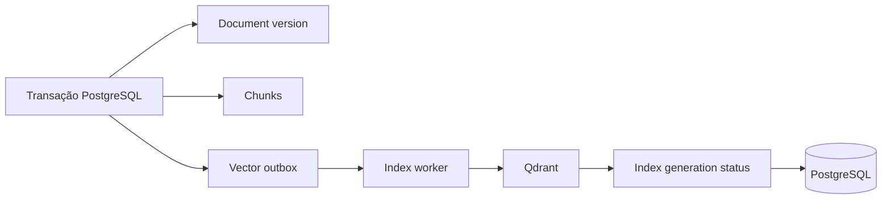
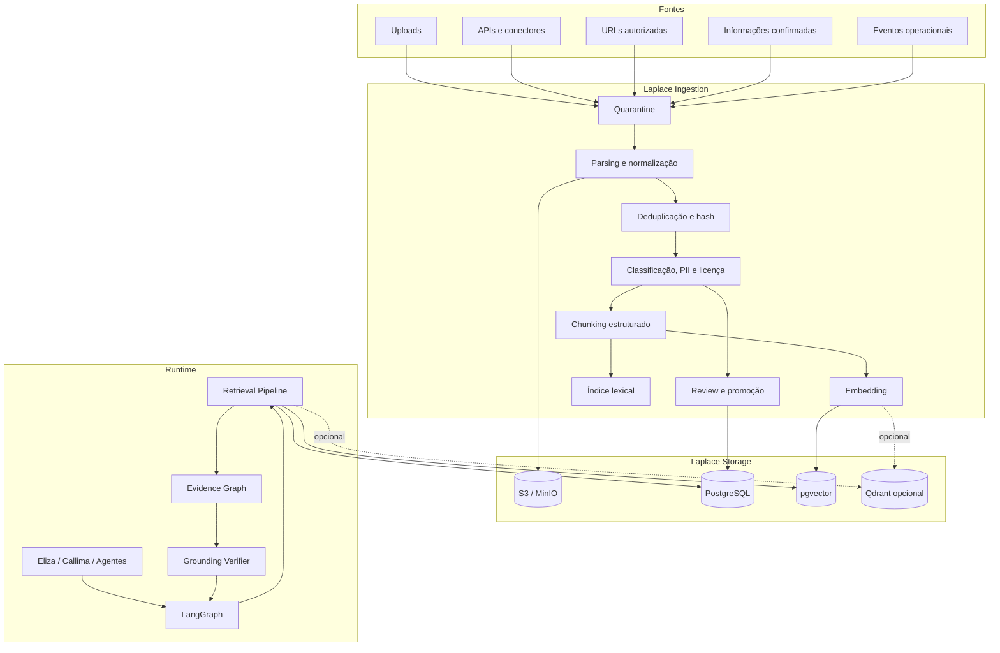
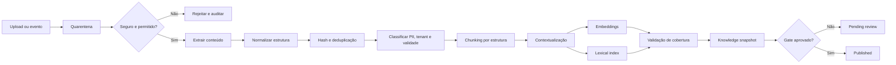
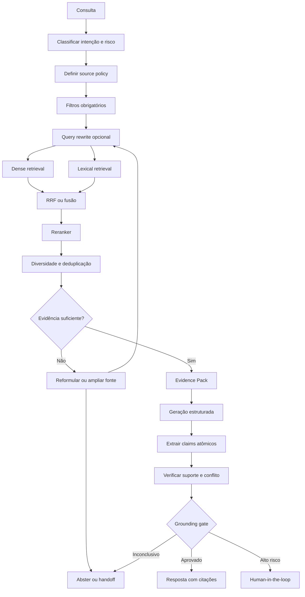
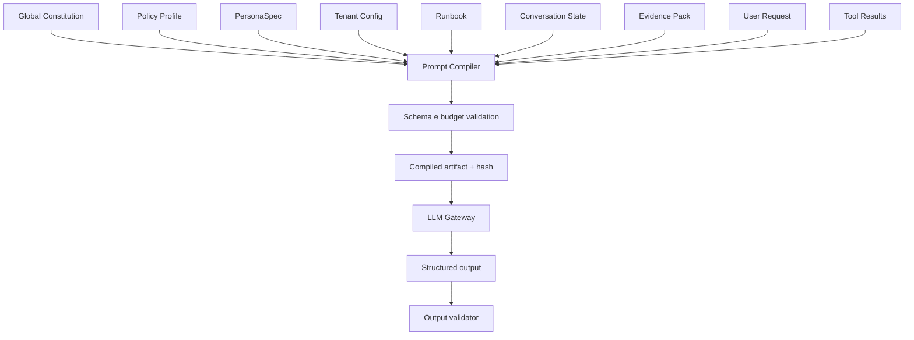
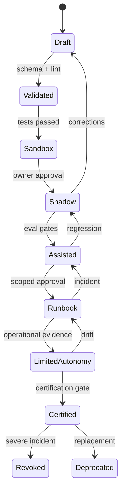
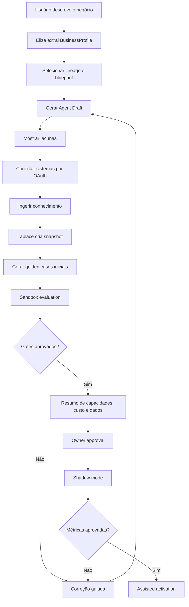
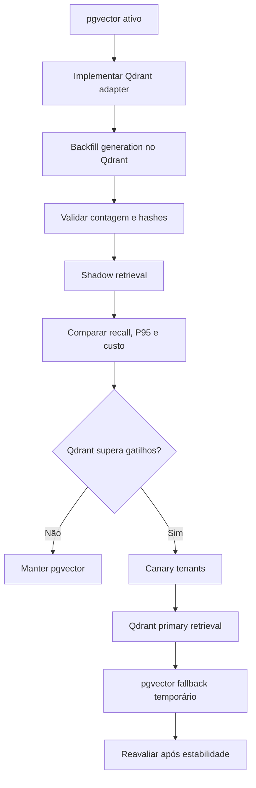

# Laplace e RAG no Ginkgo Workforce: PostgreSQL com pgvector, Qdrant e guardrails de antialucinação

## Resumo executivo

### Decisão recomendada

Para o MVP e para a primeira fase de produção com assinantes, a stack recomendada é:

```text
PostgreSQL + pgvector
+ Redis
+ S3/MinIO/R2
+ LangGraph
+ worker de ingestão
+ reranker opcional
+ Laplace Kernel
```

**Qdrant não é necessário para a primeira versão de produção.** O conjunto PostgreSQL + pgvector é suficiente para implementar:

- busca semântica;
- busca lexical;
- busca híbrida;
- filtros por tenant e metadados;
- versionamento de documentos e embeddings;
- proveniência;
- cadeia de evidências;
- full RAG;
- memória estruturada;
- lifecycle de personas;
- prompts versionados;
- onboarding automatizado;
- avaliações de factualidade;
- retenção e exclusão de dados.

Entretanto, **PostgreSQL + Redis sem pgvector não é suficiente para o Laplace completo**, salvo se a busca semântica for delegada a um serviço externo. O PostgreSQL puro pode executar busca lexical robusta, mas não fornece nativamente recuperação por embeddings. Para o desenho pretendido, `pgvector` deve deixar de ser “opcional” e tornar-se o backend vetorial padrão do Laplace v1.

O pgvector mantém os vetores junto aos dados relacionais, suporta busca exata e aproximada, HNSW, IVFFlat, diferentes métricas de distância, transações ACID, joins e recuperação point-in-time. A própria documentação recomenda combinar pgvector com o full-text search do PostgreSQL e utilizar Reciprocal Rank Fusion ou cross-encoder para busca híbrida. citeturn18search0

A recomendação definitiva é:

| Decisão | Recomendação |
|---|---|
| Fonte canônica | PostgreSQL |
| Backend vetorial inicial | pgvector |
| Busca lexical | PostgreSQL Full-Text Search |
| Busca híbrida | Dense + lexical + RRF |
| Cache, locks e filas | Redis |
| Arquivos originais | S3/MinIO/R2 |
| Estado de agentes | LangGraph com checkpointer PostgreSQL |
| Antialucinação | Laplace Grounding Pipeline, não o banco vetorial isoladamente |
| Qdrant | Backend opcional futuro, atrás de uma interface |
| Arquitetura futura | PostgreSQL canônico + Qdrant como índice derivado |
| Migração | Somente após benchmark e gatilhos objetivos |

### Conclusão central

A escolha do banco vetorial influencia latência, recall, filtros e escalabilidade, mas **não cria, por si só, um sistema antialucinação**. RAG reduz a dependência do conhecimento paramétrico e melhora factualidade e proveniência, porém uma recuperação incorreta ou insuficiente também pode induzir respostas incorretas. Os trabalhos Self-RAG e CRAG mostram justamente que recuperação indiscriminada ou de baixa qualidade pode prejudicar a geração, e que é necessário avaliar relevância, suficiência e suporte antes de responder. citeturn20academia38turn21search0turn21academia50

Portanto:

```text
Banco vetorial
    ≠
Guardrail antialucinação

Laplace completo
    =
ingestão governada
+ recuperação híbrida
+ filtros estruturados
+ reranking
+ proveniência
+ claims atômicos
+ verificação
+ thresholds
+ abstention/handoff
+ avaliações
```

A arquitetura já documentada no repositório está conceitualmente alinhada com isso. Ela define memória por escopo, estados de proveniência, promoção controlada de conhecimento, versionamento, busca lexical e vetorial, reranking, limitação de contexto e referências obrigatórias. fileciteturn1file0L19-L49 fileciteturn1file0L62-L96 fileciteturn1file0L191-L202

### O que deve mudar no repositório

Hoje, o repositório encontra-se em consolidação arquitetural e já prevê `Memory Service`, `Evaluation Service`, PostgreSQL, Redis e storage, mas ainda não possui o Laplace como bounded context executável. fileciteturn5file0L76-L92 fileciteturn5file0L124-L166

A decisão recomendada para o próximo ADR é:

> **Laplace v1 utilizará PostgreSQL + pgvector como fonte canônica e backend de retrieval. A interface de vector store será desacoplada para permitir Qdrant como índice derivado no futuro.**

## Avaliação comparativa da camada vetorial

### Visão geral

| Atributo | PostgreSQL + pgvector | Qdrant | PostgreSQL + Qdrant |
|---|---|---|---|
| Papel ideal | Banco canônico e retrieval inicial | Motor vetorial especializado | PostgreSQL canônico, Qdrant como índice |
| Latência em escala moderada | Muito boa, sem hop adicional | Muito boa e previsível para workload vetorial | Potencialmente a melhor, com hop e sincronização |
| Escalabilidade vetorial | Vertical, réplicas e particionamento; sharding exige mais engenharia | Escala horizontal orientada a shards e réplicas | Independência entre OLTP e retrieval |
| Custo incremental | Menor | Médio, pois PostgreSQL ainda será necessário | Maior |
| Complexidade operacional | Baixa a média | Média | Alta |
| Backup e restore | Unificados com dados, RLS e metadados | Snapshots próprios e restauração separada | Dois planos de DR e reconciliação |
| Consistência | ACID com documento, versão e vetor na mesma transação | Consistência configurável; não é transação relacional conjunta | PostgreSQL forte, índice vetorial eventualmente consistente |
| Isolamento multi-tenant | RLS, schemas, partições e roles | Filtros de payload, shard keys e gateway | RLS canônico + filtros obrigatórios no índice |
| Segurança | Ecossistema maduro de roles, RLS, TLS, auditoria | Precisa ser explicitamente protegido no self-hosted | Maior superfície de ataque |
| Filtros por metadados | Excelente, incluindo joins e subconsultas | Excelente para payloads indexados | Excelente, mas duplicação de metadados |
| ANN | HNSW e IVFFlat | HNSW, quantização e consultas multiestágio | Ambos disponíveis |
| Busca híbrida | FTS + vetor + RRF/cross-encoder implementado pela aplicação | Dense + sparse + fusão nativa | Qdrant para candidatos, PostgreSQL para autoridade |
| Multivector/late interaction | Possível, porém mais artesanal | Suporte mais direto a named vectors e consultas multiestágio | Bom para evolução avançada |
| Manutenção do índice | VACUUM, REINDEX, memória e parâmetros do PostgreSQL | Gestão de segmentos, shards, otimização e snapshots | Duas rotinas de manutenção |
| Versionamento de embeddings | Excelente em tabelas relacionais | Payload ou coleções separadas | PostgreSQL controla generations; Qdrant materializa |
| Retenção e GDPR | Exclusão transacional e políticas próximas à fonte | Exclusão precisa ser sincronizada e comprovada | Workflow de tombstone + purge nos dois sistemas |
| Snapshotting | pg_dump, backup físico, WAL/PITR | Snapshot por coleção/nó | Coordenar snapshot canônico e capacidade de rebuild |
| Melhor uso | MVP, early production e corpus moderado | Grande escala vetorial ou recursos avançados | Escala posterior com workload vetorial independente |

O pgvector oferece busca exata com recall perfeito e busca aproximada com HNSW ou IVFFlat. HNSW possui melhor relação velocidade-recall, mas exige mais memória e construção mais lenta; IVFFlat consome menos memória e constrói mais rapidamente, com maior sensibilidade a treinamento, listas e probes. citeturn18search0

O principal cuidado do pgvector no cenário Ginkgo é o filtro multi-tenant. Nos índices aproximados, os filtros SQL são aplicados após o scan ANN; se um tenant representa uma pequena fração dos vetores, uma busca pode retornar candidatos insuficientes. O pgvector oferece iterative scans, índices parciais e particionamento para mitigar o problema. citeturn18search0

O Qdrant tem vantagens quando o retrieval se torna um workload independente: consultas híbridas densas e esparsas, múltiplos vetores por ponto, prefetch, fusão, quantização e reranking multiestágio são expostos por uma API própria. citeturn18search1turn18search10

Por outro lado, o Qdrant self-hosted não vem seguro por padrão; autenticação, bind de rede, TLS, chaves granulares e auditoria precisam ser configurados explicitamente. citeturn18search6

### Consistência e fonte de verdade

PostgreSQL permite persistir, na mesma transação:

```text
document_version
chunk
embedding_generation
embedding
knowledge_snapshot
audit_event
```

Isso evita estados como:

```text
documento publicado sem vetor
vetor ativo de versão removida
tenant excluído com embedding restante
snapshot apontando para chunk inexistente
```

No Qdrant, as escritas podem utilizar ordenação `weak`, `medium` ou `strong`. A ordenação forte melhora a consistência, mas reduz disponibilidade quando o líder permanente está indisponível. Mesmo assim, uma escrita no PostgreSQL e outra no Qdrant não formam uma transação ACID única. citeturn19search7

Por isso, em uma arquitetura híbrida:

```text
PostgreSQL = verdade
Qdrant     = projeção reconstruível
```

A sincronização deve ocorrer por transactional outbox:



O sistema nunca deve confirmar que um knowledge snapshot está `searchable` apenas porque a transação relacional foi concluída. O estado precisa distinguir:

```text
accepted
parsed
chunked
embedded
indexed
verified
published
```

Essa separação já é coerente com o contrato do repositório, que afirma que `accepted` não significa `completed`, `queued` não significa `published` e `sent` não significa `delivered`. fileciteturn2file0L182-L203

### Backup, restauração e retenção

Com pgvector, documentos, vetores, versões e metadados participam do mesmo mecanismo de backup PostgreSQL. `pg_dump` produz um snapshot transacional consistente sem bloquear leitores e escritores; backups físicos e WAL permitem recuperação point-in-time quando configurados adequadamente. citeturn7view1turn6search7

Snapshots do Qdrant contêm configuração, pontos e payloads de uma coleção. Em clusters distribuídos, snapshots são criados por nó; aliases não são incluídos no snapshot da coleção e precisam ser restaurados separadamente. citeturn18search11

Para privacidade e retenção, o Laplace deve aplicar:

```text
pedido de exclusão
→ tombstone canônico
→ bloquear novas recuperações
→ excluir chunks e vetores ativos
→ propagar purge ao backend derivado
→ confirmar purge
→ registrar evidência
→ cumprir política de expiração de backup
```

O GDPR exige minimização, limitação de finalidade e conservação pelo tempo necessário, além do direito de apagamento quando as condições legais forem satisfeitas. Embora a operação brasileira seja regida principalmente pela LGPD, esses princípios são igualmente úteis para o desenho técnico do Workforce. citeturn20search7turn20search8

### Estimativa relativa de custo

Os valores abaixo são estimativas arquiteturais, não cotações de fornecedores.

| Opção | Infra relativa | Esforço operacional | Duplicação de storage | Adequação ao MVP |
|---|---:|---:|---:|---|
| PostgreSQL + pgvector | 1,0–1,3× | 1,0× | Não | Excelente |
| PostgreSQL + Qdrant como único índice | 1,4–1,9× | 1,4–1,8× | Sim | Desnecessária inicialmente |
| PostgreSQL + pgvector + Qdrant | 1,7–2,6× | 1,7–2,4× | Sim | Somente após escala comprovada |
| Vector DB hospedado externo | 1,5–3,0× | Menor internamente, maior dependência | Sim | Depende de volume e compliance |

O custo adicional do Qdrant não é apenas CPU e memória. Inclui:

- deploy e atualização;
- segurança adicional;
- monitoramento;
- backups;
- restore;
- sincronização;
- dead-letter;
- reconciliação;
- testes de consistência;
- procedimentos de exclusão;
- capacidade duplicada em staging e produção.

### Componentes obrigatórios

| Componente | Obrigatório no MVP | Responsabilidade |
|---|---:|---|
| PostgreSQL | Sim | Fonte canônica, documentos, versões, claims, evidências e auditoria |
| pgvector | Sim | Dense retrieval |
| PostgreSQL FTS | Sim | Lexical retrieval |
| Redis | Sim | Filas, cache, locks, debouncing; nunca conhecimento canônico |
| Object storage | Sim | Arquivos originais, extrações e artefatos |
| Laplace API | Sim | Interface governada de ingestão e recuperação |
| Ingestion worker | Sim | Parsing, chunking, embedding e publicação |
| Reranker | Recomendado | Seleção final de evidências |
| LangGraph checkpointer | Sim | Estado durável e HITL |
| Evaluation service | Sim | Golden datasets, regressão e métricas |
| Qdrant | Não | Índice vetorial especializado futuro |
| Knowledge graph dedicado | Não inicialmente | Relações avançadas futuras |

## Laplace Kernel e guardrails antialucinação

### Papel do Laplace

Laplace não deve ser uma persona, um chatbot nem apenas uma função `similaritySearch()`. Ele deve ser o **kernel de conhecimento e grounding** do Workforce.



O repositório já define corretamente que memória não é um depósito de conversas, e que uploads e clippings precisam passar por quarentena, extração, revisão, promoção e retrieval versionado. fileciteturn1file0L5-L17 fileciteturn1file0L98-L129

### Modelo de dados recomendado

```text
knowledge_sources
knowledge_documents
document_versions
document_sections
knowledge_chunks

embedding_models
embedding_generations
chunk_embeddings

knowledge_snapshots
snapshot_members

retrieval_runs
retrieval_candidates
retrieval_results

evidence_items
answer_claims
claim_evidence_links
verification_results

memory_candidates
knowledge_claims
knowledge_methods

retention_policies
deletion_requests
deletion_tombstones
```

Uma geração de embeddings deve ser imutável:

```yaml
embedding_generation:
  id: embgen_2026_08_v1
  tenant_id: tenant_123
  provider: configured-provider
  model: configured-model
  dimensions: 1536
  distance: cosine
  normalization: unit
  chunker_version: laplace-chunker-1.0.0
  contextualizer_version: contextual-header-1.0.0
  created_at: 2026-08-01T00:00:00Z
  status: building
```

Uma nova versão de modelo não sobrescreve vetores anteriores:

```text
generation A: active
generation B: building
generation B: validating
generation B: shadow
generation B: active
generation A: retired
generation A: purge-after-retention
```

### Pipeline de ingestão

O pipeline recomendado é:



**Chunking inicial recomendado**, sujeito a benchmark:

| Tipo de conteúdo | Estratégia inicial |
|---|---|
| FAQ | Uma pergunta/resposta por chunk |
| Políticas e SOPs | Heading-aware, preservando seção e subseção |
| Contratos | Cláusula e subcláusula |
| Catálogos | Produto ou variante por unidade |
| Tabelas | Linhas ou grupos semânticos, preservando cabeçalhos |
| Conversas | Resumos estruturados e fatos confirmados; não mensagens cruas por padrão |
| Documentação geral | Aproximadamente 300–700 tokens, overlap de 10–20% |
| Documentos longos | Parent-child chunks para recuperar pequeno e apresentar contexto maior |

Esses tamanhos são pontos de partida, não verdades universais. A estratégia precisa ser otimizada no corpus real. O trabalho da Anthropic sobre Contextual Retrieval reforça que chunks isolados frequentemente perdem informação sobre entidade, período e seção; combinar contexto de documento, busca lexical, embeddings e reranking reduziu falhas de recuperação nos experimentos publicados pela empresa. citeturn20search1

### Retrieval completo



A combinação de busca lexical e densa é importante porque embeddings capturam relações semânticas, enquanto mecanismos lexicais preservam nomes, códigos, números, SKUs, cláusulas e outros matches exatos. O pgvector permite a combinação com full-text search e sugere RRF ou cross-encoder; o Qdrant oferece dense+sparse e fusão nativa. citeturn18search0turn18search10

O RAG híbrido descrito pelo LangChain inclui query enhancement, validação da recuperação e validação da resposta, oferecendo mais controle que um agente que simplesmente decide chamar uma tool de busca. citeturn19search1

### Guardrails necessários

| Guardrail | Implementação |
|---|---|
| Tenant obrigatório | Filtro server-side e RLS antes de qualquer retrieval |
| Source policy | Define quais classes de fonte podem responder a cada intenção |
| Validade temporal | `valid_from`, `valid_until`, `superseded_at` |
| Proveniência | Documento, versão, página, seção, offset e hash |
| Evidence sufficiency | Exige cobertura mínima dos pontos solicitados |
| Claim decomposition | Divide a resposta em afirmações verificáveis |
| Claim-to-evidence | Liga cada afirmação a uma ou mais evidências |
| Contradiction detection | Detecta conflito entre fontes e entre resposta e evidência |
| Confidence gate | Combina retrieval, reranking, suporte, autoridade e atualidade |
| Abstention | Responde “não confirmado” em vez de completar lacunas |
| HITL | Encaminha claims sensíveis ou conflitantes |
| Schema validation | Rejeita outputs fora do contrato |
| Idempotência | Impede duplicação de ações após geração |
| Tool result semantics | Não transforma `accepted` em `completed` |
| Prompt injection boundary | Conteúdo recuperado permanece dado não confiável |
| Audit trail | Registra query, candidatos, evidências, prompt e versão |
| Retention gate | Exclui material expirado antes da busca |
| Revalidation | Reavalia resposta após alteração de knowledge snapshot |

A “cadeia de evidências” deve ser um grafo auditável, não a cadeia privada de raciocínio do modelo:

```text
answer
└── claim_1
    ├── evidence_chunk_14
    │   └── document_version_3
    │       └── source_upload_7
    └── connector_event_82
        └── calendar_provider
```

Exemplo de contrato:

```json
{
  "answer_id": "ans_123",
  "knowledge_snapshot_id": "ks_2026_08_01",
  "claims": [
    {
      "claim_id": "claim_1",
      "text": "A empresa atende de segunda a sexta, das 8h às 18h.",
      "status": "supported",
      "confidence": 0.98,
      "evidence": [
        {
          "evidence_id": "ev_14",
          "source_ref": "document:policy-9:v3:section-2",
          "authority": "tenant_approved_policy",
          "retrieval_score": 0.84,
          "rerank_score": 0.93
        }
      ]
    }
  ],
  "unsupported_claims": [],
  "verification_status": "passed"
}
```

O valor `confidence` não deve ser a distância vetorial convertida em porcentagem. Deve combinar, por código:

```text
retrieval relevance
+ reranker relevance
+ fonte autorizada
+ cobertura do claim
+ atualidade
+ ausência de contradição
+ resultado do verifier
```

O próprio documento de memória do Workforce já estabelece que confiança não transforma hipótese em fato e que `verified` requer fonte autorizada. fileciteturn1file0L74-L96

### Política de resposta

| Estado | Comportamento |
|---|---|
| Evidência forte e não conflitante | Responder e citar |
| Evidência parcial | Responder somente à parte sustentada |
| Evidência ausente | Declarar que não há informação confirmada |
| Fontes conflitantes | Mostrar conflito ou encaminhar |
| Fato operacional | Consultar a fonte transacional autorizada |
| Informação sensível | Aplicar policy e possível HITL |
| Pergunta criativa | Permitir geração sem grounding factual rígido, marcando o modo |
| Ação externa | Grounding não autoriza execução; passar pelo Skill Engine |

Self-RAG demonstra que recuperar sempre um número fixo de passagens pode introduzir conteúdo irrelevante; CRAG propõe avaliar a qualidade do retrieval e executar caminhos corretivos. A implementação Ginkgo não precisa reproduzir esses modelos literalmente, mas deve incorporar o padrão arquitetural: **avaliar necessidade, relevância, suficiência e suporte**. citeturn21search0turn21academia50

## Arquitetura de prompts, soul.md e onboarding

### Prompt architecture

A arquitetura existente do Workforce já define uma ordem correta:

```text
Global Constitution
> Domain Policy
> Persona Contract
> Tenant Configuration
> Runbook/Campaign
> Conversation State
> Retrieved Evidence
> Current Request
> Tool Results
```

As camadas inferiores não podem alterar as superiores. fileciteturn2file0L5-L23

O compilador deve materializar isso assim:



Há três classes de prompt:

| Classe | Quem controla | Editável pelo usuário | Exemplo |
|---|---|---:|---|
| Constituição interna | Ginkgo | Não | isolamento, evidência, tools e segurança |
| Prompt de domínio/persona | Ginkgo e versões certificadas | Parcialmente por slots | Callima, Nyra, Alfred |
| Template do tenant | Owner/admin | Sim, dentro de schema | tom, abertura, FAQs, CTA |
| Conteúdo de sessão | Runtime | Não diretamente | estado, evidências e tool results |
| Mensagem do usuário | Usuário final | Sim | solicitação atual |

O conteúdo fornecido pelo usuário não pode ser concatenado livremente dentro do system prompt. Campos editáveis devem possuir:

```yaml
slot:
  id: brand_tone
  type: enum
  allowed:
    - formal
    - friendly
    - concise
  max_tokens: 80
  trust: tenant-authored
  may_define_tools: false
  may_override_policy: false
```

Cada build deve produzir:

```yaml
prompt_artifact:
  id: callima-response
  version: 2.4.1
  compiled_hash: sha256:...
  constitution_version: 1.2.0
  persona_version: callima-2.0.0
  policy_version: customer-facing-3.1.0
  knowledge_snapshot_mode: runtime
  model_compatibility:
    - balanced-chat
    - premium-chat
  estimated_static_tokens: 1850
  max_dynamic_tokens: 6000
  tests:
    suite: callima-response-2.4
    status: passed
  status: signed
```

Prompts em produção devem ser tratados como artefatos versionados, revisáveis e testáveis, não como strings editadas diretamente. A orientação oficial da OpenAI para aplicações de produção também enfatiza prompts armazenados em código ou sistemas versionados, schemas tipados, fixtures, avaliações e rollout controlado. citeturn13view3

O repositório já prevê lint, resolução de dependências, compilação, budget de contexto, testes, model matrix, sandbox, shadow, artefato assinado e deploy. fileciteturn2file0L221-L246

### Token budgeting

O budget deve ser calculado antes da inferência:

```text
limite do modelo
- reserva para output
- constituição
- policy
- persona
- estado mínimo
- instrução atual
= budget máximo de evidências
```

Configuração proposta:

```yaml
context_budget:
  max_total_tokens: 16000
  reserve_output_tokens: 1800

  static:
    constitution_max: 900
    policy_max: 700
    persona_max: 900
    runbook_max: 1200

  dynamic:
    conversation_max: 2500
    evidence_max: 6000
    tool_results_max: 1500

  overflow:
    strategy:
      - remove_low_ranked_evidence
      - compress_old_conversation
      - preserve_current_request
      - preserve_policy_and_persona
    fail_if_policy_truncated: true
```

A compactação nunca deve remover:

- Constituição;
- policy;
- tenant e actor context;
- restrições de tools;
- evidências vinculadas a claims críticos;
- aprovações;
- estado de efeito externo.

### Especificação de `soul.md`

`soul.md` faz sentido como formato humano de autoria, mas não deve ser o artefato executado diretamente.

```text
soul.md
→ parser
→ PersonaSpec validado
→ policy binding
→ evals
→ immutable persona version
→ deployment
```

O arquivo pode usar front matter:

```markdown
---
apiVersion: workforce.ginkgo.ai/v1
kind: PersonaSoul
id: callima
version: 2.1.0
lineage: callima
owner: ginkgo
status: draft
language: pt-BR
role: customer_relationship_agent
policyProfile: customer-facing-standard
---

# Missão

Atender contatos, responder com base em conhecimento autorizado,
coletar o próximo dado necessário e transferir quando houver risco.

# Objetivos

- entender a necessidade;
- preservar continuidade;
- consultar fontes autorizadas;
- executar runbooks aprovados;
- realizar handoff com contexto.

# Não objetivos

- decidir política comercial;
- conceder desconto;
- afirmar pagamento sem confirmação;
- editar ferramentas ou permissões.

# Estilo

- profissional e humano;
- breve;
- uma ideia por mensagem;
- uma pergunta por vez;
- clareza acima de charme.

# Política de evidência

Fatos operacionais exigem fonte autoritativa.
Ausência de evidência produz abstention ou handoff.

# Memória

Somente fatos confirmados podem ser promovidos.
Inferências produzem memory candidates.

# Escalonamento

- baixa confiança;
- conflito entre fontes;
- tema sensível;
- duas falhas consecutivas de tool.
```

O compilador transforma esse conteúdo em:

```yaml
persona_spec:
  identity:
    id: callima
    lineage: callima
    version: 2.1.0

  mission:
    role: customer_relationship_agent
    objectives: [...]
    non_goals: [...]

  communication:
    language: pt-BR
    tone: professional-human-concise
    one_question_at_a_time: true

  evidence_policy:
    operational_facts: authoritative_source_required
    no_evidence: abstain_or_handoff

  memory_policy:
    canonical_write: confirmed_only
    inferred_write: candidate_only

  requested_tools:
    - knowledge.search
    - crm.contact.upsert
    - calendar.availability.search

  escalation:
    low_confidence: human
    source_conflict: human

  audit:
    source_file_hash: sha256:...
    compiler_version: persona-compiler-1.0.0
```

**Requested tools não são grants.** O Agent Package Specification atual já separa persona, tool requests, deployment grants e autorização real. fileciteturn3file0L96-L107 fileciteturn3file0L168-L187

### Lifecycle da persona



O lifecycle já definido no repositório vai de Draft a Certified e exige evidência operacional, policy compliance e aprovação humana; ele também permite rebaixamento automático em caso de violação, custo anormal, falhas ou ausência de telemetria. fileciteturn4file0L5-L32 fileciteturn4file0L252-L284

### Onboarding automatizado



O onboarding deve produzir artefatos, não apenas uma conversa:

| Etapa | Artefato |
|---|---|
| Descoberta | `BusinessProfile` |
| Seleção | `AgentBlueprintRef` |
| Persona | `PersonaDraft` |
| Regras | `PolicyBindingDraft` |
| Tools | `RequestedCapabilities` |
| Conhecimento | `KnowledgeIngestionPlan` |
| Custo | `CreditBudgetProposal` |
| Testes | `EvaluationPlan` |
| Ativação | `DeploymentCandidate` |
| Aprovação | `OwnerApprovalEvent` |
| Shadow | `ShadowEvaluationReport` |

A arquitetura atual já adota exatamente a tese “conversa → intenção estruturada → draft → conexão → ingestão → sandbox → resumo de permissões e custo → aprovação → ativação gradual”. fileciteturn3file0L226-L239

LangGraph é adequado para esse processo porque sua persistência salva checkpoints por thread, possibilitando retomada, human-in-the-loop, time travel e recuperação após falhas. Em produção, o checkpointer deve ser persistente, como o PostgreSQL. citeturn19search0turn19search2

## Plano de implementação e infraestrutura

### Estrutura proposta no monorepo

```text
packages/
├── laplace-kernel/
│   ├── src/
│   │   ├── ingestion/
│   │   ├── chunking/
│   │   ├── embeddings/
│   │   ├── retrieval/
│   │   ├── fusion/
│   │   ├── reranking/
│   │   ├── grounding/
│   │   ├── verification/
│   │   └── retention/
│   └── tests/
│
├── knowledge-registry/
├── prompt-compiler/
├── persona-registry/
├── evaluation-service/
├── vector-store/
│   ├── contract.ts
│   ├── pgvector.ts
│   └── qdrant.ts
│
├── contracts/
│   ├── knowledge/
│   ├── retrieval/
│   ├── evidence/
│   ├── prompt/
│   └── persona/
│
apps/
├── workforce-api/
├── workforce-worker/
└── workforce-console/
```

Interface de backend:

```typescript
export interface VectorIndex {
  upsert(input: {
    tenantId: string;
    generationId: string;
    chunks: EmbeddedChunk[];
    idempotencyKey: string;
  }): Promise<IndexReceipt>;

  search(input: {
    tenantId: string;
    workspaceId?: string;
    generationId: string;
    queryVector: number[];
    filters: RetrievalFilters;
    limit: number;
  }): Promise<VectorCandidate[]>;

  delete(input: {
    tenantId: string;
    chunkIds: string[];
    idempotencyKey: string;
  }): Promise<DeletionReceipt>;

  health(): Promise<VectorIndexHealth>;
}
```

Nenhum agente, workflow n8n ou persona deve saber se o backend ativo é pgvector ou Qdrant.

### Configuração Laplace

```yaml
laplace:
  canonical_store: postgres
  object_store: s3

  vector_backend:
    provider: pgvector
    generation: embgen-default-v1
    distance: cosine
    index:
      type: hnsw
      iterative_scan: strict_order

  lexical_backend:
    provider: postgres_fts
    language_profiles:
      - pt-BR
      - en

  retrieval:
    dense_candidates: 40
    lexical_candidates: 40
    fused_candidates: 30
    reranked_candidates: 12
    final_evidence_chunks: 8
    fusion:
      type: reciprocal_rank_fusion
      rrf_k: 60

  grounding:
    require_source_refs: true
    decompose_claims: true
    verify_claim_support: true
    detect_contradictions: true
    abstain_on_insufficient_evidence: true

  tenancy:
    tenant_filter_required: true
    workspace_filter_required_when_present: true
    fail_closed: true

  retention:
    enforce_validity_windows: true
    deletion_tombstones: true

  observability:
    log_retrieval_candidates: redacted
    store_prompt_hash: true
    store_knowledge_snapshot: true
```

### PostgreSQL e pgvector

```yaml
services:
  postgres:
    image: ${PGVECTOR_IMAGE:?Use uma tag ou digest fixo}
    restart: unless-stopped
    environment:
      POSTGRES_DB: ${POSTGRES_DB}
      POSTGRES_USER: ${POSTGRES_USER}
      POSTGRES_PASSWORD_FILE: /run/secrets/postgres_password
    volumes:
      - postgres_data:/var/lib/postgresql/data
      - ./infrastructure/postgres/init:/docker-entrypoint-initdb.d:ro
    secrets:
      - postgres_password
    healthcheck:
      test: ["CMD-SHELL", "pg_isready -U ${POSTGRES_USER} -d ${POSTGRES_DB}"]
      interval: 10s
      timeout: 5s
      retries: 10
    networks:
      - data
    deploy:
      resources:
        limits:
          memory: 8G
```

Inicialização:

```sql
CREATE EXTENSION IF NOT EXISTS vector;
CREATE EXTENSION IF NOT EXISTS pg_trgm;
```

Tabela simplificada:

```sql
CREATE TABLE chunk_embeddings (
    id uuid PRIMARY KEY,
    tenant_id uuid NOT NULL,
    workspace_id uuid,
    chunk_id uuid NOT NULL,
    embedding_generation_id uuid NOT NULL,
    embedding vector(<DIMENSIONS>) NOT NULL,
    created_at timestamptz NOT NULL DEFAULT now(),
    deleted_at timestamptz,

    UNIQUE (
        tenant_id,
        chunk_id,
        embedding_generation_id
    )
);

CREATE INDEX CONCURRENTLY chunk_embeddings_hnsw_cosine
ON chunk_embeddings
USING hnsw (embedding vector_cosine_ops);

CREATE INDEX chunk_embeddings_tenant_generation
ON chunk_embeddings (
    tenant_id,
    embedding_generation_id
)
WHERE deleted_at IS NULL;
```

O tipo `vector` do pgvector suporta até 2.000 dimensões; `halfvec` suporta até 4.000. A dimensão do modelo de embeddings escolhido precisa ser verificada no ADR, e modelos acima do limite do tipo `vector` exigirão `halfvec`, redução de dimensão ou outro backend. citeturn18search0

RLS:

```sql
ALTER TABLE chunk_embeddings ENABLE ROW LEVEL SECURITY;
ALTER TABLE chunk_embeddings FORCE ROW LEVEL SECURITY;

CREATE POLICY chunk_embeddings_tenant_policy
ON chunk_embeddings
USING (
    tenant_id = current_setting('app.tenant_id', true)::uuid
)
WITH CHECK (
    tenant_id = current_setting('app.tenant_id', true)::uuid
);
```

Cada transação deve configurar o tenant no servidor:

```sql
BEGIN;
SET LOCAL app.tenant_id = '00000000-0000-0000-0000-000000000001';
SELECT ...;
COMMIT;
```

O role da aplicação não deve ser owner da tabela nem possuir `BYPASSRLS`. Quando RLS está habilitado e nenhuma policy se aplica, o PostgreSQL assume default deny; owners e roles privilegiados requerem cuidado especial. citeturn7view0

### Qdrant opcional por profile

```yaml
services:
  qdrant:
    profiles: ["qdrant"]
    image: ${QDRANT_IMAGE:?Use uma tag ou digest fixo}
    restart: unless-stopped
    expose:
      - "6333"
    environment:
      QDRANT__SERVICE__API_KEY: ${QDRANT_API_KEY}
      QDRANT__TELEMETRY_DISABLED: "true"
    volumes:
      - qdrant_data:/qdrant/storage
      - qdrant_snapshots:/qdrant/snapshots
    networks:
      - vector
    read_only: true
    tmpfs:
      - /tmp
    cap_drop:
      - ALL
    security_opt:
      - no-new-privileges:true
    deploy:
      resources:
        limits:
          memory: 8G
```

Em produção:

- nenhuma porta pública;
- acesso somente pelo Laplace;
- API key ou JWT granular;
- TLS quando houver tráfego entre hosts;
- backup e restore testados;
- filesystem persistente limitado aos volumes;
- usuário não privilegiado;
- rotação de chave;
- logs de auditoria.

Esses controles não são opcionais: a documentação do Qdrant alerta que instâncias open-source self-hosted não são seguras por padrão. citeturn18search6

### Etapas de implementação

| Prioridade | Etapa | Entrega | Critério de conclusão |
|---|---|---|---|
| P0 | ADR do Laplace | Decisão pgvector default, Qdrant optional | ADR aprovado |
| P0 | Contratos | Schemas de source, document, chunk, retrieval e evidence | Typecheck e schemas |
| P0 | Data model | Tabelas, RLS, retention e embedding generations | Testes cross-tenant |
| P0 | Ingestion pipeline | Upload → quarantine → parse → chunk → embed | Documento publicável |
| P0 | Retrieval lexical | PostgreSQL FTS por tenant e validade | Golden retrieval |
| P0 | Retrieval vetorial | pgvector exato e HNSW | Recall benchmark |
| P0 | Busca híbrida | Dense + lexical + RRF | Superior a cada retriever isolado |
| P0 | Evidence contracts | Claims, evidências e source refs | Auditável por resposta |
| P0 | Grounding gate | Suficiência, suporte, conflito e abstention | Zero claims críticos sem fonte |
| P0 | Prompt compiler | Artefato imutável, hash e budget | CI operacional |
| P0 | Persona compiler | `soul.md` → PersonaSpec | Versionamento e rollback |
| P0 | Onboarding graph | Draft → knowledge → tests → shadow | Vertical slice |
| P1 | Reranker | Cross-encoder ou serviço compatível | Ganho medido no corpus |
| P1 | Contextual chunks | Headers e contexto documental | Redução de retrieval failures |
| P1 | Evaluation service | Golden datasets e regression suite | Gate no CI |
| P1 | Observabilidade | Traces, retrieval runs, custo e P95 | Dashboard e alertas |
| P1 | Deletion workflow | Tombstone, purge e evidência | Drill de exclusão |
| P1 | Restore drill | PostgreSQL, objects e configs | RPO/RTO comprovados |
| P2 | Qdrant benchmark | Implementar adapter e carga espelhada | Relatório A/B |
| P2 | Dual-index migration | Outbox e shadow reads | Consistência medida |
| P2 | Qdrant production | Somente se gatilhos forem atendidos | Go/no-go aprovado |

### Migração futura para Qdrant



A migração nunca deve ser um dual-write síncrono no request principal. O padrão é:

```text
transação PostgreSQL
→ outbox
→ index worker
→ Qdrant upsert idempotente
→ verification
→ generation indexed
```

## Testes, métricas e decisão sobre Qdrant

### Matriz de testes

| Categoria | Teste | Métrica ou assert |
|---|---|---|
| Retrieval | Dense contra ground truth | Recall@k, Precision@k, MRR, nDCG |
| ANN | HNSW contra busca exata | ANN Recall@k |
| Lexical | Nomes, SKUs, cláusulas e códigos | Exact-match success |
| Hybrid | Dense vs lexical vs fusion | Delta de Recall@n e nDCG |
| Filters | Tenant, workspace, validade e sensitivity | Zero item fora do filtro |
| Reranker | Ordenação final | nDCG e Precision@k |
| Chunking | Estratégias por tipo documental | Retrieval success por domínio |
| Grounding | Claims suportados | Claim support rate |
| Hallucination | Claims sem evidência | Unsupported claim rate |
| Citation | Evidência realmente sustenta claim | Citation precision |
| Coverage | Claims relevantes com evidência | Citation coverage |
| Factuality | Correção externa | Factual accuracy |
| Faithfulness | Alinhamento ao contexto | Answer faithfulness |
| Contradição | Fontes incompatíveis | Conflict detection recall |
| Abstention | Ausência de informação | Correct refusal/abstention |
| Prompt injection | Instrução maliciosa em documento | Zero policy override |
| Multi-tenant | Tenant A tenta recuperar B | Zero vazamento |
| Persona | Consistência e limites | Persona eval score |
| Prompt CI | Diff de prompt/modelo | Regression pass |
| Onboarding | Configuração incompleta | Gate bloqueia ativação |
| Idempotência | Retry de ingestão | Uma versão e um índice |
| Exclusão | Delete + reindex + cache | Zero retrieval após SLA |
| Backup | Restore completo | RPO/RTO |
| Performance | Carga concorrente realista | P50/P95/P99 |
| Manutenção | Reindex/vacuum/rebuild | Duração e degradação |
| Drift | Novo modelo de embedding | Delta de métricas |
| HITL | Claim ou ação sensível | Pause/resume consistente |

A documentação oficial do pgvector recomenda monitorar recall comparando os resultados aproximados com busca exata. citeturn18search0

ARES avalia sistemas RAG nas dimensões de relevância do contexto, faithfulness da resposta e relevância da resposta, utilizando amostras humanas para calibrar os avaliadores. RAGChecker complementa esse modelo com diagnóstico fino dos módulos de retrieval e geração. citeturn21academia48turn21academia49

O Evaluation Service do Workforce deve seguir a mesma filosofia: model judges podem ajudar, mas não devem ser a única fonte. O repositório já exige asserts determinísticos, comparação com eventos externos, regras de policy, revisão humana amostral e golden datasets por domínio. fileciteturn4file0L189-L239

### Targets iniciais propostos

Estes são gates de engenharia iniciais, a serem recalibrados com o corpus real:

| Métrica | Gate inicial |
|---|---:|
| Vazamento cross-tenant | 0 |
| Claims críticos sem suporte | 0 |
| Schema validation | 100% |
| Citation precision | ≥ 98% |
| Citation coverage em respostas factuais | ≥ 95% |
| ANN Recall@10 contra exact search | ≥ 95% |
| Retrieval Recall@10 no golden set | ≥ 90% |
| Correct abstention | ≥ 95% |
| Prompt-injection policy bypass | 0 |
| Retrieval P95 sem reranker externo | ≤ 400 ms |
| Retrieval P95 com reranker | ≤ 800 ms |
| Ingestão idempotente | 100% |
| Exclusão dentro do SLA | 100% |
| Knowledge snapshot inconsistente | 0 |
| Restore drills | 100% aprovados |
| Runs com prompt e snapshot identificáveis | 100% |

“Hallucination rate” precisa ser decomposto:

```text
unsupported_claim_rate
contradicted_claim_rate
incorrect_citation_rate
missing_citation_rate
false_completion_rate
false_operational_fact_rate
```

Uma resposta pode ser fiel a uma fonte errada; portanto factualidade externa e faithfulness ao contexto precisam ser medidas separadamente.

### Observabilidade mínima por retrieval

```json
{
  "retrieval_run_id": "ret_123",
  "tenant_id": "tenant_123",
  "query_hash": "sha256:...",
  "knowledge_snapshot_id": "ks_42",
  "embedding_generation_id": "embgen_7",
  "vector_backend": "pgvector",
  "lexical_candidates": 40,
  "dense_candidates": 40,
  "fused_candidates": 30,
  "reranked_candidates": 12,
  "evidence_selected": 8,
  "retrieval_latency_ms": 132,
  "rerank_latency_ms": 91,
  "filters": {
    "workspace_id": "leaf_123",
    "valid_at": "2026-07-30T14:00:00Z"
  },
  "abstention": false
}
```

### Checklist go/no-go para Qdrant

**Continuar com pgvector** quando:

- os SLOs de recall e P95 forem atendidos;
- o corpus e a concorrência permanecerem controláveis;
- o índice HNSW couber adequadamente na memória;
- filtros por tenant funcionarem com iterative scans, índices ou particionamento;
- manutenção não prejudicar o OLTP;
- a equipe ainda estiver consolidando o MVP;
- backup e restore unificados forem uma vantagem relevante;
- não houver necessidade real de multivector, sparse vectors nativos ou consultas multiestágio.

**Iniciar um spike Qdrant** quando pelo menos dois destes sinais forem observados:

- retrieval passa a competir com transações do Workforce;
- crescimento do HNSW aumenta excessivamente memória, VACUUM ou REINDEX;
- filtros multi-tenant reduzem recall apesar de tuning e particionamento;
- a carga exige escalabilidade independente do PostgreSQL;
- dense+sparse, multivector ou reranking multiestágio tornam-se requisitos centrais;
- rebuild do índice não cabe na janela operacional;
- réplicas de leitura do PostgreSQL não entregam o throughput necessário;
- corpus, QPS ou concorrência crescem uma ordem de grandeza;
- equipes de produto e dados precisam evoluir retrieval sem alterar o banco OLTP.

**Aprovar Qdrant para produção** somente se o benchmark demonstrar pelo menos um ganho material, por exemplo:

```text
≥ 25% menor P95 no mesmo recall
ou
≥ 5 pontos percentuais de Recall@10 na mesma latência
ou
isolamento completo do impacto sobre o OLTP
ou
recurso obrigatório inviável no pgvector
```

Além disso, todos os gates abaixo devem estar aprovados:

```text
[ ] adapter VectorIndex concluído
[ ] backfill idempotente
[ ] outbox e dead-letter funcionando
[ ] reconciliação por hash e contagem
[ ] filtro tenant obrigatório e testado
[ ] API sem exposição pública
[ ] autenticação e TLS configurados
[ ] snapshots e restore testados
[ ] workflow de exclusão sincronizado
[ ] shadow retrieval por período suficiente
[ ] fallback documentado
[ ] custo adicional aprovado
[ ] runbook de incidente
```

### TODOs priorizados para o repositório

| Prioridade | TODO |
|---|---|
| P0 | Criar ADR `Laplace vector backend` aprovando pgvector como default |
| P0 | Alterar a documentação de “pgvector opcional” para “pgvector obrigatório ou vector backend equivalente” |
| P0 | Criar `packages/laplace-kernel` |
| P0 | Criar contrato `VectorIndex` desacoplado |
| P0 | Criar schemas de documento, chunk, embedding generation e snapshot |
| P0 | Implementar RLS e testes cross-tenant |
| P0 | Implementar ingestão idempotente e versionada |
| P0 | Implementar PostgreSQL FTS + pgvector + RRF |
| P0 | Implementar Evidence Pack, claims e links de proveniência |
| P0 | Implementar grounding gate e abstention |
| P0 | Criar golden dataset inicial da Callima |
| P0 | Criar Prompt Compiler e Persona Compiler |
| P0 | Formalizar `soul.md` como source format, não runtime artifact |
| P0 | Integrar Laplace ao onboarding da Eliza |
| P1 | Adicionar reranker e contextual chunks |
| P1 | Implementar knowledge snapshot por deployment |
| P1 | Implementar re-embedding em shadow mode |
| P1 | Criar retention/deletion pipeline |
| P1 | Criar dashboard de retrieval e factualidade |
| P1 | Executar restore e deletion drills |
| P1 | Medir custo em Ginkgo Credits por ingestão e retrieval |
| P2 | Implementar Qdrant adapter |
| P2 | Criar benchmark pgvector × Qdrant |
| P2 | Implementar dual-index por outbox |
| P2 | Promover Qdrant somente após go/no-go |

### Veredito final

```text
PostgreSQL + Redis sem pgvector:
insuficiente para o Laplace semântico completo

PostgreSQL + pgvector + Redis + object storage:
suficiente e recomendado para MVP e early production

Qdrant:
não necessário agora

Qdrant no futuro:
válido como índice derivado quando benchmarks demonstrarem necessidade
```

A principal prioridade não é adicionar outro banco. É implementar corretamente:

```text
Laplace Kernel
├── Knowledge Registry
├── Ingestion Pipeline
├── Embedding Generations
├── Hybrid Retriever
├── Reranker
├── Evidence Graph
├── Grounding Verifier
├── Retention Engine
└── Evaluation Service
```

O desenho mais seguro, econômico e reversível para o Ginkgo Workforce é começar com pgvector, manter PostgreSQL como autoridade e construir a abstração necessária para que Qdrant possa ser introduzido posteriormente sem alterar personas, prompts, agentes ou contratos de knowledge retrieval.