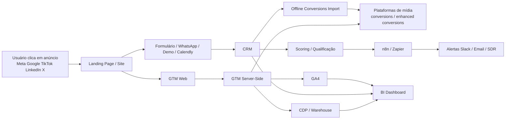
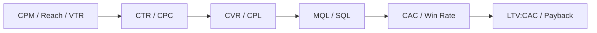

# Anúncios e Tráfego Pago e Orgânico para a Ginkgo

## Resumo executivo

Para a Ginkgo, a lógica de escala não é “achar o criativo mágico”; é construir um sistema de aquisição que combine intenção, atenção, confiança e mensuração. Em termos práticos, isso significa usar **Google Search** para capturar demanda existente, **Meta e TikTok** para gerar demanda e testar ângulos criativos rapidamente, **LinkedIn** para qualificar pipeline B2B de maior ticket, **YouTube** para educar e aumentar lembrança de marca, e **programática/native/áudio** como camadas de alcance incremental e remarketing qualificado. Plataformas com mais automação hoje recompensam mais quem alimenta o algoritmo com **dados próprios, criativos variados e feedback de CRM** do que quem hipersegmenta demais desde o primeiro dia. citeturn27view2turn27view1turn16search6turn24view0turn28view2

Os formatos vencedores seguem um padrão: **vídeo vertical curto** para descoberta e teste de ganchos, **carrossel** para narrativa modular e prova, **search** para intenção explícita, **vídeo long-form** para educação e autoridade, **documentos/lead forms** para B2B, e **áudio** para frequência incremental em contextos de escuta. No ecossistema Google, Shorts ads performam melhor com vídeo vertical, som ligado, criativo social-first e menos de 60 segundos; no TikTok, criativos “TikTok-first” capturam mais atenção e geram mais ação; no LinkedIn, vídeos curtos abaixo de 30 segundos tendem a elevar completions, enquanto conteúdos mais densos e Document Ads funcionam melhor para consideração e geração de leads. citeturn24view1turn24view0turn24view2turn30view0

A régua de performance precisa ser por estágio do funil. **CTR** mede atrito entre mensagem e audiência; **CVR** mede aderência da oferta e da landing page; **CPA/CAC** mede eficiência econômica; **ROAS** faz mais sentido em e-commerce e ofertas com receita transacional curta; e **LTV:CAC** é decisivo para SaaS e serviços B2B. Em landing pages, a mediana geral de conversão reportada pela Unbounce foi **6,6%**; em Search Ads, benchmark consolidado recente da WordStream aponta média de **CTR 6,66%**, **CPC US$ 5,26** e **CVR 7,52%**; em e-commerce, a Polar Analytics mostra diferenças enormes por vertical, com **CAC e ROAS variando materialmente por categoria**. Isso reforça que benchmark é GPS, não piloto automático. citeturn39view2turn7search8turn39view3

Para a Ginkgo, assumindo uma oferta **B2B de automação com IA, n8n, agentes e eficiência operacional**, a estratégia mais racional nos primeiros 90 dias é um modelo de **full-funnel enxuto**: Search + Remarketing + LinkedIn ABM light + Meta/TikTok creator-style para educação/dor/prova + orgânico sincronizado com paid. Com orçamento inicial de **R$ 30.000/mês**, isso equivale a aproximadamente **US$ 5.868/mês** usando **1 USD = R$ 5,1126** no momento desta resposta. A meta inicial não deve ser “ROAS bonito para screenshot”, e sim: gerar volume de sinais suficientes para o algoritmo e para o time aprender quais dores, segmentos, provas e formatos viram reunião qualificada e oportunidade. citeturn14search14turn20calculator0

## Panorama de canais, formatos e métricas

A escolha de plataforma deve seguir a física do comportamento do usuário. **Google** opera melhor onde existe busca explícita e demanda latente; **Meta** domina descoberta baseada em feed e retargeting com excelente escala; **TikTok** acelera atenção e prova social nativa; **LinkedIn** é o motor de precisão profissional; **X** funciona melhor em contexto de tempo real, comunidade e topicalidade; **YouTube** entrega profundidade e cobertura multimodal; **programática/DSP** compra alcance e frequência com governança; e **native** encaixa bem para conteúdo e consideração em ambientes editoriais. citeturn27view2turn16search18turn36view0turn28view0turn31view0turn32search7turn32search3

### Tabela comparativa de plataformas

As classificações de **custo**, **escala** e **maturidade de targeting** abaixo são qualitativas e servem para planejamento. Elas sintetizam documentação oficial de formatos/targeting, dinâmica de leilão e benchmarks de mercado; na prática, variam por geo, categoria, criativo, oferta e estágio de conta. citeturn28view2turn27view2turn36view0turn31view0turn32search7turn32search2

| Plataforma | Custo típico | Escala | Maturidade de targeting | Formatos fortes | Quando usar | Melhores práticas |
|---|---|---:|---:|---|---|---|
| **Meta** | Médio | Muito alta | Alta | Reels, Stories, Feed, Carousel, Lead Ads, Click-to-Message | Geração de demanda, remarketing, social commerce, D2C, topo e meio de funil | Reels com vídeo vertical; Stories com cenas curtas; carrossel para narrativa/prova; Advantage+ audience para maioria dos tipos de campanha, exceto retargeting mais estrito; localização quando a tese for local. citeturn16search9turn16search1turn16search2turn16search6turn16search25 |
| **Google Search / Demand Gen / YouTube** | Médio a alto em intenção; médio em vídeo | Muito alta | Muito alta em intenção; alta em automação | Search, RSA, Demand Gen, Shorts, in-stream, Display | Captura de demanda, expansão de intenção, vídeo full-funnel, remarketing | Search com RSAs fortes e múltiplos assets; Demand Gen com criativo variado; Shorts com 9:16, som e criativo social-first; usar modelos de atribuição e Smart Bidding com base em conversões robustas. citeturn27view3turn27view2turn24view1turn27view4turn27view1 |
| **TikTok** | Baixo a médio | Alta | Média a alta, com smart targeting | Vídeo vertical curto, Spark Ads, creator-led, Lead Gen | Descoberta, prova social, UGC, testes de ângulo criativo, categorias visuais e educacionais | Criar criativos TikTok-first; usar trends como moldura narrativa; renovar criativos com frequência; creators reduzem fadiga e aumentam autenticidade. citeturn24view0turn36view0turn36view2 |
| **LinkedIn** | Alto | Média | Muito alta em atributos profissionais | Single Image, Video, Carousel, Document Ads, Lead Gen Forms, Conversation Ads | B2B, ABM, categorias com ciclo consultivo, ticket alto, conteúdo técnico | Lead Gen Forms para reduzir atrito; vídeo curto para awareness; Document Ads para whitepapers/cases; Conversation Ads para qualificação. citeturn28view0turn28view1turn24view2turn30view0 |
| **X** | Médio | Média | Média | Text, Image, Video, Vertical Video, Carousel, Amplify | Tempo real, eventos, comunidades, tecnologia, finanças, notícias | Copys nativos; vídeo vertical e sound-on; aproveitar contexto topical; acompanhar CPM, CPC, CTR em Ads Manager. citeturn31view0turn31view1turn31view2 |
| **YouTube** | Médio | Muito alta | Alta | Shorts, in-stream, long-form, CTV | Educação, autoridade, consideração, remarketing por engajamento | Aplicar ABCDs criativos; sequenciar formatos; usar Shorts para descoberta e CTV para impacto de marca. citeturn38view0turn24view1turn22view1 |
| **Programática / DSP** | Médio a alto | Muito alta | Alta com dados e governança | Display, vídeo, CTV, áudio, DOOH em alguns stacks | Alcance incremental, frequência controlada, inventário premium, CTV, áudio | Operar com DSP e inventário premium/brand-safe; usar first-party data, frequency capping e deals programáticos quando fizer sentido. citeturn37search5turn32search7turn32search2turn32search5 |
| **Native** | Médio | Alta na open web | Média | In-feed editorial, recommendation widgets, motion native | Conteúdo, consideração, advertorial, amplificação de conteúdo | Criativo deve parecer conteúdo útil sem parecer enganação; headline e imagem são tudo; trabalhar whitelists/blacklists e LP dedicada. citeturn32search3turn32search6 |
| **Áudio** | Médio | Média a alta | Média | Streaming audio, podcasts, smart speakers | Alcance incremental, lembrança, frequência, upper/mid funnel | Marcar a marca nos primeiros segundos e repetir a marca de forma memorável; usar companion banner/CTA onde disponível. citeturn37search0turn37search10 |

### Formatos que mais importam

**Reels, Shorts e TikTok** são os formatos mais úteis para testar hipóteses criativas rápido porque eliminam parte da fricção visual e permitem alta cadência de variações. No Google, Shorts ads funcionam melhor com vídeo vertical, som, linguagem social-first e duração abaixo de 60 segundos; no TikTok, vídeos “TikTok-first” geram mais atenção e 3,3x mais ações do que benchmarks comparativos citados pela própria plataforma; no Meta, Reels e Stories também favorecem linguagem vertical e rápida. citeturn24view1turn24view0turn16search9turn16search1

**Carrossel** continua sendo um coringa subestimado. Ele permite mostrar múltiplos produtos, etapas, objeções e provas em sequência. No Meta, o formato suporta de 2 a 10 cards; no LinkedIn, ele é especialmente útil para explicar processos, frameworks e ofertas B2B com mais contexto do que uma imagem única; no X, carrosséis suportam até seis imagens ou vídeos. citeturn16search7turn16search18turn28view0turn31view0

**Search** é o formato mais próximo de “dor declarada”. No Google, RSAs com melhor Ad Strength tendem a produzir mais cliques e conversões; logos, assets e múltiplas versões por ad group melhoram resiliência do conjunto criativo. Em serviços B2B, Search costuma ser a melhor camada de fundo de funil, principalmente quando conectado a importação de conversões offline e CRM. citeturn27view3turn26view3

**Vídeo long-form e conteúdos profundos** são decisivos quando o mercado exige educação. O YouTube explicitamente se beneficia de abordagens multiformato, e a própria plataforma recomenda princípios criativos baseados em pesquisa dos “ABCDs”. Para B2B, o LinkedIn amplia essa lógica com Document Ads, Lead Gen Forms e vídeos explicativos, reduzindo o salto entre conteúdo e captura. citeturn38view0turn30view0turn28view1

### Métricas-chave por estágio do funil

As métricas não são personagens isolados; elas formam uma cadeia causal. **CTR** diz se a promessa chama clique. **CVR** diz se a página entrega o que o anúncio prometeu. **CPA** mede o custo do evento. **CAC** mede aquisição de cliente, idealmente com fechamento vindo do CRM. **ROAS** serve quando a receita pode ser observada em janela curta. **LTV** e **LTV:CAC** dizem se a máquina cresce sem virar fogueira de caixa. **CPM** revela o “pedágio do leilão” e costuma subir quando a segmentação é estreita, a concorrência aumenta ou o criativo perde relevância. O erro clássico é tentar resolver CVR ruim com mais budget, o que é basicamente tentar curar um funil rachado com gasolina premium. citeturn27view4turn28view1turn31view2turn39view4

Como referência geral, a Unbounce reporta mediana de **6,6%** para landing pages em todas as indústrias; em Search Ads, a WordStream reporta média de **CTR 6,66%**, **CPC US$ 5,26** e **CVR 7,52%**; em SaaS, a mediana de landing-page CVR cai para **3,8%**; em educação sobe para **8,4%**; em serviços profissionais fica em **6,1%**; e em e-commerce, a mediana reportada pela Unbounce é **4,2%** para páginas desse contexto, enquanto a Polar mostra que CAC e ROAS variam drasticamente por vertical. citeturn39view2turn7search8turn41view0turn41view1turn41view3turn41view2turn39view3

## Benchmarks, funil e casos de escala

Antes de comparar números, vale o aviso metodológico: benchmark de **landing page CVR** não é igual a benchmark de **campanha na plataforma**, e benchmark de **CAC blended** não é igual a **paid CAC**. A leitura correta é usar os números como faixa de plausibilidade, nunca como meta universal. Para planejamento, isso é suficiente; para governança, a verdade final precisa sair do seu próprio dado, coeso entre mídia, analytics e CRM. citeturn39view2turn39view4turn26view3

### Benchmarks direcionais por indústria

| Indústria | CVR de landing page | CAC / eficiência econômica | ROAS / monetização | Leitura prática |
|---|---:|---:|---:|---|
| **SaaS** | **3,8%** mediana; Google Search dentro de SaaS em **5,1%**; Instagram social em **9,2%** em contextos de landing pages SaaS da amostra Unbounce | Self-serve SaaS CAC mediano de **US$ 702**; piso recomendado de **LTV:CAC 3:1**; payback-alvo em **12 meses** para esse benchmark de referência | Menos foco em ROAS isolado; foco em **pipeline, payback e LTV:CAC** | Se a oferta é consultiva ou complexa, aceite CVR menor em troca de lead mais qualificado. Simplificar copy e usar prova tende a mover a agulha. citeturn41view0turn39view4 |
| **E-commerce** | **4,2%** mediana em páginas e-commerce na Unbounce; Polar mostra CVR por vertical entre **1,43%** e **3,08%** em brands Shopify analisadas | CAC varia muito por vertical; em Polar, vai de cerca de **US$ 22** a **US$ 84** na snapshot de categorias | ROAS de novos clientes em Polar varia de **1,47x** a **5,16x** por vertical; referência de mercado recente coloca e-commerce médio em torno de **2,87x** | Jogue com AOV, recompra, bundles e remarketing. Sem elevar ticket ou retenção, ROAS bom hoje vira margem ruim amanhã. citeturn41view2turn39view3turn8search1 |
| **B2B serviços** | **6,1%** mediana em commercial/professional services | Em benchmarks recentes, paid CAC costuma ser várias vezes o CAC blended; para operações B2B, medir somente blended mascara custo real | ROAS é imperfeito aqui; melhor acompanhar **MQL→SQL→Opp→Won**, CAC por conta e LTV:CAC | Urgência implícita, prova e copy clara elevam conversão; Search tende a ser a melhor camada de intenção, LinkedIn a melhor de qualificação. citeturn41view3turn39view4turn28view1 |
| **Educação** | **8,4%** mediana; cursos online chegam a **18,3%**, ensino superior em **6,3%**, tutoria/primário em **4,9%** | CAC varia muito com ticket e compromisso; quanto maior o “ask”, menor tende a ser a conversão | ROAS existe, mas acompanhamento de matrícula efetiva e retenção é mais confiável | Educação converte bem quando a oferta reduz fricção e compromisso percebido. Webinar, aula aberta, lead magnet e prova curricular funcionam melhor que anúncio “matricule-se já” frio. citeturn41view1 |

### Casos de campanhas escaladas globalmente e hipersegmentadas

No **YouTube**, a Nissan combinou um criativo de longa duração com in-stream e lineups relacionados; no primeiro mês, o vídeo superou **7 milhões de views** e alcançou **15 minutos** de watch time médio em todos os devices, chegando a **19 minutos** em CTV. Já a Les Mills reutilizou vídeo vertical curto para Shorts e campanhas de ação, obtendo **+52% em CTR**, **-10% em CPA** e **-16% em CPI**. O ponto não é copiar o formato literal; é entender a lógica: **um mesmo tema criativo pode escalar quando é desdobrado por superfície e intenção**. citeturn22view2turn22view1

No **LinkedIn**, a MoEngage oferece um bom blueprint de expansão internacional com localização por mercado. A empresa combinou **ABM** com campanhas altamente localizadas por conjunto de contas, ajustando mensagem e estágio do funil por região. Em seis trimestres, isso influenciou **35%** das oportunidades geradas e resultou em **65 deals** ganhos ou reservados. Para a Ginkgo, isso é particularmente útil porque serviços de automação com IA costumam ter forte dependência de contexto setorial, maturidade digital e linguagem de prova. citeturn21view0

No **Meta**, um caso valioso para escala criativa é o da **home24**, que obteve **2,2x mais compras incrementais** ao combinar vídeos “na linguagem de Reels” com campanha de Advantage+ shopping. Em e-commerce e também em serviço com alta dependência de prova visual, a lição é clara: quando o criativo parece nativo do contexto de consumo, o leilão tende a trabalhar a favor em vez de cobrar pedágio pela rejeição estética. citeturn35search5

Para **hipersegmentação local**, a **IKEA Colombia** executou campanhas nacionais combinadas com segmentação por cidade — **Cali, Medellín e Bogotá** — e reportou **8x maior taxa de conversão** nas entregas estrategicamente segmentadas por cidade. Esse é o tipo de lógica útil quando a Ginkgo quiser atacar clusters específicos, como polos industriais, hubs de SaaS, redes educacionais ou capitais com maior densidade de decisores. citeturn34search18

Em campanhas conversacionais mais próximas de operação local e “last mile de consideração”, o **Banco Mercantil** reportou que **51%** dos clientes que iniciaram uma conversa no WhatsApp adquiriram ao menos um produto de crédito, com **11x maior taxa de conversão** a partir de mensagens de marketing no WhatsApp. Para ofertas consultivas, a analogia é poderosa: em vários contextos brasileiros, **a conversa é a landing page**. citeturn12search15

## Skills, papéis, stack e automação

Escala saudável exige um time em formato de “esquadrão”, não uma coleção de freelancers que se cruzam como naves em hiperespaço sem radar. O núcleo mínimo para uma máquina de growth B2B com mídia paga e orgânico robusto costuma incluir **media buyer**, **CRO/landing page owner**, **copywriter**, **motion designer/editor**, **data engineer/analytics engineer** e **growth PM**. Em stacks mais sofisticados, entram também **CRM ops**, **revops**, **marketing automation** e apoio de **creative strategist**. Essa estrutura faz sentido porque as plataformas estão cada vez mais automatizadas no leilão, e cada vez menos tolerantes com criativo fraco, sinal ruim e feedback de downstream ausente. citeturn27view1turn26view3turn24view0turn28view1

Em tecnologia, a espinha dorsal ideal é: **GA4 + GTM server-side + CRM + CDP ou warehouse/CDP leve + automação + sincronização de conversões offline/enhanced conversions + dashboards**. O Google documenta que server-side tagging melhora performance, privacidade e qualidade de dados; a Twilio Segment posiciona CDP como camada para captar first-party data em múltiplos touchpoints e ativar em mais de 550 destinos; o n8n e o Zapier operam como camada de orquestração entre mídia, CRM, scoring, alertas e agentes de IA. citeturn25view1turn33view0turn33view1turn33view2

### Matriz de skills x ferramentas

| Papel | Responsabilidade principal | Ferramentas prioritárias | Onde gera vantagem real |
|---|---|---|---|
| **Media buyer** | Estrutura de campanha, orçamento, lances, públicos, remarketing | Meta Ads, Google Ads, LinkedIn Campaign Manager, TikTok Ads, X Ads, DV360 | Faz a conta performar sem sufocar aprendizado do algoritmo |
| **CRO / LP owner** | LPs, testes A/B, oferta, UX, formulários, velocidade | Unbounce/Webflow/HubSpot CMS, GA4, Hotjar/Clarity, VWO/Optimizely | Transforma clique em lead; sem esse papel, CAC vira cimento |
| **Copywriter** | Mensagem, headlines, hooks, CTAs, prova, scripts | Docs/Notion, LLMs, plataformas criativas, biblioteca de anúncios | Melhora CTR, CVR e clareza de proposta |
| **Motion designer / editor** | Reels, Shorts, UGC-style, recortes por estágio | CapCut, Premiere, After Effects, TikTok/Meta creative tools | Aumenta cadência de testes e reduz fadiga criativa |
| **Data engineer / analytics engineer** | Tracking, schema, UTMs, ETL, joins CRM↔mídia | GTM SS, BigQuery, Segment, dbt, APIs, Looker Studio/Power BI | Fecha o loop de mensuração e torna automação confiável |
| **Growth PM** | Prioriza backlog, integra dados, operação, criativo e vendas | Notion/Jira, dashboards, n8n/Zapier, CRM | Evita que o growth vire fábrica de testes sem tese |
| **CRM / RevOps** | Pipeline, scoring, lifecycle, offline conversions | HubSpot/Salesforce/Pipedrive, Google enhanced conversions, LinkedIn lead sync | Faz mídia otimizar para receita, não só para formulário |
| **Automation builder** | Fluxos de alertas, enriquecimento, roteamento, IA operacional | n8n, Zapier, webhooks, Slack, email, enrichment APIs | Economiza horas e reduz tempo entre sinal e ação |

A aderência entre papel e stack não é cosmética. O LinkedIn Lead Gen Forms já nasce preparado para integração com CRM e download de leads; o Google recomenda enhanced conversions para leads e importação automatizada de offline conversions; o X Ads Manager expõe métricas como CPM, CTR, CPC; o TikTok oferece Video Insights e ferramentas criativas/creator marketplace; e a camada de automação moderna ficou muito mais poderosa com orquestração de apps e agentes. citeturn28view1turn26view3turn31view2turn36view2turn33view2turn33view1

### Stack recomendado para a Ginkgo

Para uma operação B2B de serviços/consultoria com IA, eu recomendaria a seguinte arquitetura prática:

| Camada | Recomendação base | Alternativas / evolução |
|---|---|---|
| Analytics | **GA4** | Amplitude / Mixpanel para produto ou self-serve |
| Tagging | **GTM Web + GTM Server-Side** | Stape / deploy próprio em Cloud Run/App Engine |
| CRM | **HubSpot** se marketing-first; **Salesforce** se enterprise-heavy | Pipedrive com camada extra de automação |
| CDP / identity | **Segment** se quiser velocidade | RudderStack / warehouse-native CDP |
| Warehouse / BI | **BigQuery + Looker Studio** | Power BI / Metabase |
| Automação | **n8n** para flexibilidade/self-hosting | Zapier para time menor e rapidez |
| Landing pages | **Webflow + forms + GTM** ou **Unbounce** | HubSpot CMS |
| Attribution / offline | **Google enhanced conversions + offline imports + meta CAPI/server-side** | LeadsBridge / integrações de parceiro |
| Criativo | **CapCut + Premiere + biblioteca modular** | Motion + creator network |
| Consentimento | **CMP + política de cookies + logs de consentimento** | Camada jurídica e de governança mais formal conforme escala |

Essa combinação é coerente com o que a documentação oficial sugere: primeira parte dos dados fluindo por touchpoints unificados, tagging server-side, importação de conversões offline, CRM integrado e automação orquestrando eventos e respostas. citeturn33view0turn25view1turn26view3turn33view1turn33view2turn18search0turn19search3

## Mensuração, governança e tracking para escala

A diferença entre “mídia que parece boa” e “mídia que cresce de verdade” está no **fechamento do loop de dados**. Google afirma que server-side tagging cria um endpoint intermediário próprio, reduz carga no cliente, melhora privacidade e permite validar/normalizar dados antes de distribuí-los a parceiros. Para contas B2B, isso é ainda mais importante porque boa parte da conversão real acontece fora do browser: reunião marcada, proposta enviada, SQL criado, contrato assinado. Sem esse retorno ao algoritmo, a plataforma otimiza para lead barato; com retorno, ela começa a otimizar para lead útil. citeturn25view1turn25view0turn26view3

Em Google Ads, **enhanced conversions for leads** é hoje a recomendação explícita para quem já usa importação offline. O recurso usa dados próprios com hash, melhora a acurácia da mensuração, suporta conversões cross-device e engaged-view, e pode ser operacionalizado com Google Tag, GTM, Data Manager, API e até Zapier. Em paralelo, UTMs consistentes continuam sendo base para ler aquisição em GA4, especialmente para canais que não têm integração nativa perfeita entre plataforma e CRM. citeturn26view3turn26view4turn33view4

No Brasil, a camada de governança precisa respeitar a **LGPD** e as orientações da **ANPD**. A LGPD regula o tratamento de dados pessoais inclusive em meios digitais; a ANPD publicou guia orientativo sobre cookies e proteção de dados pessoais, reforçando transparência, categorias de cookies e bases legais aplicáveis. Em termos práticos para growth: consentimento claro para cookies não necessários, política de cookies legível, armazenamento de logs de consentimento, revisão de bases legais do CRM e minimização de dados compartilhados com plataformas. citeturn19search3turn18search0turn18search2

### Fluxo técnico de tracking e automação para escala

Esse fluxo deve operar com três princípios. O primeiro é **deduplicação e schema**: mesma convenção de eventos, nomes, UTMs e IDs. O segundo é **feedback por estágio**: lead, MQL, SQL, oportunidade, win. O terceiro é **latência aceitável**: quanto menos tempo entre “lead qualificado” e “sinal enviado de volta”, mais cedo o algoritmo aprende. Google recomenda modelos de atribuição e relatórios de comparação para avaliar CPA e ROAS sob diferentes lógicas; LinkedIn e X também oferecem leitura por métricas específicas no próprio gerenciador. citeturn27view4turn31view2turn28view1

### Gráficos sugeridos para KPIs ao longo do funil

| Etapa | KPI principal | KPI de diagnóstico | Tipo de gráfico recomendado | O que ele responde |
|---|---|---|---|---|
| Awareness | Reach, Impressions, CPM, VTR | Frequency, Thumb-stop rate | Linha por semana + barras empilhadas por canal | O alcance está crescendo sem inflacionar frequência? |
| Traffic | CTR, CPC, Sessions | LP views, bounce, scroll depth | Linha por canal + scatter CTR x CPC | O clique está caro por criativo ruim ou por leilão? |
| Lead | CVR, CPL | Form completion, drop-off por campo | Funnel chart + heatmap por LP/oferta | O problema é tráfego ou página? |
| Qualificação | MQL rate, SQL rate | Tempo até contato, origem por segmento | Cohort / stacked bar por canal e segmento | Qual canal traz lead “bonito” versus lead bom? |
| Revenue | CAC, Opp rate, Win rate, Payback | LTV:CAC, pipeline velocity | Waterfall + linha mensal | A mídia está gerando caixa ou só volume? |
| Eficiência criativa | CTR, Hook rate, CPA por criativo | Fatigue, first-impression ratio | Pareto + control chart | Quais criativos escalam e quais devem morrer cedo? |

Se quiser uma forma visual simples para o dashboard executivo, use a seguinte lógica:

Essa visualização evita o erro clássico de culpar o canal errado. Se o **CTR** está bom e o **CVR** ruim, o problema quase sempre é oferta, página ou formulário. Se o **CVR** está bom e o **SQL rate** ruim, o problema está na qualificação, promessa ou ICP. Se tudo está bom até SQL e o **CAC** ainda não fecha, o vilão geralmente é ciclo comercial, ticket, ou baixa eficiência operacional no pós-lead. citeturn39view2turn26view3turn39view4

## Estratégia recomendada para a Ginkgo

### Premissas, objetivos e público-alvo

Assumo a Ginkgo como uma operação **B2B de automação com IA**, com serviços como diagnóstico, implantação, integração, agentes, workflows n8n/Zapier, governança e eficiência operacional. Nesse contexto, o objetivo principal dos próximos 90 dias deve ser **gerar pipeline qualificado**, não apenas volume de leads. O funil alvo é: **awareness qualificado → lead com dor real → reunião diagnóstica → proposta → projeto/retainer**. Em B2B desse tipo, vale mais 20 reuniões certas do que 200 formulários decorativos.  

O público-alvo primário deveria ser segmentado em grupos de maior probabilidade de dor operacional e orçamento: **founders e heads de operação em PMEs e scale-ups**, **COOs / heads de operações em empresas com processos repetitivos**, **times de RevOps/Marketing Ops**, **gestores de atendimento/comercial**, e **empresas de educação, SaaS, serviços B2B e e-commerce com base relevante de processos e dados**. Para hipersegmentação, eu dividiria em quatro clusters: **SaaS/tech**, **educação**, **serviços B2B**, **varejo/e-commerce operacional**. Isso conversa diretamente com os benchmarks e com os casos de expansão localizada/ABM vistos em LinkedIn e Meta. citeturn21view0turn34search18turn41view0turn41view1turn41view3

### Arquitetura de funil e mix de canais

O mix recomendado para o primeiro ciclo é o seguinte:

| Camada | Papel | Canais |
|---|---|---|
| **Captura de demanda** | Converter quem já busca solução | Google Search, branded + non-branded, remarketing RLSA, comparativos |
| **Geração de demanda** | Fazer a dor ficar nítida antes da busca | Meta Reels/Feed, TikTok, YouTube Shorts |
| **Qualificação B2B** | Filtrar contas e decisores | LinkedIn Lead Gen + Document Ads + retargeting |
| **Autoridade / educação** | Explicar o que a Ginkgo resolve | YouTube long-form, LinkedIn orgânico, blog/SEO, webinars, mini-cases |
| **Conversacional** | Reduzir fricção para contato | WhatsApp, Calendly, e-mail sequenciado, SDR assistido |
| **Alcance incremental** | Escalar frequência de forma controlada | Programática/DSP e native em fase 2, quando já houver tese vencedora |

Essa combinação é coerente com o comportamento de cada plataforma: Search captura intenção, Meta/TikTok expandem atenção, LinkedIn qualifica por atributos profissionais, YouTube educa em profundidade e a camada conversacional reduz perda entre clique e reunião. citeturn27view2turn24view0turn28view1turn38view0turn31view0

### Estratégia criativa e de conteúdo

A Ginkgo deve operar uma **biblioteca modular de criativos**, não campanhas artesanais isoladas. Os cinco blocos criativos mínimos são:

| Bloco | Ângulo | Formatos |
|---|---|---|
| **Dor operacional** | “onde processo quebra e gente apaga incêndio” | Reels, TikTok, Shorts, carrossel |
| **Prova e case** | antes/depois, números, diagnóstico aplicado | carrossel, vídeo curto, landing page, Document Ad |
| **Educação prática** | frameworks, checklists, arquiteturas, erros comuns | YouTube, LinkedIn post, newsletter, blog |
| **Oferta** | diagnóstico, sprint, workshop, piloto | Search, LinkedIn lead form, LP, retargeting |
| **Autoridade** | visão de mercado, POV, teardown | vídeo long-form, artigo, webinar, X/LinkedIn |

Essa biblioteca deve ser produzida em variações de **hook**, **prova**, **CTA** e **verticalização**. Plataformas de vídeo curto deixam claro que criativos precisam parecer nativos do feed; o YouTube reforça que bons criativos capturam atenção no começo e explicitam marca/CTA; LinkedIn pede concisão para awareness e formatos de conteúdo para meio de funil. citeturn24view0turn24view1turn38view0turn24view2

### Integração entre orgânico e paid

O orgânico não deve ser um “canal de vaidade” separado do paid; ele deve funcionar como **laboratório de narrativa** e **amplificador de prova**. No TikTok, a própria plataforma reporta que exposição orgânica anterior reduz sensação de intrusão do anúncio; no LinkedIn, thought leadership e documentos fortalecem confiança antes do clique; no YouTube, a coexistência entre conteúdo curto e longo aumenta aderência contextual. citeturn36view2turn28view3turn38view0

Para a Ginkgo, eu faria um ritmo editorial simples, mas cirúrgico:

| Frequência | Conteúdo |
|---|---|
| 3x por semana | vídeos curtos de 20–45s sobre dores, erros e sinais de maturidade |
| 2x por semana | carrosséis com frameworks, checklists e playbooks |
| 1x por semana | case ou teardown de processo/automação |
| 1x por semana | artigo/newsletter com visão mais densa |
| quinzenal | webinar, live ou mini-aula |
| mensal | lead magnet premium, checklist técnico ou benchmark proprietário |

Os temas orgânicos que mais performarem em retenção, comentários, saves e cliques viram criativos pagos. Em outras palavras: o orgânico é o “radar quântico” da mensagem; o paid é o motor de dobra. Um sem o outro até anda, mas viaja pior.

### Plano de testes A/B

A lógica de teste deve seguir prioridade econômica:

| Ordem | O que testar | Porque vem primeiro |
|---|---|---|
| 1 | **Oferta**: diagnóstico, workshop, piloto, auditoria | Oferta ruim mata campanha boa |
| 2 | **Hook / headline** | Muda CTR rápido |
| 3 | **Prova**: case, depoimento, número, contraste | Muda confiança e CVR |
| 4 | **CTA**: “agendar”, “diagnóstico”, “receber plano” | Muda intenção percebida |
| 5 | **Formato**: vídeo curto, carrossel, Document Ad | Ajusta aderência por canal |
| 6 | **Segmento**: vertical, cargo, porte, geo | Só vale depois de ter mensagem minimamente validada |
| 7 | **Landing page**: estrutura, campos, social proof | Otimiza depois que há tráfego suficiente |

O YouTube recomenda experimentação contínua; no LinkedIn, formatos como vídeo, documentos e lead forms têm papéis distintos; em Meta e TikTok, criativo e audiência ampla com bons sinais tendem a superar segmentação excessivamente restrita. citeturn38view0turn28view0turn16search6turn24view0

### Orçamento inicial e cenários de escala

Usando a taxa observada de **1 USD = R$ 5,1126**, o orçamento inicial assumido de **R$ 30.000/mês** equivale a cerca de **US$ 5.868/mês**. Cenários de escala úteis para planejamento: **R$ 60.000 ≈ US$ 11.736**, **R$ 90.000 ≈ US$ 17.604**, **R$ 120.000 ≈ US$ 23.471**. citeturn14search14turn20calculator0turn20calculator1turn20calculator2turn20calculator3

Distribuição recomendada para o mês inicial:

| Canal | % do budget | BRL/mês | USD/mês | Papel |
|---|---:|---:|---:|---|
| Google Search + brand + remarketing | 35% | R$ 10.500 | US$ 2.054 | fundo de funil / intenção |
| LinkedIn | 20% | R$ 6.000 | US$ 1.174 | ABM light / leads qualificados |
| Meta | 25% | R$ 7.500 | US$ 1.467 | geração de demanda + remarketing |
| TikTok | 10% | R$ 3.000 | US$ 587 | teste criativo / topo de funil |
| YouTube | 10% | R$ 3.000 | US$ 587 | educação + remarketing por vídeo |

Regra de escala: subir budget **20% a 30%** por vez apenas quando o conjunto mantiver, por pelo menos 7 a 14 dias, combinação saudável de **CTR estável ou crescente, CVR estável, CPL/CAC dentro da meta e qualidade de CRM preservada**. Escalar antes disso é o equivalente digital de colocar turbo em carro sem freio.

### Cronograma de 90 dias

| Fase | Objetivo | Entregas | KPIs principais |
|---|---|---|---|
| **Dias 1–30** | Fundar a infraestrutura e validar mensagens | tracking completo, UTMs, GTM SS, CRM sync, LPs, primeiras campanhas Search/Meta/LinkedIn/TikTok, biblioteca inicial de 12–20 criativos | CTR, CPC, CVR LP, CPL, taxa de agenda |
| **Dias 31–60** | Encontrar combinação vencedora de oferta + segmento + formato | pausar perdedores, duplicar vencedores, lançar retargeting sequencial, adicionar YouTube, iniciar conteúdos profundos | MQL rate, SQL rate, CPA por segmento, custo por reunião |
| **Dias 61–90** | Escalar o que prova economia unitária | importação de offline conversions, otimização por estágio de CRM, expansão geográfica/vertical, playbooks orgânico+paid | CAC, Opp rate, Win rate, pipeline gerado, payback inicial |

### KPIs-alvo para o primeiro ciclo

Como targets iniciais, eu usaria faixas, não números rígidos:

| KPI | Meta inicial Ginkgo | Observação |
|---|---:|---|
| CTR Search | 5%–8% | alinhado à realidade de Search eficiente e benchmark geral recente |
| CTR paid social | 1%–2,5% | depende muito do criativo e do estágio |
| CVR landing page | 4%–8% | bom target para B2B serviços com LP bem feita |
| CPL | variável por segmento | menos importante que custo por reunião qualificada |
| Taxa lead → reunião | 10%–25% | depende da oferta e da velocidade comercial |
| Taxa reunião → oportunidade | 20%–40% | se abaixo disso, problema costuma ser ICP/proposta |
| LTV:CAC | mínimo 3:1 | especialmente se houver retainer/expansão |
| Payback | 6–12 meses | depende do ticket e ciclo comercial |

Essas faixas dialogam com benchmarks de landing-page CVR por indústria e com a lógica financeira de CAC/LTV. Em operações B2B de serviço, custo por lead bonito sem taxa de reunião e oportunidade é maquiagem estatística. citeturn41view0turn41view3turn39view4turn39view2

### Playbooks de otimização

**Se o CTR estiver baixo**, revise hook, criativo, prova e fit entre mensagem e audiência. Em vídeo curto, os primeiros segundos são decisivos; no YouTube, o framework ABCD começa por atrair atenção desde o início; no LinkedIn, os primeiros 10 segundos importam especialmente em vídeo. citeturn38view0turn24view2turn24view0

**Se o CTR estiver bom, mas o CVR ruim**, conserte a landing page, não o anúncio. Simplifique copy, reduza campos, aumente prova, alinhe headline da LP com a promessa do anúncio e teste formato de conversão — formulário, WhatsApp, Calendly, documento gated. Unbounce mostra de forma consistente que clareza de copy e facilidade de leitura influenciam fortemente CVR em SaaS, e-commerce e serviços. citeturn41view0turn41view2turn41view3

**Se o CPL estiver bom, mas a qualidade ruim**, mova a otimização para estágios de CRM. Suba eventos de MQL/SQL/Opp via offline conversions/enhanced conversions, ajuste scoring, refine oferta e remova claims amplos demais no topo do funil. Google recomenda explicitamente enhanced conversions para leads para melhorar acurácia e bidding em conversões offline. citeturn26view3turn26view4

**Se houver fadiga criativa**, aumente a cadência de variações. TikTok recomenda refresh frequente; creator assets e UGC ajudam a reduzir desgaste; formatos curtos em Meta/Shorts também pedem biblioteca modular, não peças monolíticas. citeturn24view0turn36view2turn24view1

### Oportunidades de automação e IA aplicáveis

Para a Ginkgo, há um prato cheio de automações óbvias e úteis:

| Automação | Como funciona | Ferramentas |
|---|---|---|
| **Roteamento de leads por score** | form/WhatsApp entra → enriquecimento → score → CRM owner → alerta | n8n, Zapier, CRM, enrichment |
| **Feedback de conversão offline** | estágio muda no CRM → evento é enviado à plataforma | HubSpot/Salesforce + Google enhanced conversions + APIs |
| **Biblioteca criativa assistida por IA** | transforma cases e artigos em scripts, ganchos, versões por vertical | LLM + CapCut + templates |
| **Alertas de anomalia** | queda de CTR/CVR ou pico de CPL dispara alerta | BI + n8n/Zapier + Slack |
| **Classificação de leads** | IA lê formulário/transcrição e marca intenção, urgência, fit | LLM + CRM + automação |
| **Reciclagem orgânico→paid** | posts com alta retenção são marcados para promoção | social analytics + automação |
| **Resumo executivo semanal** | dados de mídia + CRM viram memo automático para liderança | warehouse + LLM + automação |

Isso casa com o que n8n e Zapier hoje oferecem em orquestração e com a necessidade de reduzir o tempo entre sinal, decisão e ação. O risco aqui não é automatizar demais; é automatizar sem governança, sem schema e sem owner. IA sem processo é só caos com GPU. citeturn33view1turn33view2turn25view1

### Recomendação final para a Ginkgo

Se eu estivesse montando a operação amanhã, começaria com este stack tático:

1. **Instrumentação**: GA4, GTM web + server-side, UTMs, CRM integrado, pixels/conversions, dashboards.
2. **Ofertas**: diagnóstico express, workshop executivo, piloto de automação, benchmark/checklist técnico.
3. **Canais prioritários**: Google Search, LinkedIn, Meta, depois TikTok e YouTube.
4. **Criativos**: 12–20 ativos iniciais em vídeo curto, carrossel, provas e cases.
5. **Segmentação**: ampla o bastante para aprender, mas organizada por cluster vertical.
6. **Mensuração**: lead, reunião, MQL, SQL, opp, won; nada de parar no formulário.
7. **Ritmo operacional**: review criativo semanal, review de ICP/oferta quinzenal, review econômico mensal.

A melhor chance de a Ginkgo escalar não está em perseguir “o criativo perfeito”. Está em operar uma máquina onde **criativo gera clique, página gera lead, CRM devolve valor, e automação acelera aprendizado**. Quando isso acontece, o paid deixa de ser caça-níquel e vira infraestrutura. E infraestrutura boa é aquela que cresce enquanto a concorrência ainda está discutindo cor de botão.