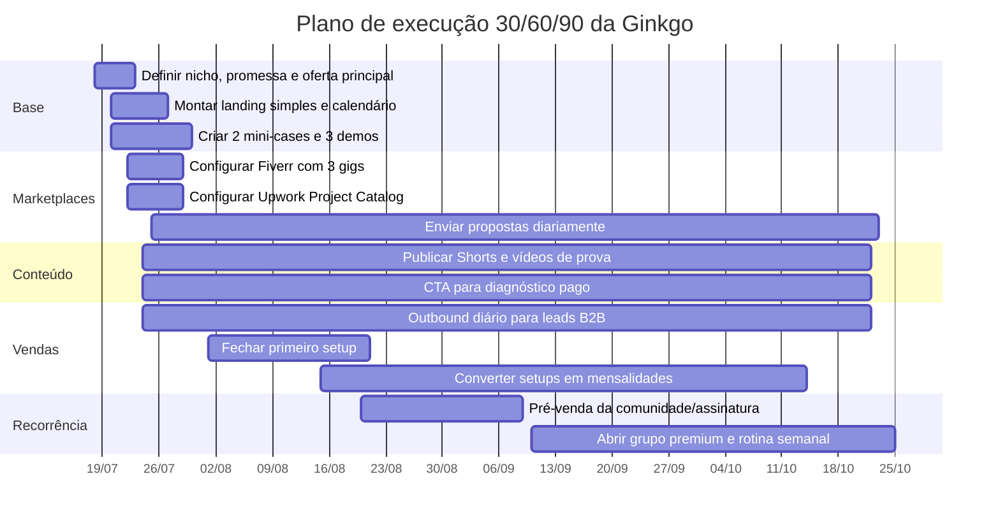
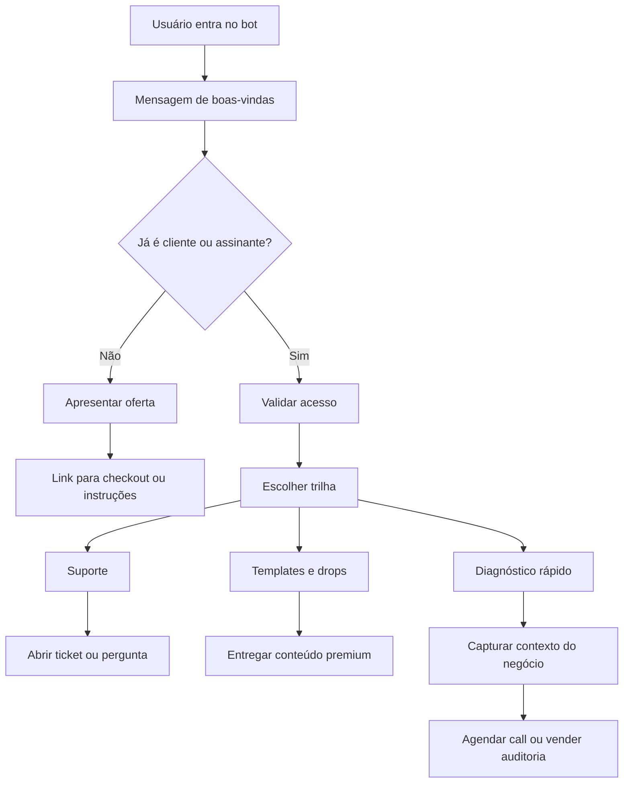

# Plano de monetização recorrente de baixo custo para a Ginkgo

## Resumo executivo

Partindo do que você descreveu — expertise em automação com IA, n8n, agentes autônomos, geração de eficiência operacional e uma relação profissional com a marca/empresa/projeto Ginkgo — a rota mais realista para bater **R$3.000 líquidos por mês com baixo custo inicial** não é depender de emprego formal nem esperar o YouTube “virar”. A melhor aposta é combinar **ofertas B2B productizadas de automação**, **marketplaces de freelancing como canal de aquisição** e **conteúdo de autoridade como máquina de inbound**, usando YouTube/shorts e/ou presença social para gerar confiança, não para depender de AdSense no curto prazo. Em paralelo, **assinatura/produto digital** faz sentido como segunda camada, e **Telegram** funciona melhor como canal de entrega/comunidade do que como motor principal de aquisição. citeturn24view0turn24view1turn23view0turn23view1turn22view5turn4view0turn22view1

A matemática também favorece modelos com ticket maior. Para chegar a **R$3.000 líquidos**, você precisaria de cerca de **4 projetos/mês de R$990** em marketplace com comissão de 20%, ou de **pouco mais de 2 clientes de R$1.500/mês** em um fluxo com fee de 5%, ou ainda de **23 assinantes de R$149/mês** em uma assinatura com taxa padrão da Hotmart de 9,9% + R$1 por venda. Em outras palavras: seu alvo não exige escala de mídia absurda; exige oferta certa, prova de valor e uma cadência disciplinada de prospecção. citeturn22view2turn23view1turn22view0turn19calculator0turn19calculator2turn19calculator3

Minha recomendação priorizada é testar **três frentes em paralelo por 90 dias**:  
**microagência Ginkgo de automações recorrentes**, **Fiverr/Upwork com 3 ofertas fixas muito bem embaladas**, e **conteúdo curto de autoridade para puxar diagnósticos e calls pagas**. Eu **não priorizaria** como rota principal: emprego formal como única saída, YouTube focado só em anúncios, VIP Telegram sem audiência prévia, ou agenciamento de modelos “hot”. Essas opções ou têm ciclo lento, ou dependem de distribuição que você ainda não disse ter, ou trazem risco jurídico/comercial desproporcional ao objetivo de caixa recorrente rápido. citeturn24view1turn24view2turn22view5turn22view3turn25view0turn20search0

## Suposições e critérios

Para montar esta análise, assumi o seguinte sobre você e sobre a Ginkgo: você tem **experiência prática suficiente para demonstrar 2 a 5 casos ou protótipos**, consegue operar ferramentas como ChatGPT Plus, Claude, Docker e ElevenLabs sem custo incremental relevante além do que já paga, tem disponibilidade de **20 a 30 horas por semana** para vender e entregar, e pode posicionar a Ginkgo como **marca operacional profissional** para ofertas, portfólio, landing page e prospecção. Também assumi que sua audiência atual não é grande o bastante para sustentar um negócio só de conteúdo ou de comunidade paga. Essas hipóteses afetam diretamente as probabilidades estimadas abaixo.

Usei como critério principal **velocidade até a primeira receita**, seguida de **potencial de recorrência**, **custo inicial**, **risco legal/comercial** e **alavancagem da sua stack atual**. O alvo financeiro foi tratado como **líquido operacional**, ou seja, após taxas diretas de plataforma e custos variáveis óbvios, mas **antes** de imposto de renda pessoal, porque seu enquadramento fiscal não foi informado. Se você operar como MEI, há limite geral de **R$81 mil anuais**, emissão de nota fiscal e recolhimento mensal fixo de tributos; isso ajuda comercialmente, mas impõe teto e obrigações. citeturn13search3turn12search17turn13search2

Essa formalização importa especialmente para venda de produtos digitais. A Hotmart informa que **não cobra mensalidade**, usa taxa padrão de **9,9% + R$1,00** em vendas BRL acima de R$10, e ainda observa que contas vendendo como **CPF** têm limite mensal de saque de **R$1.900**; para saques ilimitados, é necessário CNPJ. Em uma estratégia séria de assinatura, essa limitação aparece rápido. citeturn22view0turn22view1

Também considerei restrições de plataforma. YouTube pede conteúdo **original e não repetitivo** para monetização, exige disclosure para conteúdo de IA realista ou significativamente alterado, e adverte contra impersonação, inclusive com voz ou semelhança geradas por IA. Telegram, por sua vez, exige que vendas de **bens e serviços digitais dentro dos bots/mini-apps** usem **Telegram Stars**, além de demandar termos e suporte claros para compradores. citeturn22view3turn22view4turn26view0turn26view2turn4view0turn25view0

## Matriz comparativa das opções

A tabela abaixo mistura **regras oficiais de plataforma** com **estimativas minhas** sobre velocidade, esforço e probabilidade de bater R$3.000 líquidos em até 90 dias, considerando o seu perfil.

| Opção | Custo inicial estimado | Tempo até primeira receita | Potencial de recorrência | Receita líquida estimada em 90 dias | Probabilidade de atingir R$3.000 líquidos em até 90 dias | Prioridade |
|---|---:|---|---|---:|---:|---|
| Microagência Ginkgo de automações recorrentes | R$0–R$500 | 7–21 dias | Alta | R$2.000–R$8.000 | 55%–70% | Muito alta |
| Freelancing em Fiverr/Upwork | R$0–R$300 | 7–30 dias | Média a alta | R$1.000–R$6.000 | 35%–55% | Alta |
| Consultoria productizada e auditoria IA | R$0–R$200 | 3–14 dias | Média a alta | R$1.500–R$5.000 | 40%–60% | Alta |
| Assinatura/comunidade/produto digital | R$0–R$400 | 14–45 dias | Alta | R$500–R$4.000 | 25%–45% | Média |
| YouTube e conteúdo como geração de leads | R$0–R$600 | 14–45 dias | Média a alta | R$0–R$3.000 | 20%–35% | Média |
| Telegram bot/VIP como produto principal | R$0–R$300 | 14–45 dias | Média | R$0–R$2.000 | 10%–25% | Média-baixa |
| Emprego regular na área | R$0–R$200 | 30–120+ dias | Alta | R$0–R$8.000+ se contratado | 20%–35% | Média-baixa para curto prazo |
| Agenciamento de modelos “hot” | R$500–R$3.000+ | 30–90+ dias | Média | Muito incerta | 5%–15% | Baixíssima |

Essas faixas são coerentes com o fato de que o mercado de TIC segue demandando profissionais e há volume amplo de vagas na sua região, mas contratação formal continua mais lenta e menos controlável que venda direta. Em Curitiba e região, o LinkedIn exibe mais de 1.000 vagas para “Analista de Sistemas” e mais de 1.000 para “Analista de TI”, enquanto a Brasscom projetou geração de dezenas de milhares de empregos formais em TIC no Brasil. Isso torna emprego uma opção **economicamente válida**, mas **taticamente inferior** para resolver caixa recorrente já. citeturn24view0turn24view1turn24view2

No plano de marketplaces, a lógica é favorável se você vender escopo fechado. No Fiverr, o freelancer recebe **80% do valor do pedido**, pode usar **assinaturas** em categorias elegíveis e, em certos casos, trabalho **por hora**; no Upwork, a fee do freelancer varia de **0% a 15%**, e em **Direct Contracts** cai para **5%**, ou **0%** para quem tiver Freelancer Plus. Isso permite usar marketplace primeiro como vitrine e depois como esteira de clientes recorrentes. citeturn22view2turn23view3turn23view4turn23view0turn23view1

Para conteúdo, o principal gargalo não é criar vídeo; é **monetizar rápido com segurança**. O YouTube liberou entrada antecipada no programa expandido com **500 inscritos + 3 uploads públicos + 3.000 horas** ou **3 milhões de views em Shorts**, mas o AdSense completo ainda pede **1.000 inscritos + 4.000 horas** ou **10 milhões de views em Shorts**. Por isso, usar YouTube como **topo de funil para vender serviço, diagnóstico ou comunidade** é mais realista do que esperar anúncio pagar as contas nos primeiros 90 dias. citeturn22view5turn22view4

Telegram e Hotmart funcionam como camadas de recorrência, mas com limites importantes. No Telegram, venda de bens e serviços digitais **dentro do app** exige **Stars**, e o vendedor precisa oferecer **termos** e **suporte** claros. Na Hotmart, assinatura é nativa, o acesso é suspenso automaticamente se o pagamento falhar, e a taxa padrão em BRL acima de R$10 é de **9,9% + R$1,00**; isso é bom para recorrência, mas não substitui aquisição de audiência. citeturn4view0turn3view0turn7search3turn22view0turn22view1

### Ponto de equilíbrio de alguns modelos

| Modelo | Conta simplificada | Resultado |
|---|---|---:|
| Marketplace com 20% de comissão | R$3.000 / 0,8 | R$3.750 brutos necessários citeturn18calculator0turn22view2 |
| Plano com 5% de fee | R$3.000 / 0,95 | R$3.157,89 brutos necessários citeturn18calculator1turn23view1 |
| Hotmart 9,9% + R$1 | preço de assinatura a R$149 | ~23 assinantes para R$3.000 líquidos citeturn19calculator0turn22view0 |
| Hotmart 9,9% + R$1 | plano a R$297 | ~12 assinantes para R$3.000 líquidos citeturn19calculator1turn22view0 |
| Direct Contracts a R$1.500/mês | taxa de 5% | pouco mais de 2 clientes para R$3.000 líquidos citeturn19calculator3turn23view1 |
| Marketplace com projetos de R$990 | comissão de 20% | ~4 projetos por mês citeturn19calculator2turn22view2 |

A conclusão dessa matemática é brutalmente útil: **você não precisa de milhões de views; precisa de 2 a 4 clientes certos, ou de uma assinatura bem posicionada**. O seu jogo, portanto, é muito mais “arquitetura de oferta + prova + distribuição” do que “viralizar”.

## Análise detalhada das opções

**Microagência Ginkgo de automações recorrentes**

| Campo | Síntese |
|---|---|
| Estratégia | Transformar a Ginkgo em uma **microagência productizada** que instala e mantém automações de atendimento, qualificação de leads, follow-up, base de conhecimento e agentes internos para PMEs. A proposta central não é “faço automação”, e sim “reduzo tempo de resposta, tiro trabalho manual da equipe e deixo um agente rodando 24/7”. Chatbots e agentes de IA são frequentemente posicionados como forma de melhorar experiência do cliente, reduzir custos e ampliar o suporte; isso combina diretamente com sua skill set. citeturn27view0 |
| Requisitos e custos | Você já tem a stack principal. O custo incremental pode ficar em **R$0–R$500** para landing page simples, domínio, automação de agendamento e eventualmente algum crédito de API se a quinta ferramenta não cobrir isso. O requisito real é montar **1 nicho + 3 ofertas + 2 provas visuais**. |
| Passos práticos em 30 dias | Escolha 1 nicho com dor repetitiva — clínicas, imobiliárias, infoprodutores, pequenas agências, e-commerce. Crie 3 demos: “bot que classifica lead”, “follow-up automático”, “FAQ/knowledge base”. Grave telas curtas e monte 1 página “Ginkgo Sprint IA”. Inicie prospecção por WhatsApp, e-mail e LinkedIn. Faça 2 ofertas: **setup + mensalidade** e **diagnóstico pago**. |
| Receita mensal realista | **R$2.000–R$8.000 líquidos em 90 dias** é plausível com 2 a 4 clientes. Exemplo simples: setup de R$1.500–R$3.000 + mensalidade de R$497–R$1.500. A chance de bater R$3.000 é alta porque o ponto de equilíbrio é baixo em número de clientes. |
| Riscos e barreiras | Maior risco é vender promessa genérica demais, virar “faz-tudo” e perder margem. Há também obrigações de dados pessoais; a LGPD cobre tratamento de dados em meios digitais, e a ANPD fiscaliza a lei. Mitigue com termo de escopo, política mínima de dados, checklist de acesso e logs. citeturn11search12turn11search1 |
| Métricas e MVPs | Meta inicial: 100 contatos qualificados em 2 semanas, 10 respostas, 4 reuniões, 1 venda. MVP: instalar um fluxo mínimo que reduza tempo de resposta, capture lead ou gere follow-up. O KPI não é “bot funcionando”; é **resposta mais rápida, mais leads qualificados ou menos trabalho manual**. |
| Recursos e templates | Oferta-mãe sugerida: **“Implanto em 7 dias um agente de IA que responde, qualifica e empurra leads para o seu time — sem trocar seu CRM.”** Diagnóstico de entrada a **R$197–R$497**. Pós-venda em plano mensal de manutenção, ajustes e analytics. |

**Freelancing em Fiverr, Upwork e similares**

| Campo | Síntese |
|---|---|
| Estratégia | Usar marketplaces como **canal de aquisição inicial** e não como teto de negócio. O ideal é entrar com 3 ofertas fixas, super específicas, vendendo entregável e não “horas de especialista”. No Fiverr, você fica com **80%** do pedido; no Upwork, a fee do freelancer varia de **0% a 15%**, e Direct Contracts cobram **5%** do freelancer. O Project Catalog do Upwork funciona bem para serviços scopo-fechado. citeturn22view2turn23view0turn23view1turn23view2 |
| Requisitos e custos | Custo direto quase zero. O trabalho real é montar perfil, mini-portfólio, PDFs de amostra e vídeo curto. No Fiverr, assinaturas estão disponíveis em categorias elegíveis por **3 ou 6 meses**; no Upwork, Project Catalog e Direct Contracts ajudam a puxar recorrência. citeturn23view3turn23view2 |
| Passos práticos em 30 dias | Suba 3 gigs/ofertas: **automação n8n para atendimento**, **qualificação de leads com IA**, **workflow de conteúdo com IA + ElevenLabs**. Todo dia, envie propostas curtas e personalizadas. No Upwork, crie 2 projects no Project Catalog. No Fiverr, teste pacote básico/intermediário/premium. |
| Receita mensal realista | **R$1.000–R$6.000 líquidos em 90 dias** é realista se você mantiver volume diário de proposta e focar em tickets de R$700–R$2.000. A chance de bater R$3.000 é boa, mas menor que venda direta porque você depende de ranking, prova social e tempo de maturação. |
| Riscos e barreiras | Guerra de preço, clientes problemáticos, contas novas sem reviews e dependência de plataforma. Mitigue nichando a oferta, usando vídeo, prova visual e escopo extremamente claro. Em projetos maiores no Fiverr, milestones ajudam a proteção em caso de chargeback. citeturn22view2 |
| Métricas e MVPs | Responder rápido, medir visualizações do gig, taxa de clique, taxa de resposta e taxa de fechamento. MVP: conseguir o primeiro job pago em até 14 dias com uma oferta simples e bem demonstrada. |
| Recursos e templates | Títulos sugeridos: **“I will build your AI lead qualification workflow with n8n”**, **“I will automate your customer support FAQ with AI and Telegram/WhatsApp logic”**, **“I will create a content automation pipeline with ChatGPT, Claude and ElevenLabs”**. |

**Consultoria productizada e auditoria IA**

| Campo | Síntese |
|---|---|
| Estratégia | Vender primeiro **diagnóstico e roadmap**, depois implementação. Isso reduz fricção porque você não exige confiança total no começo. Em vez de “consultoria aberta”, venda um pacote com nome, prazo e entregáveis: mapa de gargalos, oportunidades de automação, blueprint técnico, ROI estimado e plano de implantação. |
| Requisitos e custos | Praticamente zero de custo. Você precisa só de 1 página, formulário de briefing e roteiro de call. O ativo principal é sua capacidade de explicar valor de negócio, não a tecnologia em si. |
| Passos práticos em 30 dias | Lance uma oferta tipo **“Auditoria de Automação e IA em 72h”** por R$197, R$297 ou R$497. Use isso em outbound, LinkedIn, grupos e bio. O upsell é implantação ou assinatura de acompanhamento. |
| Receita mensal realista | **R$1.500–R$5.000 em 90 dias** é totalmente plausível. Você pode bater o alvo com 6 a 10 diagnósticos/mês, ou com menos diagnósticos se eles virarem implantação. |
| Riscos e barreiras | Risco de parecer “PowerPoint premium”. Mitigue entregando algo acionável: planilha de oportunidades, score de ROI, fluxos sugeridos e vídeo de walkthrough. Se coletar dados do cliente, aplique minimização e delimite acesso pela LGPD. citeturn11search12turn11search16 |
| Métricas e MVPs | Taxa de conversão de call para diagnóstico; taxa de diagnóstico para projeto; ticket médio por cliente. MVP: vender 3 diagnósticos em 14 dias. |
| Recursos e templates | Nome pronto: **“Raio-X Ginkgo de Operação IA”**. Entregáveis: 1 mapa de processos, 3 gargalos, 5 automações prioritárias, 1 plano 30/60/90, gravação Loom com recomendações. |

**Assinatura, comunidade e produtos digitais**

| Campo | Síntese |
|---|---|
| Estratégia | Montar uma assinatura B2B/profissional da Ginkgo com **templates, workflows n8n, prompts testados, aulas rápidas, office hours e estudos de caso**. Hotmart permite planos recorrentes com periodicidades diferentes; enquanto o pagamento estiver em dia, o assinante mantém acesso ao conteúdo. citeturn7search1turn7search3 |
| Requisitos e custos | Quase zero se você entregar em Notion, Telegram, Discord ou área simples; se usar estruturas nativas de membro, a Hotmart cobra taxa padrão de **9,9% + R$1** em BRL acima de R$10, e há taxas extras se você usar Player de Vídeo. Se vender como CPF, existe limite de saque mensal de **R$1.900**, então um CNPJ ajuda quando o produto começa a andar. citeturn22view0turn22view1 |
| Passos práticos em 30 dias | Faça uma pré-venda da comunidade antes de gravar tudo. Estruture 1 promessa: **“Toda semana você recebe automações prontas para economizar horas da sua operação.”** Abra lista de espera, venda founding members e entregue 4 semanas de conteúdo ao vivo antes de escalar. |
| Receita mensal realista | **R$500–R$4.000 em 90 dias** se você tiver alguma distribuição ou se usar a comunidade como backend de clientes de serviço. A chance de bater R$3.000 só com isso é média; como camada complementar, é ótima. |
| Riscos e barreiras | Churn alto se o conteúdo for genérico, excesso de produção e baixa retenção. Mitigue estreitando o tema: “automação prática para PMEs”, não “IA em geral”. |
| Métricas e MVPs | Lista de espera, taxa de conversão da pré-venda, retenção no mês seguinte, consumo de conteúdo e perguntas por membro. MVP: 10 founding members pagos. |
| Recursos e templates | Nome: **Clube Ginkgo Ops IA**. Preço de teste: R$49–R$149 nos 30 primeiros dias. Estrutura: 1 drop semanal, 1 live quinzenal, 1 workflow por semana, 1 canal para dúvidas. |

**YouTube, conteúdo dark/nicho e influencer de IA**

| Campo | Síntese |
|---|---|
| Estratégia | Aqui o ponto não é “viver de anúncio agora”; é usar vídeo como **motor de autoridade e captação**. YouTube é útil para mostrar casos, desmontar processos ruins, comparar ferramentas e provar raciocínio. O canal pode ser “dark” no sentido de sem aparecer sempre, mas para monetização o conteúdo precisa ser **original, não repetitivo** e com direitos claros. O YouTube exige originalidade, tem política de reused content e disclosure para IA realista. citeturn22view3turn22view4turn26view0turn26view2 |
| Requisitos e custos | Sua stack já resolve roteiro, edição assistida, voz e thumbnails. O YouTube deixa claro que usar IA para **outline, script, thumbnail, título, ideia, legenda e até clonar a própria voz para locução/dublagem** entra em usos que normalmente **não exigem disclosure**, desde que não sejam realistas a ponto de enganar; realistic AI alterada pede disclosure. ElevenLabs, por sua vez, limita Professional Voice Clone à **própria voz**, e Instant Voice Cloning exige permissão para a voz clonada. citeturn26view0turn21search2turn21search14 |
| Passos práticos em 30 dias | Suba 12 a 20 vídeos curtos e 4 vídeos mais densos. Foco em temas com CTA para diagnóstico: “como automatizar lead”, “como tirar atendimento repetitivo”, “quanto custa não automatizar”. Não espere YPP para vender; use YouTube para agenda de calls. |
| Receita mensal realista | **R$0–R$3.000 em 90 dias** quando o canal é usado para gerar clientes ou comunidade. A chance de bater R$3.000 só com AdSense em 90 dias é baixa. |
| Riscos e barreiras | Conteúdo genérico, dependência de alcance, reused content e impersonação. O YouTube informa que disclosure de IA **não limita monetização por si só**, mas isso não isenta de políticas de monetização, copyright e impersonação. citeturn26view0turn26view2 |
| Métricas e MVPs | Vídeos publicados por semana, retenção de Shorts, CTR de thumbnails, cliques para página/call, DMs recebidas, diagnósticos vendidos. MVP: 30 dias de publicação consistente e pelo menos 5 leads qualificados vindos do conteúdo. |
| Recursos e templates | Melhor formato para você: **estúdio de opinião + teardown + tutorial prático**. Pense em “canal que fecha cliente”, não “canal que implora CPM”. |

**Telegram bots e VIPs**

| Campo | Síntese |
|---|---|
| Estratégia | Telegram é excelente para **distribuição e comunidade**, mas raramente é um bom motor de demanda do zero. Funciona melhor como canal premium da Ginkgo: alertas, templates, briefing diário, drops de automação, suporte a clientes e comunidade fechada. Se você vender bens e serviços digitais **dentro de bots e mini-apps**, Telegram exige **Telegram Stars**; além disso, o bot deve oferecer **termos** e **suporte** claros. citeturn4view0turn3view0turn25view0 |
| Requisitos e custos | Como você domina automação e Docker, o custo técnico é baixo. O gargalo real é audiência e posicionamento. Sem distribuição, VIP no Telegram vira condomínio de luxo sem rua de acesso. |
| Passos práticos em 30 dias | Use Telegram como backstage de outra oferta: clientes da microagência, founding members da comunidade, assinantes do produto. Se quiser testar produto nativo, venda algo muito específico: **“Radar diário de automações úteis”** ou **“drops semanais de workflows n8n com suporte”**. |
| Receita mensal realista | **R$0–R$2.000 em 90 dias** sem base prévia; mais se vier acoplado a serviço ou comunidade externa. |
| Riscos e barreiras | Cobrança dentro do app tem regra própria; para bots/mini-apps, Telegram informa que bens e serviços digitais devem usar Stars. Também há exigência de /terms, /support ou /paysupport, e a plataforma é ativa na moderação de conteúdo que viola termos. Em 2026, o Telegram informa bloquear dezenas de milhares de grupos/canais por dia. citeturn4view0turn25view0turn25view1 |
| Métricas e MVPs | Número de membros, conversão da página para grupo, retenção, abertura/clique, mensagens por membro e cancelamentos. MVP: 20 a 50 membros pagantes ou incluídos como bônus de serviço. |
| Recursos e templates | Melhor uso para você: **Telegram como camada de entrega** de assinatura, suporte e alertas; não como aposta isolada de primeira receita. |

**Emprego regular na área**

| Campo | Síntese |
|---|---|
| Estratégia | Continuar aplicando, mas como trilha secundária. Há demanda real em TIC no Brasil e muitas vagas abertas em Curitiba e região para perfis adjacentes ao seu. citeturn24view0turn24view1turn24view2 |
| Requisitos e custos | Quase zero de caixa; alto custo de tempo emocional e de fila. Currículo, LinkedIn e portfólio continuam necessários. |
| Passos práticos em 30 dias | Ajuste CV para 2 versões, publique 2 estudos de caso no LinkedIn, faça networking direto com gestores e consultorias, e limite isso a um bloco fixo da semana para não consumir a energia do plano principal. |
| Receita mensal realista | Se contratado, o alvo de R$3.000 tende a ser superado; o problema é o tempo até fechar e começar a receber. |
| Riscos e barreiras | Processo lento, filtros automáticos, desalinhamento de título e experiência, dependência de terceiros. |
| Métricas e MVPs | Taxa de entrevista por candidatura e número de conversas com recrutadores. |
| Recursos e templates | Use emprego como hedge, não como único motor. A máquina principal deve continuar sendo venda de serviço próprio. |

**Agenciamento de modelos “hot”**

| Campo | Síntese |
|---|---|
| Estratégia | Eu trataria isso como **não recomendado** para o seu objetivo atual. Embora possa parecer um atalho de recorrência, é um terreno com risco alto de reputação, compliance, meios de pagamento, moderação de plataforma e questões de consentimento, documentação e operação. |
| Requisitos e custos | Maior custo operacional, jurídico e reputacional do que todas as outras alternativas listadas. |
| Passos práticos em 30 dias | A recomendação é **não priorizar**. O capital de execução que você gastaria aqui fica muito melhor empregado em uma oferta B2B ou educacional/profissional sob a marca Ginkgo. |
| Receita mensal realista | Muito incerta. Pode até existir em teoria, mas o risco-retorno é ruim para quem precisa de previsibilidade e baixo custo inicial. |
| Riscos e barreiras | Telegram proíbe conteúdo pornográfico ilegal em canais/bots públicos e remove conteúdo que viole seus termos; Stripe lista **adult content and services** como negócio proibido/restrito, incluindo pornografia e live-chat adulto. Em outras palavras: o risco de receber bloqueio, restrição comercial ou dor jurídica é real. citeturn25view0turn25view1turn20search0turn20search1 |
| Métricas e MVPs | Não recomendo gastar seu ciclo de testes nisso. |
| Recursos e templates | Melhor substituir essa ideia por uma versão segura e profissional: **agenciamento de creators B2B com automação de operação, funil e monetização de conhecimento**. |

## Plano priorizado para testar em paralelo

A melhor combinação para os próximos 90 dias é esta:

**Frente principal: microagência Ginkgo de automações recorrentes.**  
Essa é a rota mais curta para recorrência, porque você precisa de poucos clientes para bater a meta. Use oferta clara, escopo fechado e nicho específico. O melhor desenho é **setup + mensalidade**, não “mensalidade pura” sem implantação, porque o setup gera caixa logo e financia a operação.

**Frente paralela: Fiverr + Upwork com ofertas productizadas.**  
Essas plataformas te dão distribuição imediata, pagamento organizado e prova social acumulável. No Fiverr, pense em serviços com potencial de assinatura; no Upwork, use Project Catalog para inbound e Direct Contracts quando puxar cliente próprio para dentro da esteira da plataforma. citeturn23view3turn23view2turn23view1

**Frente de autoridade: conteúdo curto para funil.**  
O conteúdo não deve buscar monetização por anúncio no começo. Ele deve vender **diagnóstico**, depois **projeto**, depois **manutenção/comunidade**. Essa frente aumenta confiança, melhora fechamento e dá material para perfil em marketplace.

### Metas financeiras sugeridas

| Horizonte | Meta de caixa recebida | Meta de MRR contratada | Meta operacional |
|---|---:|---:|---|
| 30 dias | R$1.500–R$2.500 | R$500–R$1.000 | 1 cliente de setup + 1 a 3 diagnósticos pagos |
| 60 dias | R$3.000–R$5.000 | R$2.000–R$3.000 | 2 clientes recorrentes + 2 jobs de marketplace |
| 90 dias | R$4.000–R$8.000 | R$3.000–R$5.000 | 3 clientes recorrentes ou 2 clientes + assinatura/comunidade rodando |

### Cronograma 30/60/90 em mermaid



### Checklist diário

- Prospectar **20 leads qualificados** no nicho escolhido.
- Enviar **5 mensagens personalizadas**.
- Enviar **3 propostas de marketplace**.
- Publicar **1 ativo de prova**: Short, post, mini-case ou Loom.
- Fazer **1 follow-up** em leads antigos.
- Refinar **1 trecho da oferta** com base em objeções reais.

### Checklist semanal

- Fechar **2 a 4 calls**.
- Publicar **1 estudo de caso**.
- Atualizar **1 gig/oferta** com base em clique e resposta.
- Construir **1 novo demo reutilizável**.
- Revisar pipeline: leads, propostas, fechamentos, churn.
- Medir qual frente está mais perto de R$3.000: serviço, marketplace ou assinatura.

## Recursos e templates

### Modelo de oferta principal

**Nome:** Ginkgo Sprint IA  
**Promessa:** “Implanto em 7 dias uma automação com IA para reduzir tempo de resposta, qualificar leads e tirar tarefas repetitivas da sua equipe.”  
**Escopo base:** briefing, mapeamento rápido, fluxo n8n, integração mínima, testes, vídeo de handoff e 14 dias de suporte.  
**Upsell:** manutenção mensal, novos fluxos, analytics, treinamento da equipe.

### Pitch curto para WhatsApp, e-mail ou DM

```text
Oi, [nome]. Vi que vocês atendem [tipo de demanda/canal].
Normalmente, nesse ponto as empresas perdem lead, repetem resposta manual e deixam follow-up morrer.

Eu trabalho com a Ginkgo e monto automações com IA que:
1) respondem mais rápido,
2) qualificam o lead,
3) empurram o contato certo para o time certo.

Se fizer sentido, eu te mostro em 10 minutos um fluxo simples que dá para implantar sem trocar toda a operação.
```

### Pitch de diagnóstico pago

```text
Se você preferir começar sem projeto grande, eu tenho um Raio-X de Automação em 72h.

Entrego:
- mapa dos gargalos,
- 3 a 5 automações prioritárias,
- estimativa de ganho,
- plano 30/60/90.

É um jeito barato de descobrir onde a IA realmente economiza tempo na sua operação.
```

### Exemplos de títulos para Fiverr ou Upwork Project Catalog

```text
I will build your AI lead qualification workflow with n8n
I will automate your customer support FAQ using AI and knowledge base
I will create an AI content pipeline with ChatGPT Claude and ElevenLabs
I will build a Telegram or web bot flow for premium support and onboarding
I will audit your business and map the best AI automations in 72 hours
```

### Estrutura recomendada de um canal YouTube focado em lead

**Pilares editoriais**
- Teardown de processos ruins.
- Tutoriais curtos de automação.
- Comparativos honestos de ferramentas.
- Estudos de caso Ginkgo.
- “Quanto custa não automatizar?”

**Estrutura de vídeo longo**
- Gancho com dor concreta.
- Diagnóstico do erro comum.
- Demonstração visual.
- Solução mínima viável.
- CTA para diagnóstico ou call.

**Títulos sugeridos**
- Como automatizar atendimento sem virar refém de ferramenta
- O erro que faz sua equipe responder tudo manualmente
- Montei um agente de IA que qualifica leads em minutos
- Quanto dinheiro sua operação perde sem follow-up automático
- Usei n8n + IA para cortar tarefas repetitivas de uma PME
- O jeito certo de usar ChatGPT e Claude na rotina operacional

### Estrutura enxuta de assinatura da Ginkgo

**Produto:** Clube Ginkgo Ops IA  
**Entrega semanal**
- 1 workflow pronto
- 1 playbook curto
- 1 sessão de dúvidas
- 1 estudo de caso
- 1 repositório de prompts/templates

**Formato de preço**
- Founding members: R$49–R$97
- Plano validado: R$149
- Plano premium com office hours: R$297

### Fluxo base de bot Telegram para comunidade ou suporte



### Copy curta para anúncio orgânico de oferta

```text
Sua equipe ainda responde tudo na mão?
A Ginkgo implanta automações com IA para atendimento, follow-up e qualificação de leads.
Menos trabalho manual. Mais velocidade. Mais previsibilidade.
Se quiser, eu te mostro um fluxo simples aplicado ao seu negócio.
```

### Script para vídeo curto de prova

```text
Gancho:
“Se sua empresa ainda copia e cola resposta no WhatsApp, você está pagando salário para fazer o trabalho que um fluxo resolve.”

Corpo:
“Eu montei um processo onde a IA entende a pergunta, consulta a base certa, coleta contexto e manda para o humano só quando precisa.”

Prova:
“Na prática, isso reduz tempo de resposta e evita lead perdido no meio do caos.”

CTA:
“Se quiser, eu te mando um exemplo e mostro onde isso caberia na sua operação.”
```

### Veredito final

Se o objetivo é **R$3.000 líquidos recorrentes com baixo custo inicial**, a rota mais inteligente para você, hoje, é esta:

- **Prioridade máxima:** vender **automações recorrentes B2B** sob a Ginkgo.
- **Prioridade alta:** usar **Fiverr/Upwork** como canal paralelo de aquisição.
- **Prioridade média e complementar:** construir **conteúdo de autoridade** para vender diagnóstico, projeto e comunidade.
- **Prioridade secundária:** assinatura/produto digital, depois que a esteira de aquisição começar a funcionar.
- **Prioridade baixa:** emprego formal como hedge, não como plano central dos próximos 90 dias.
- **Evitar como aposta principal:** VIP Telegram sem audiência e agenciamento de modelos “hot”.

Em linguagem direta: **o jeito mais rápido de sair do zero não é montar um império de mídia; é vender uma dor clara, resolver essa dor em 7 dias e transformar a solução em mensalidade**. Isso conversa perfeitamente com sua experiência, seu stack e o posicionamento natural da Ginkgo.